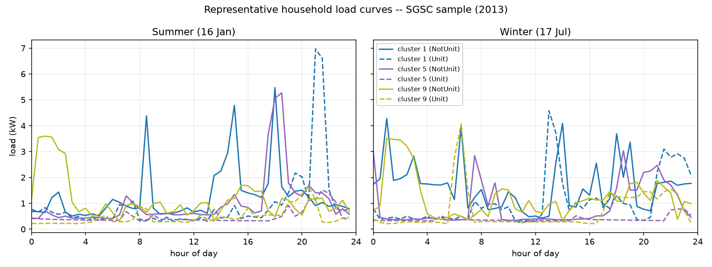
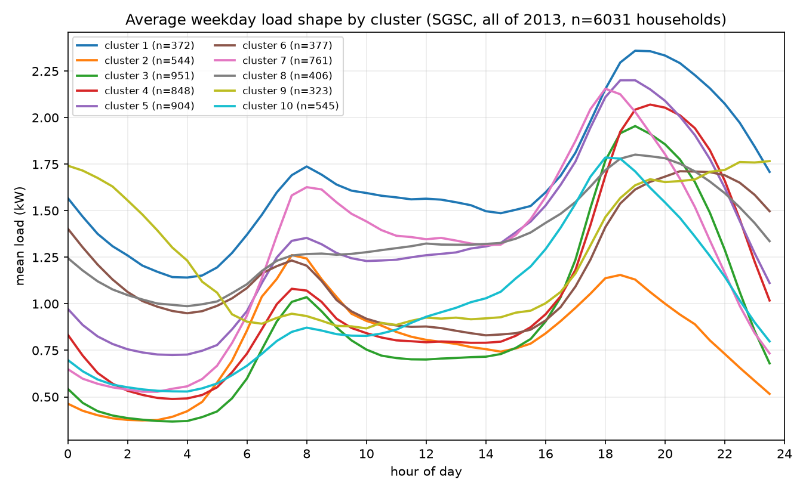

# SGSC Data Profile (Phase 0)

Summarises the raw Ausgrid Smart Grid, Smart City (SGSC) dataset in
`llm-hems/data/raw/` (gitignored, ~946MB), the working sample extracted from
it, and the resulting load-shape observations. Produced by
[`llm-hems/experiments/ingest_sgsc.py`](llm-hems/experiments/ingest_sgsc.py)
and [`llm-hems/experiments/profile_sgsc.py`](llm-hems/experiments/profile_sgsc.py).
No simulator, appliance, or MILP logic is implemented here — this is data
characterisation only.

## 1. Raw files

| File | Size | Format | Shape |
|---|---|---|---|
| `interval load data/data_3_groups.csv` | 990 MB | wide CSV | 17,520 rows × 6,032 cols |
| `index files/demographic_lookup_3_groups.csv` | 1.5 MB | CSV | 6,031 rows × 68 cols |
| `index files/cluster_index.csv` | 192 KB | CSV | 6,034 rows × 7 cols |
| `index files/Column Mappings.csv` | 164 KB | CSV | 659 rows × 13 cols — data dictionary only |

**`data_3_groups.csv`** — the interval load data. One `timestamp` column plus
one column per household, named by its `customer_ID` (6,031 households).
Rows run `2013-01-01 00:00:00` → `2013-12-31 23:30:00` at a constant **30-min
step** (17,520 = 365 days × 48 steps) — **confirmed: 30-min resolution, full
calendar year 2013, no other years present.** Cell values are **kWh consumed
in that half-hour** (not instantaneous kW); multiply by 2 for average kW over
the interval. No column headers or units are given in-file — units were
inferred from magnitude (median household ≈ 8,267 kWh/yr ≈ 22.6 kWh/day,
consistent with real AU household electricity use) and cross-checked against
`eDaily` (a precomputed average-daily-kWh field already present in the
demographic file, see below).

**`demographic_lookup_3_groups.csv`** — one row per household (`customer_ID`),
68 columns covering trial/control group, tariff product, location, dwelling
type, occupancy, appliance ownership (aircon, solar, pool pump, gas, etc.),
income band, and the study's own cluster labels (`cluster_all`,
`cluster_house`, `cluster_unit`) plus `eDaily` (avg daily kWh) and `peakTime`
(hour of daily peak) — both apparently precomputed by the original SGSC
study.

**`cluster_index.csv`** — an alternate/parallel view of cluster membership,
columns `customer_ID, 3a, 3h, 3u, ca, ch, cu`. `3a` is numerically identical
to `demographic_lookup`'s `cluster_all` (correlation 1.0, verified) — it's
the same 10-cluster, dwelling-agnostic labelling. `3h`/`3u` are the same
clustering restricted to house/unit subsets (`cluster_house`/`cluster_unit`
in the other file). `ca/ch/cu` are a second, sparser clustering scheme
(only 526–1,786 of 6,031 households labelled, weak correlation with `3a`/`ca`
≈ 0.12) whose provenance isn't documented in `Column Mappings.csv`; **not
used** for sampling below — `cluster_all` (10 clusters, fully populated) is
the one we stratify on.

**`Column Mappings.csv`** — Ausgrid's own data dictionary for the
demographic table (subject area, description, source schema/column, datatype)
— useful reference, not consumed programmatically.

All three data files key on the same `customer_ID` / `10-digit numeric
household id`, and the 6,031 IDs are **identical across all three files** (no
orphans either direction) — confirmed by exact set intersection.

## 2. Structure

**Household identification:** a 10-digit `customer_ID`, consistent across
the load-data column headers, `demographic_lookup_3_groups.csv`, and
`cluster_index.csv`.

**Clustering:** `cluster_all` (aka `3a`) assigns every one of the 6,031
households to one of **10 clusters** (labelled 1–10, sizes 323–951
households) via a dwelling-agnostic load-shape clustering — this is a
*label per household*, not a set of separate representative-profile rows.
`cluster_house`/`cluster_unit` are the same idea run separately within each
dwelling type (a household gets a nonzero label in exactly one of the two,
0 in the other). No literature/methodology reference for the algorithm is
included in the raw files.

**Dwelling type:** the interview-stated `DWELLING_TYPE_CD` field is mostly
missing (4,650/6,031 null; only 1,381 populated: SeparateHouse / Unit /
SemiDetached). The **assumed/imputed** `ASSRTD_DWELLING_TYPE_CD` field is
**fully populated** (`NotUnit`: 3,950, `Unit`: 2,081) and matches the
`cluster_house`/`cluster_unit` split exactly — this is the dwelling-type
field to rely on.

**Missing / filled values:**
- **Interval load data: zero missing values** across the entire 17,520 × 6,031
  matrix (verified by a full-file scan) — the dataset has already been
  gap-filled upstream by Ausgrid/UNSW; we cannot distinguish originally
  metered intervals from imputed ones from this file alone. All values are
  ≥ 0 (no negative/net-export readings; min 0.0, max 26.3 kWh/half-hour).
  51,489 / 105.7M cells (0.05%) are exactly `0.0`; one household
  (0.02% of the sample) has an unusually high zero-fraction (88%,
  likely a metering/logging gap) and was excluded from sampling (see below).
- **Demographic table:** most of the *optional interview* fields
  (`NUM_OCCUPANTS`, `HHOLD_INCOME_GROUP_CD`, etc.) are sparse — only ~1,380
  of 6,031 households (23%) have them populated, since these come from an
  opt-in lifestyle-audit interview, not the smart-meter trial itself.
  Structural fields (`ASSRTD_DWELLING_TYPE_CD`, `HAS_SOLAR`, `HAS_AIRCON`,
  `HAS_POOLPUMP`, `TRIAL_CUSTOMER_TYPE`, `cluster_all`) are fully populated.
- **Trial structure:** 1,786 households are `Control` (no trial tariff),
  4,245 are `Network` (trial participants, further split by `Group` into two
  network sub-cohorts). This matters if real historical tariffs are ever
  cross-referenced against this data — our simulator's tariff is synthetic
  (`config/tariff.yaml`, all `CONFIRM`), not the households' actual trial
  tariff, so this split doesn't currently constrain sampling.

## 3. Working sample

**Method** (`ingest_sgsc.py`, fully deterministic — no RNG): for each of the
20 `(cluster_all × ASSRTD_DWELLING_TYPE_CD)` strata (10 clusters × 2 dwelling
types), household is excluded if it has >5% zero-valued intervals or annual
consumption outside the population's 1st–99th percentile, then the household
**closest to that stratum's median annual kWh** is picked — i.e. one
"typical" house and one "typical" unit per cluster, chosen for
representativeness rather than randomness.

**Result:** 20 households, one `NotUnit` + one `Unit` per cluster (all 10
clusters represented), written to:
- [`llm-hems/data/processed/households.parquet`](llm-hems/data/processed/households.parquet)
  (20 rows: id, cluster, dwelling type, annual kWh, peak kW, and a few
  demographic flags — 8 KB)
- [`llm-hems/data/processed/load_curves.parquet`](llm-hems/data/processed/load_curves.parquet)
  (350,400 rows = 20 households × 17,520 steps, long format `customer_ID,
  timestamp, kwh` — 1.2 MB)

| customer_ID | cluster | dwelling | annual kWh | peak kW | trial group | solar | aircon | pool pump |
|---|---|---|---|---|---|---|---|---|
| 10447791 | 1 | NotUnit | 12,557 | 11.9 | Network | N | Y | N |
| 8456863 | 1 | Unit | 8,948 | 9.2 | Control | Y | Y | Y |
| 8473761 | 2 | NotUnit | 6,991 | 12.5 | Control | Y | Y | Y |
| 10358736 | 2 | Unit | 6,097 | 12.9 | Control | Y | Y | Y |
| 8596070 | 3 | NotUnit | 7,842 | 7.8 | Network | N | Y | N |
| 10909344 | 3 | Unit | 5,432 | 8.7 | Control | Y | Y | Y |
| 8196663 | 4 | NotUnit | 9,433 | 16.5 | Network | N | Y | N |
| 10233626 | 4 | Unit | 5,842 | 9.9 | Control | Y | Y | Y |
| 8602070 | 5 | NotUnit | 11,368 | 9.8 | Network | Y | Y | Y |
| 11162259 | 5 | Unit | 5,317 | 5.6 | Control | Y | Y | Y |
| 10288616 | 6 | NotUnit | 11,469 | 13.6 | Control | Y | Y | Y |
| 11170263 | 6 | Unit | 6,376 | 9.7 | Network | Y | Y | Y |
| 10733858 | 7 | NotUnit | 11,347 | 13.1 | Control | Y | Y | Y |
| 10760974 | 7 | Unit | 7,581 | 8.2 | Network | Y | Y | Y |
| 8147897 | 8 | NotUnit | 10,227 | 10.0 | Network | Y | Y | Y |
| 8191457 | 8 | Unit | 5,512 | 3.8 | Network | Y | Y | Y |
| 8358702 | 9 | NotUnit | 12,181 | 7.9 | Control | Y | Y | Y |
| 10200184 | 9 | Unit | 6,078 | 8.4 | Control | Y | Y | Y |
| 10649763 | 10 | NotUnit | 8,653 | 12.3 | Network | Y | Y | Y |
| 11139953 | 10 | Unit | 5,364 | 12.4 | Network | Y | Y | Y |

Houses consistently show higher annual consumption than units within the
same cluster (larger dwellings, more appliances — pool pumps in particular
are almost exclusively a `Unit`-sample coincidence of who was closest to the
stratum median, not a general house/unit pattern).

The full raw dataset (`data/raw/`, ~946MB) stays gitignored per the project's
`.gitignore`; only this ~1.3MB processed sample is committed. Note: the
`.gitignore` in `llm-hems/` previously excluded *all* of `data/` and
`results/`, which would have also hidden this sample and the plots below —
it's been updated to `data/*` / `!data/processed/**` and `results/*` /
`!results/data_profile/**` so raw data stays out but the processed sample and
profile figures are trackable.

## 4. Load-shape observations

Six sample households (clusters 1, 5, 9; one house + one unit each) on a
summer weekday (16 Jan) and a winter weekday (17 Jul). Individual-household
traces are spiky and dominated by a small number of appliance-driven peaks
(likely HVAC/hot-water/pool-pump cycling) rather than smooth curves — exactly
the kind of discrete on/off structure the appliance models in `§7` of the
build spec are meant to represent. Units (dashed) generally show lower,
flatter baseload than houses (solid) in the same cluster, consistent with
smaller dwellings / fewer major appliances.

Mean weekday (Mon–Fri) profile per cluster, averaged over **all** households
in that cluster (not just the 20-household sample) across the full year.
The 10 clusters separate into two broad shapes:

- **Evening-peak clusters (3, 4, 5, 7):** low overnight/daytime baseload,
  sharp rise from ~16:00 to a peak around 18:00–20:00 (~2.0–2.2 kW) — the
  "typical occupied household, home in the evening" shape, and the largest
  clusters by membership (761–951 households each).
- **Flatter / non-evening-peaked clusters (1, 6, 8, 9):** higher overnight
  base (1.0–1.75 kW), a milder or earlier peak, and in cluster 9's case a
  peak that is *higher overnight than in the evening* — consistent with
  always-on loads (electric storage hot water, pool pumps) or occupants home
  during the day.

All clusters show a small secondary bump around 07:00–08:00 (morning
routine), most visible in clusters 4, 5, 7.

## 5. Data-quality caveats

- **Pre-cleaned data:** zero missing values in the interval file means gaps
  were already filled before this data was published; we have no way to flag
  which intervals are original meter reads vs. imputed from this file alone.
- **Units inferred, not labelled:** the raw CSV has no header row describing
  units; kWh-per-half-hour was inferred from magnitude and cross-checked
  against the `eDaily` field, not confirmed from an Ausgrid data dictionary
  entry for this specific file (`Column Mappings.csv` documents the
  demographic table, not the interval-data file).
- **Sparse interview fields:** occupancy count and income band are only
  available for ~23% of households — not used in this sample's selection or
  characterisation beyond what's shown in §3.
- **Two clustering schemes coexist** (`3a/3h/3u` vs `ca/ch/cu`) with no
  documented difference in the raw files; `cluster_all` was chosen for being
  fully populated and having a documented match to `cluster_house`/
  `cluster_unit`, not because its methodology was confirmed.
- **One excluded household** (customer_ID redacted from the sample; 88%
  zero-valued intervals) suggests at least isolated metering gaps exist
  despite the file showing no explicit `NaN`s — worth another pass if a
  larger population sample (Phase 4) is built later.
- **Trial/control and real tariff exposure** is present in the demographic
  table (`TRIAL_CUSTOMER_TYPE`, `TARIFF_PRODUCT_CD`) but not used here; our
  simulator applies its own synthetic tariff (`config/tariff.yaml`), so the
  households' real historical billing tariff is out of scope unless a future
  phase wants to validate against it.
