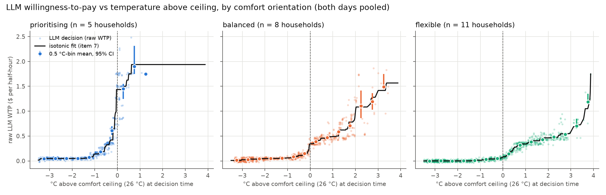
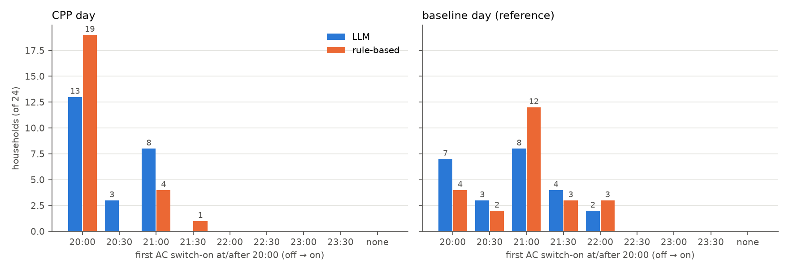
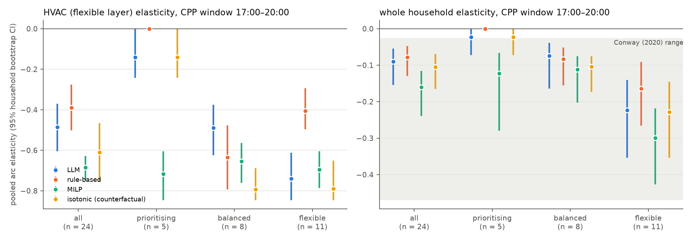
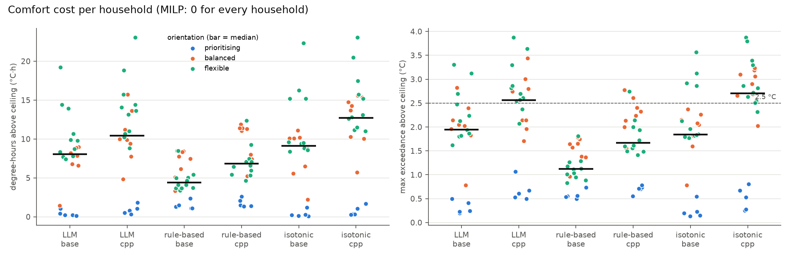

# arm_a — post-run analysis

Generated by `experiments/analyze_final_v1.py --label arm_a` from the saved artifacts in `results/phase3/arm_a/` (model `gemini-3.8-flash`; run commit `5851b05` on branch `arm-a`). Same code, tables and bootstrap as the final_v1 analysis; the prose summaries here are generated from the numbers (the final_v1 analysis carries hand-checked wording). No live LLM calls: every LLM answer is replayed from `results/phase3/llm_cache_arm_a.jsonl`, with the client patched to raise on any cache miss or write. Nothing outside `analysis/` was written.

Every result is labelled **pre-registered** or **exploratory (post-hoc)**. For a pre-registered optional arm (docs/prereg_final_run_v1.md, *Optional arms* and *Deviations*) the pre-registered metrics and H1 keep that label; everything the final_v1 analysis labelled exploratory stays exploratory. Bootstrap CIs: households resampled with replacement, 10,000 draws, seed 42, percentile 95% intervals. n per orientation is imbalanced (prioritising 5 / balanced 8 / flexible 11).

## 0. Offline regeneration

Every household × agent × seed × day was re-simulated from the current code with the run's own model id (`gemini-3.8-flash`, read from `config_resolved.yaml`) and the LLM replayed from the run's cache. All checks below must hold before anything else is computed.

| check | result |
|---|---|
| curves.parquet reproduced exactly (13,824 rows) | True |
| llm_decision_log reproduced exactly (4,608 rows) | True |
| rule_decision_log reproduced exactly | True |
| summary.csv recomputed from replay identical | True |
| live LLM calls during replay | 0 |
| cache hits during replay | 2304 |
| cache file unchanged (sha256 before = after) | True |
| max |prompt temperature − replayed pre-decision temperature| (°C) | 0.050 |

## 1. H1 — LLM raw WTP by comfort orientation at matched temperature  *(pre-registered)*

Raw LLM WTP (before archetype factor), both days pooled, 0.5 °C bins of exact pre-decision °C above the 26 °C ceiling (right-closed). Decision-weighted bin means; CI resamples households within orientation; differences resample each orientation independently.

| C_above_ceiling | prioritising_n_hh | prioritising_n_dec | prioritising_ci | balanced_n_hh | balanced_n_dec | balanced_ci | flexible_n_hh | flexible_n_dec | flexible_ci | prio_minus_bal | bal_minus_flex |
|---|---|---|---|---|---|---|---|---|---|---|---|
| (-3.5, -3.0] | 3 | 50 | 0.04 [0.04, 0.05] | 6 | 76 | 0.01 [0.01, 0.02] | 8 | 126 | 0.00 [0.00, 0.00] | 0.03 [0.02, 0.04] | 0.01 [0.01, 0.02] |
| (-3.0, -2.5] | 5 | 70 | 0.05 [0.05, 0.05] | 8 | 122 | 0.03 [0.03, 0.03] | 11 | 160 | 0.00 [0.00, 0.00] | 0.02 [0.02, 0.02] | 0.03 [0.03, 0.03] |
| (-2.5, -2.0] | 5 | 34 | 0.05 [0.04, 0.05] | 8 | 68 | 0.04 [0.04, 0.04] | 11 | 80 | 0.00 [0.00, 0.00] | 0.01 [-0.00, 0.01] | 0.04 [0.04, 0.04] |
| (-2.0, -1.5] | 5 | 41 | 0.05 [0.05, 0.05] | 8 | 44 | 0.05 [0.04, 0.05] | 11 | 62 | 0.00 [0.00, 0.00] | 0.00 [-0.00, 0.01] | 0.05 [0.04, 0.05] |
| (-1.5, -1.0] | 5 | 60 | 0.07 [0.06, 0.08] | 8 | 43 | 0.06 [0.05, 0.06] | 11 | 49 | 0.01 [0.00, 0.01] | 0.02 [0.00, 0.03] | 0.05 [0.04, 0.06] |
| (-1.0, -0.5] | 5 | 88 | 0.18 [0.16, 0.21] | 8 | 76 | 0.08 [0.08, 0.09] | 11 | 73 | 0.03 [0.03, 0.04] | 0.10 [0.07, 0.13] | 0.05 [0.04, 0.06] |
| (-0.5, +0.0] | 5 | 85 | 0.61 [0.52, 0.70] | 8 | 75 | 0.15 [0.14, 0.17] | 11 | 74 | 0.05 [0.05, 0.06] | 0.46 [0.37, 0.55] | 0.10 [0.08, 0.12] |
| (+0.0, +0.5] | 5 | 46 | 1.45 [1.25, 1.55] | 8 | 83 | 0.39 [0.37, 0.41] | 11 | 99 | 0.15 [0.13, 0.16] | 1.06 [0.86, 1.16] | 0.25 [0.22, 0.26] |
| (+0.5, +1.0] | 4 | 5 | 1.90 [1.75, 2.31] | 8 | 57 | 0.47 [0.45, 0.49] | 11 | 107 | 0.32 [0.31, 0.33] | 1.43 [1.27, 1.84] | 0.15 [0.13, 0.17] |
| (+1.0, +1.5] | 1 | 1 | 1.75 [1.75, 1.75] | 8 | 52 | 0.58 [0.52, 0.63] | 11 | 70 | 0.38 [0.36, 0.40] | 1.17 [1.12, 1.23] | 0.20 [0.14, 0.25] |
| (+1.5, +2.0] | 0 | 0 | – | 8 | 43 | 0.71 [0.65, 0.78] | 11 | 61 | 0.43 [0.41, 0.45] | – | 0.28 [0.21, 0.35] |
| (+2.0, +2.5] | 0 | 0 | – | 6 | 15 | 1.11 [0.86, 1.42] | 11 | 40 | 0.48 [0.46, 0.50] | – | 0.63 [0.38, 0.93] |
| (+2.5, +3.0] | 0 | 0 | – | 4 | 8 | 1.19 [1.03, 1.36] | 9 | 41 | 0.54 [0.50, 0.57] | – | 0.66 [0.49, 0.83] |
| (+3.0, +3.5] | 0 | 0 | – | 2 | 6 | 1.49 [1.44, 1.75] | 3 | 9 | 0.71 [0.65, 0.85] | – | 0.79 [0.64, 1.09] |
| (+3.5, +4.0] | 0 | 0 | – | 0 | 0 | – | 2 | 5 | 1.19 [1.15, 1.35] | – | – |

### H1 robustness  *(exploratory (post-hoc) robustness check; same bins and bootstrap)*

(a) Baseline day only:

| C_above_ceiling | prioritising_n_hh | prioritising_n_dec | prioritising_ci | balanced_n_hh | balanced_n_dec | balanced_ci | flexible_n_hh | flexible_n_dec | flexible_ci | prio_minus_bal | bal_minus_flex |
|---|---|---|---|---|---|---|---|---|---|---|---|
| (-3.5, -3.0] | 3 | 25 | 0.04 [0.04, 0.05] | 6 | 38 | 0.01 [0.01, 0.02] | 8 | 63 | 0.00 [0.00, 0.00] | 0.03 [0.02, 0.04] | 0.01 [0.01, 0.02] |
| (-3.0, -2.5] | 5 | 35 | 0.05 [0.05, 0.05] | 8 | 61 | 0.03 [0.03, 0.03] | 11 | 80 | 0.00 [0.00, 0.00] | 0.02 [0.02, 0.02] | 0.03 [0.03, 0.03] |
| (-2.5, -2.0] | 5 | 17 | 0.05 [0.04, 0.05] | 8 | 34 | 0.04 [0.04, 0.04] | 11 | 40 | 0.00 [0.00, 0.00] | 0.01 [-0.00, 0.01] | 0.04 [0.04, 0.04] |
| (-2.0, -1.5] | 5 | 18 | 0.05 [0.05, 0.05] | 8 | 21 | 0.05 [0.04, 0.05] | 11 | 31 | 0.00 [0.00, 0.00] | 0.00 [-0.00, 0.01] | 0.05 [0.04, 0.05] |
| (-1.5, -1.0] | 5 | 33 | 0.07 [0.06, 0.08] | 8 | 20 | 0.06 [0.05, 0.07] | 11 | 23 | 0.01 [0.00, 0.01] | 0.01 [0.00, 0.02] | 0.05 [0.04, 0.06] |
| (-1.0, -0.5] | 5 | 46 | 0.18 [0.15, 0.21] | 8 | 37 | 0.09 [0.08, 0.10] | 11 | 38 | 0.03 [0.03, 0.04] | 0.09 [0.07, 0.12] | 0.05 [0.04, 0.07] |
| (-0.5, +0.0] | 5 | 46 | 0.62 [0.55, 0.70] | 8 | 45 | 0.14 [0.13, 0.16] | 11 | 36 | 0.05 [0.04, 0.06] | 0.48 [0.40, 0.55] | 0.09 [0.08, 0.11] |
| (+0.0, +0.5] | 5 | 20 | 1.47 [1.20, 1.58] | 8 | 44 | 0.40 [0.38, 0.41] | 11 | 51 | 0.14 [0.12, 0.16] | 1.07 [0.81, 1.18] | 0.25 [0.23, 0.28] |
| (+0.5, +1.0] | 0 | 0 | – | 8 | 32 | 0.48 [0.46, 0.50] | 11 | 62 | 0.32 [0.30, 0.33] | – | 0.16 [0.14, 0.19] |
| (+1.0, +1.5] | 0 | 0 | – | 7 | 31 | 0.60 [0.53, 0.65] | 11 | 41 | 0.38 [0.36, 0.39] | – | 0.22 [0.15, 0.28] |
| (+1.5, +2.0] | 0 | 0 | – | 7 | 14 | 0.74 [0.63, 0.83] | 11 | 36 | 0.43 [0.41, 0.45] | – | 0.31 [0.19, 0.40] |
| (+2.0, +2.5] | 0 | 0 | – | 5 | 6 | 1.08 [0.68, 1.40] | 6 | 16 | 0.49 [0.47, 0.51] | – | 0.60 [0.19, 0.92] |
| (+2.5, +3.0] | 0 | 0 | – | 1 | 1 | 0.95 [0.95, 0.95] | 3 | 9 | 0.57 [0.45, 0.65] | – | 0.38 [0.30, 0.50] |
| (+3.0, +3.5] | 0 | 0 | – | 0 | 0 | – | 2 | 2 | 0.80 [0.75, 0.85] | – | – |

(b) One decision per distinct prompt (1,034 of 2,304; first occurrence household → baseline → time):

| C_above_ceiling | prioritising_n_hh | prioritising_n_dec | prioritising_ci | balanced_n_hh | balanced_n_dec | balanced_ci | flexible_n_hh | flexible_n_dec | flexible_ci | prio_minus_bal | bal_minus_flex |
|---|---|---|---|---|---|---|---|---|---|---|---|
| (-3.5, -3.0] | 3 | 24 | 0.04 [0.04, 0.05] | 6 | 23 | 0.01 [0.00, 0.02] | 6 | 29 | 0.00 [0.00, 0.00] | 0.03 [0.03, 0.04] | 0.01 [0.00, 0.02] |
| (-3.0, -2.5] | 5 | 32 | 0.05 [0.05, 0.05] | 8 | 47 | 0.03 [0.02, 0.03] | 10 | 46 | 0.00 [0.00, 0.00] | 0.02 [0.02, 0.03] | 0.03 [0.02, 0.03] |
| (-2.5, -2.0] | 5 | 14 | 0.05 [0.04, 0.05] | 7 | 26 | 0.04 [0.04, 0.04] | 9 | 25 | 0.00 [0.00, 0.00] | 0.01 [-0.00, 0.01] | 0.04 [0.04, 0.04] |
| (-2.0, -1.5] | 5 | 18 | 0.05 [0.05, 0.05] | 7 | 15 | 0.05 [0.04, 0.05] | 8 | 18 | 0.00 [0.00, 0.00] | 0.00 [-0.00, 0.01] | 0.04 [0.04, 0.05] |
| (-1.5, -1.0] | 5 | 37 | 0.07 [0.06, 0.08] | 7 | 18 | 0.05 [0.05, 0.06] | 8 | 16 | 0.01 [0.00, 0.02] | 0.02 [0.01, 0.02] | 0.04 [0.03, 0.05] |
| (-1.0, -0.5] | 5 | 54 | 0.18 [0.16, 0.22] | 8 | 32 | 0.09 [0.07, 0.10] | 9 | 29 | 0.03 [0.02, 0.03] | 0.09 [0.07, 0.13] | 0.06 [0.04, 0.07] |
| (-0.5, +0.0] | 5 | 47 | 0.58 [0.49, 0.67] | 8 | 43 | 0.15 [0.14, 0.18] | 10 | 34 | 0.05 [0.05, 0.06] | 0.43 [0.33, 0.52] | 0.10 [0.08, 0.13] |
| (+0.0, +0.5] | 5 | 27 | 1.44 [1.27, 1.54] | 8 | 40 | 0.39 [0.37, 0.41] | 10 | 53 | 0.15 [0.13, 0.16] | 1.06 [0.88, 1.15] | 0.24 [0.22, 0.27] |
| (+0.5, +1.0] | 3 | 4 | 1.94 [1.75, 2.50] | 8 | 32 | 0.47 [0.45, 0.50] | 11 | 48 | 0.31 [0.30, 0.33] | 1.47 [1.26, 2.02] | 0.16 [0.13, 0.19] |
| (+1.0, +1.5] | 1 | 1 | 1.75 [1.75, 1.75] | 7 | 21 | 0.57 [0.51, 0.61] | 11 | 38 | 0.38 [0.36, 0.40] | 1.18 [1.14, 1.24] | 0.18 [0.13, 0.23] |
| (+1.5, +2.0] | 0 | 0 | – | 8 | 28 | 0.70 [0.62, 0.79] | 11 | 31 | 0.43 [0.41, 0.47] | – | 0.27 [0.18, 0.36] |
| (+2.0, +2.5] | 0 | 0 | – | 4 | 7 | 1.12 [0.96, 1.46] | 9 | 26 | 0.48 [0.46, 0.52] | – | 0.64 [0.46, 0.98] |
| (+2.5, +3.0] | 0 | 0 | – | 4 | 7 | 1.23 [1.08, 1.36] | 8 | 26 | 0.55 [0.50, 0.60] | – | 0.68 [0.51, 0.83] |
| (+3.0, +3.5] | 0 | 0 | – | 2 | 6 | 1.49 [1.44, 1.75] | 3 | 7 | 0.68 [0.60, 0.85] | – | 0.81 [0.64, 1.11] |
| (+3.5, +4.0] | 0 | 0 | – | 0 | 0 | – | 2 | 5 | 1.19 [1.15, 1.35] | – | – |

Ordering check in bins where all three orientations are observed:

| variant | bin | n_hh (prio/bal/flex) | prio_mean | bal_mean | flex_mean | order_holds_point | prio-bal_CI_excl_0 | bal-flex_CI_excl_0 |
|---|---|---|---|---|---|---|---|---|
| pooled (pre-registered) | (+0.0, +0.5] | 5/8/11 | 1.45 | 0.39 | 0.15 | True | True | True |
| pooled (pre-registered) | (+0.5, +1.0] | 4/8/11 | 1.90 | 0.47 | 0.32 | True | True | True |
| pooled (pre-registered) | (+1.0, +1.5] | 1/8/11 | 1.75 | 0.58 | 0.38 | True | True | True |
| (a) base day only | (+0.0, +0.5] | 5/8/11 | 1.47 | 0.40 | 0.14 | True | True | True |
| (b) distinct prompts | (+0.0, +0.5] | 5/8/10 | 1.44 | 0.39 | 0.15 | True | True | True |
| (b) distinct prompts | (+0.5, +1.0] | 3/8/11 | 1.94 | 0.47 | 0.31 | True | True | True |
| (b) distinct prompts | (+1.0, +1.5] | 1/7/11 | 1.75 | 0.57 | 0.38 | True | True | True |

All above-ceiling decisions per orientation (not temperature-matched; context only):

| orientation | n_households_total | n_hh_above | n_dec_above | mean_wtp_above | ci | mean_C_above_of_those |
|---|---|---|---|---|---|---|
| comfort_prioritising | 5 | 5 | 52 | 1.498 | 1.50 [1.32, 1.60] | 0.251 |
| balanced | 8 | 8 | 264 | 0.588 | 0.59 [0.54, 0.63] | 1.060 |
| comfort_flexible | 11 | 11 | 432 | 0.359 | 0.36 [0.33, 0.39] | 1.257 |

**Summary.** At or below the ceiling mean WTP is 0.191 (prioritising) / 0.059 (balanced) / 0.010 (flexible). Above it, all three orientations are observed in 3 bin(s) ((+0.0, +0.5], (+0.5, +1.0], (+1.0, +1.5]); the order prioritising > balanced ≥ flexible holds at the point estimate in 3 of 3, prioritising − balanced has a CI above zero in 3 and balanced − flexible in 3. Prioritising households never get more than 1.06 °C over; across all 7 above-ceiling bins with balanced and flexible, balanced > flexible in 7 (CI above zero in 7). Robustness: base-day-only and distinct-prompt variants leave the ordering and both CI exclusions unchanged in every testable bin.

## 2. Per-orientation elasticity  *(exploratory, post-hoc)*

Pooled arc elasticity (Σ CPP-window kWh, base method) over households in the group; primary seed. `isotonic` = item-7 counterfactual; `rule_based_lm` = item 7b.

| agent | comfort_orientation | n | e_hvac_ci | e_total_ci | q_base_hvac_kwh | q_cpp_hvac_kwh |
|---|---|---|---|---|---|---|
| llm | all | 24 | -0.486 [-0.604, -0.370] | -0.090 [-0.155, -0.055] | 47.000 | 20.000 |
| llm | comfort_prioritising | 5 | -0.141 [-0.242, 0.000] | -0.023 [-0.072, 0.000] | 12.000 | 10.000 |
| llm | balanced | 8 | -0.490 [-0.623, -0.376] | -0.074 [-0.164, -0.039] | 19.000 | 8.000 |
| llm | comfort_flexible | 11 | -0.740 [-0.846, -0.611] | -0.224 [-0.353, -0.140] | 16.000 | 2.000 |
| rule_based | all | 24 | -0.391 [-0.501, -0.277] | -0.079 [-0.130, -0.047] | 52.000 | 28.000 |
| rule_based | comfort_prioritising | 5 | 0.000 [0.000, 0.000] | 0.000 [0.000, 0.000] | 11.000 | 11.000 |
| rule_based | balanced | 8 | -0.635 [-0.793, -0.476] | -0.083 [-0.155, -0.052] | 16.000 | 4.000 |
| rule_based | comfort_flexible | 11 | -0.406 [-0.496, -0.294] | -0.164 [-0.266, -0.091] | 25.000 | 13.000 |
| milp | all | 24 | -0.685 [-0.747, -0.628] | -0.160 [-0.239, -0.116] | 63.000 | 12.000 |
| milp | comfort_prioritising | 5 | -0.716 [-0.846, -0.604] | -0.123 [-0.280, -0.067] | 13.000 | 2.000 |
| milp | balanced | 8 | -0.654 [-0.762, -0.564] | -0.112 [-0.203, -0.075] | 22.000 | 5.000 |
| milp | comfort_flexible | 11 | -0.695 [-0.786, -0.604] | -0.300 [-0.427, -0.219] | 28.000 | 5.000 |
| isotonic | all | 24 | -0.610 [-0.752, -0.465] | -0.105 [-0.165, -0.069] | 43.000 | 12.000 |
| isotonic | comfort_prioritising | 5 | -0.141 [-0.242, 0.000] | -0.023 [-0.072, 0.000] | 12.000 | 10.000 |
| isotonic | balanced | 8 | -0.793 [-0.846, -0.688] | -0.104 [-0.173, -0.075] | 16.000 | 1.000 |
| isotonic | comfort_flexible | 11 | -0.790 [-0.846, -0.651] | -0.228 [-0.353, -0.145] | 15.000 | 1.000 |
| rule_based_lm | all | 24 | -0.604 [-0.762, -0.433] | -0.102 [-0.170, -0.063] | 42.000 | 12.000 |
| rule_based_lm | comfort_prioritising | 5 | 0.000 [0.000, 0.000] | 0.000 [0.000, 0.000] | 11.000 | 11.000 |
| rule_based_lm | balanced | 8 | -0.786 [-0.846, -0.665] | -0.091 [-0.169, -0.056] | 14.000 | 1.000 |
| rule_based_lm | comfort_flexible | 11 | -0.846 [-0.846, -0.846] | -0.267 [-0.391, -0.184] | 17.000 | 0.000 |

**Summary.** LLM HVAC elasticity: prioritising -0.14, balanced -0.49, flexible -0.74 (all -0.49); rule-based: prioritising 0.00, balanced -0.63, flexible -0.41 (all -0.39); MILP -0.72 to -0.65 across orientations. Orientation is confounded with archetype (7 of 11 flexible households are archetype A, 0 prioritising), so these are not clean orientation effects.

## 3. Comfort per household  *(metrics pre-registered; breakdowns and the > 2.5 °C list exploratory)*

Degree-hours = Σ max(0, indoor − 26 °C) × 0.5 h per household-day (end-of-step temperatures); mean over households with bootstrap CI. MILP is 0 everywhere.

By orientation:

| agent | day | comfort_orientation | n | degree_hours_mean | max_exceedance_mean | max_exceedance_max | n_hh_max_gt_2.5 |
|---|---|---|---|---|---|---|---|
| llm | base | all | 24 | 7.39 [5.49, 9.37] | 1.77 [1.41, 2.13] | 3.30 | 4 |
| llm | base | comfort_prioritising | 5 | 0.41 [0.19, 0.74] | 0.31 [0.22, 0.43] | 0.50 | 0 |
| llm | base | balanced | 8 | 7.18 [5.39, 8.47] | 2.00 [1.60, 2.35] | 2.83 | 1 |
| llm | base | comfort_flexible | 11 | 10.72 [8.84, 12.98] | 2.27 [1.97, 2.60] | 3.30 | 3 |
| llm | cpp | all | 24 | 10.02 [7.63, 12.45] | 2.28 [1.88, 2.66] | 3.88 | 13 |
| llm | cpp | comfort_prioritising | 5 | 0.89 [0.49, 1.40] | 0.67 [0.53, 0.88] | 1.06 | 0 |
| llm | cpp | balanced | 8 | 10.31 [8.14, 12.51] | 2.49 [2.12, 2.89] | 3.44 | 4 |
| llm | cpp | comfort_flexible | 11 | 13.96 [11.80, 16.45] | 2.85 [2.56, 3.17] | 3.88 | 9 |
| rule_based | base | all | 24 | 4.73 [3.81, 5.71] | 1.15 [0.99, 1.31] | 1.81 | 0 |
| rule_based | base | comfort_prioritising | 5 | 1.48 [1.14, 1.95] | 0.58 [0.52, 0.66] | 0.73 | 0 |
| rule_based | base | balanced | 8 | 6.88 [5.61, 7.97] | 1.52 [1.33, 1.67] | 1.79 | 0 |
| rule_based | base | comfort_flexible | 11 | 4.65 [3.95, 5.56] | 1.14 [1.00, 1.30] | 1.81 | 0 |
| rule_based | cpp | all | 24 | 6.85 [5.50, 8.27] | 1.72 [1.46, 1.98] | 2.77 | 3 |
| rule_based | cpp | comfort_prioritising | 5 | 1.79 [1.41, 2.26] | 0.70 [0.62, 0.75] | 0.79 | 0 |
| rule_based | cpp | balanced | 8 | 9.71 [8.03, 11.13] | 2.25 [2.00, 2.49] | 2.77 | 2 |
| rule_based | cpp | comfort_flexible | 11 | 7.07 [5.98, 8.40] | 1.79 [1.59, 2.03] | 2.74 | 1 |
| isotonic | base | all | 24 | 8.30 [6.06, 10.59] | 1.75 [1.37, 2.13] | 3.57 | 4 |
| isotonic | base | comfort_prioritising | 5 | 0.38 [0.13, 0.80] | 0.25 [0.15, 0.40] | 0.55 | 0 |
| isotonic | base | balanced | 8 | 8.07 [5.98, 9.86] | 1.89 [1.53, 2.17] | 2.37 | 0 |
| isotonic | base | comfort_flexible | 11 | 12.07 [9.71, 14.86] | 2.33 [1.97, 2.71] | 3.57 | 4 |
| isotonic | cpp | all | 24 | 11.14 [8.54, 13.67] | 2.42 [1.98, 2.84] | 3.88 | 17 |
| isotonic | cpp | comfort_prioritising | 5 | 0.74 [0.32, 1.29] | 0.51 [0.32, 0.70] | 0.81 | 0 |
| isotonic | cpp | balanced | 8 | 12.46 [10.10, 14.45] | 2.86 [2.58, 3.08] | 3.23 | 7 |
| isotonic | cpp | comfort_flexible | 11 | 14.91 [12.81, 17.27] | 2.98 [2.69, 3.29] | 3.88 | 10 |
| rule_based_lm | base | all | 24 | 9.45 [7.44, 11.53] | 1.78 [1.51, 2.05] | 3.21 | 1 |
| rule_based_lm | base | comfort_prioritising | 5 | 1.65 [1.36, 2.04] | 0.66 [0.56, 0.75] | 0.79 | 0 |
| rule_based_lm | base | balanced | 8 | 9.44 [7.90, 10.73] | 1.86 [1.66, 2.04] | 2.17 | 0 |
| rule_based_lm | base | comfort_flexible | 11 | 13.00 [11.33, 15.39] | 2.24 [2.04, 2.47] | 3.21 | 1 |
| rule_based_lm | cpp | all | 24 | 12.22 [9.75, 14.61] | 2.38 [1.99, 2.73] | 3.82 | 17 |
| rule_based_lm | cpp | comfort_prioritising | 5 | 1.80 [1.43, 2.27] | 0.70 [0.62, 0.75] | 0.79 | 0 |
| rule_based_lm | cpp | balanced | 8 | 13.09 [11.06, 14.84] | 2.67 [2.41, 2.88] | 3.07 | 6 |
| rule_based_lm | cpp | comfort_flexible | 11 | 16.33 [14.98, 18.17] | 2.93 [2.73, 3.17] | 3.82 | 11 |

By archetype:

| agent | day | archetype | n | degree_hours_mean | max_exceedance_mean | max_exceedance_max | n_hh_max_gt_2.5 |
|---|---|---|---|---|---|---|---|
| llm | base | all | 24 | 7.39 [5.49, 9.37] | 1.77 [1.41, 2.13] | 3.30 | 4 |
| llm | base | A | 8 | 7.64 [5.67, 9.03] | 1.77 [1.45, 2.02] | 2.23 | 0 |
| llm | base | B | 8 | 6.62 [2.74, 10.55] | 1.66 [0.82, 2.43] | 3.12 | 2 |
| llm | base | C | 8 | 7.92 [4.51, 11.64] | 1.88 [1.21, 2.51] | 3.30 | 2 |
| llm | cpp | all | 24 | 10.02 [7.63, 12.45] | 2.28 [1.88, 2.66] | 3.88 | 13 |
| llm | cpp | A | 8 | 11.01 [8.78, 13.05] | 2.50 [2.19, 2.80] | 3.30 | 5 |
| llm | cpp | B | 8 | 8.26 [3.70, 13.00] | 1.94 [1.12, 2.72] | 3.64 | 4 |
| llm | cpp | C | 8 | 10.80 [6.21, 15.45] | 2.39 [1.65, 3.09] | 3.88 | 4 |
| rule_based | base | all | 24 | 4.73 [3.81, 5.71] | 1.15 [0.99, 1.31] | 1.81 | 0 |
| rule_based | base | A | 8 | 3.87 [3.56, 4.26] | 1.01 [0.93, 1.10] | 1.26 | 0 |
| rule_based | base | B | 8 | 3.73 [2.23, 5.07] | 0.99 [0.72, 1.23] | 1.39 | 0 |
| rule_based | base | C | 8 | 6.61 [4.54, 8.25] | 1.44 [1.09, 1.72] | 1.81 | 0 |
| rule_based | cpp | all | 24 | 6.85 [5.50, 8.27] | 1.72 [1.46, 1.98] | 2.77 | 3 |
| rule_based | cpp | A | 8 | 5.84 [5.32, 6.38] | 1.55 [1.50, 1.62] | 1.72 | 0 |
| rule_based | cpp | B | 8 | 5.44 [3.10, 7.51] | 1.53 [1.04, 1.93] | 2.14 | 0 |
| rule_based | cpp | C | 8 | 9.26 [6.02, 11.67] | 2.07 [1.47, 2.56] | 2.77 | 3 |
| isotonic | base | all | 24 | 8.30 [6.06, 10.59] | 1.75 [1.37, 2.13] | 3.57 | 4 |
| isotonic | base | A | 8 | 8.25 [6.43, 9.36] | 1.74 [1.44, 1.94] | 2.13 | 0 |
| isotonic | base | B | 8 | 7.39 [2.83, 12.20] | 1.61 [0.75, 2.45] | 3.12 | 3 |
| isotonic | base | C | 8 | 9.25 [5.22, 13.65] | 1.89 [1.19, 2.55] | 3.57 | 1 |
| isotonic | cpp | all | 24 | 11.14 [8.54, 13.67] | 2.42 [1.98, 2.84] | 3.88 | 17 |
| isotonic | cpp | A | 8 | 11.70 [9.69, 13.41] | 2.61 [2.37, 2.86] | 3.30 | 6 |
| isotonic | cpp | B | 8 | 9.31 [4.04, 14.60] | 2.06 [1.06, 2.96] | 3.80 | 5 |
| isotonic | cpp | C | 8 | 12.43 [7.65, 16.88] | 2.60 [1.81, 3.29] | 3.88 | 6 |
| rule_based_lm | base | all | 24 | 9.45 [7.44, 11.53] | 1.78 [1.51, 2.05] | 3.21 | 1 |
| rule_based_lm | base | A | 8 | 10.42 [8.83, 11.37] | 1.92 [1.71, 2.05] | 2.19 | 0 |
| rule_based_lm | base | B | 8 | 7.68 [3.91, 11.48] | 1.58 [1.01, 2.12] | 2.47 | 0 |
| rule_based_lm | base | C | 8 | 10.25 [6.41, 14.49] | 1.86 [1.35, 2.35] | 3.21 | 1 |
| rule_based_lm | cpp | all | 24 | 12.22 [9.75, 14.61] | 2.38 [1.99, 2.73] | 3.82 | 17 |
| rule_based_lm | cpp | A | 8 | 14.27 [12.14, 15.71] | 2.68 [2.42, 2.90] | 3.13 | 7 |
| rule_based_lm | cpp | B | 8 | 9.37 [4.72, 13.74] | 1.99 [1.23, 2.68] | 3.29 | 4 |
| rule_based_lm | cpp | C | 8 | 13.03 [8.40, 17.44] | 2.46 [1.75, 3.12] | 3.82 | 6 |

Household-days with max exceedance > 2.5 °C:

| agent | household_id | day | comfort_orientation | archetype | max_exceedance_c | degree_hours | steps_above |
|---|---|---|---|---|---|---|---|
| isotonic | 8208263 | base | comfort_flexible | C | 3.57 | 22.32 | 22 |
| isotonic | 10239118 | base | comfort_flexible | B | 3.12 | 16.26 | 24 |
| isotonic | 10444433 | base | comfort_flexible | B | 2.91 | 15.18 | 19 |
| isotonic | 10556929 | base | comfort_flexible | B | 2.86 | 15.18 | 18 |
| isotonic | 8208263 | cpp | comfort_flexible | C | 3.88 | 23.06 | 22 |
| isotonic | 10239118 | cpp | comfort_flexible | B | 3.80 | 20.47 | 22 |
| isotonic | 10444433 | cpp | comfort_flexible | B | 3.39 | 17.47 | 22 |
| isotonic | 9911250 | cpp | comfort_flexible | A | 3.30 | 15.72 | 21 |
| isotonic | 10042536 | cpp | balanced | C | 3.23 | 15.35 | 20 |
| isotonic | 9012382 | cpp | balanced | C | 3.19 | 15.59 | 21 |
| isotonic | 8619039 | cpp | balanced | C | 3.10 | 14.73 | 19 |
| isotonic | 8596070 | cpp | balanced | C | 3.06 | 13.68 | 18 |
| isotonic | 8632083 | cpp | balanced | C | 2.90 | 14.24 | 18 |
| isotonic | 10556929 | cpp | comfort_flexible | B | 2.86 | 15.18 | 18 |
| isotonic | 8456189 | cpp | comfort_flexible | A | 2.81 | 12.80 | 17 |
| isotonic | 11105177 | cpp | comfort_flexible | A | 2.72 | 12.61 | 18 |
| isotonic | 8395524 | cpp | balanced | B | 2.68 | 10.06 | 15 |
| isotonic | 8201999 | cpp | balanced | B | 2.66 | 10.29 | 16 |
| isotonic | 9911204 | cpp | comfort_flexible | A | 2.63 | 13.12 | 19 |
| isotonic | 9911254 | cpp | comfort_flexible | A | 2.55 | 11.00 | 17 |
| isotonic | 10278838 | cpp | comfort_flexible | A | 2.51 | 11.49 | 22 |
| llm | 8208263 | base | comfort_flexible | C | 3.30 | 19.21 | 25 |
| llm | 10239118 | base | comfort_flexible | B | 3.12 | 13.92 | 21 |
| llm | 9012382 | base | balanced | C | 2.83 | 8.87 | 18 |
| llm | 10444433 | base | comfort_flexible | B | 2.69 | 14.41 | 19 |
| llm | 8208263 | cpp | comfort_flexible | C | 3.88 | 23.06 | 22 |
| llm | 10239118 | cpp | comfort_flexible | B | 3.64 | 18.81 | 21 |
| llm | 9012382 | cpp | balanced | C | 3.44 | 15.74 | 19 |
| llm | 9911250 | cpp | comfort_flexible | A | 3.30 | 15.72 | 21 |
| llm | 8596070 | cpp | balanced | C | 3.00 | 11.19 | 16 |
| llm | 10556929 | cpp | comfort_flexible | B | 2.86 | 14.08 | 21 |
| llm | 8456189 | cpp | comfort_flexible | A | 2.81 | 13.64 | 18 |
| llm | 8632083 | cpp | balanced | C | 2.80 | 13.64 | 18 |
| llm | 8201999 | cpp | balanced | B | 2.74 | 9.39 | 15 |
| llm | 10444433 | cpp | comfort_flexible | B | 2.69 | 14.41 | 19 |
| llm | 9911204 | cpp | comfort_flexible | A | 2.61 | 13.16 | 20 |
| llm | 10278838 | cpp | comfort_flexible | A | 2.57 | 10.65 | 20 |
| llm | 9911254 | cpp | comfort_flexible | A | 2.55 | 11.00 | 17 |
| rule_based | 8596070 | cpp | balanced | C | 2.77 | 11.90 | 20 |
| rule_based | 8208263 | cpp | comfort_flexible | C | 2.74 | 12.39 | 19 |
| rule_based | 9012382 | cpp | balanced | C | 2.61 | 11.38 | 17 |
| rule_based_lm | 8208263 | base | comfort_flexible | C | 3.21 | 23.26 | 26 |
| rule_based_lm | 8208263 | cpp | comfort_flexible | C | 3.82 | 24.29 | 25 |
| rule_based_lm | 10444433 | cpp | comfort_flexible | B | 3.29 | 17.55 | 23 |
| rule_based_lm | 9911250 | cpp | comfort_flexible | A | 3.13 | 16.52 | 23 |
| rule_based_lm | 9012382 | cpp | balanced | C | 3.07 | 15.51 | 20 |
| rule_based_lm | 10239118 | cpp | comfort_flexible | B | 3.01 | 16.80 | 23 |
| rule_based_lm | 9911254 | cpp | comfort_flexible | A | 2.97 | 15.65 | 20 |
| rule_based_lm | 10042536 | cpp | balanced | C | 2.95 | 15.76 | 23 |
| rule_based_lm | 10278838 | cpp | comfort_flexible | A | 2.88 | 16.17 | 23 |
| rule_based_lm | 8481835 | cpp | comfort_flexible | A | 2.87 | 15.40 | 24 |
| rule_based_lm | 8619039 | cpp | balanced | C | 2.84 | 15.69 | 23 |
| rule_based_lm | 8632083 | cpp | balanced | C | 2.81 | 14.36 | 20 |
| rule_based_lm | 8596070 | cpp | balanced | C | 2.76 | 13.95 | 20 |
| rule_based_lm | 8395524 | cpp | balanced | B | 2.67 | 11.70 | 19 |
| rule_based_lm | 8456189 | cpp | comfort_flexible | A | 2.62 | 15.17 | 24 |
| rule_based_lm | 10556929 | cpp | comfort_flexible | B | 2.60 | 14.41 | 21 |
| rule_based_lm | 11105177 | cpp | comfort_flexible | A | 2.55 | 13.67 | 23 |
| rule_based_lm | 9911204 | cpp | comfort_flexible | A | 2.52 | 14.00 | 24 |

**Summary.** LLM mean degree-hours on the CPP day: prioritising 0.89 [0.49, 1.40], balanced 10.31 [8.14, 12.51], flexible 13.96 [11.80, 16.45] (rule-based: prioritising 1.79 [1.41, 2.26], balanced 9.71 [8.03, 11.13], flexible 7.07 [5.98, 8.40]). LLM: 17 household-days > 2.5 °C (4 on the baseline day). rule-based: 3 household-days > 2.5 °C (0 on the baseline day). isotonic (counterfactual): 21 household-days > 2.5 °C (4 on the baseline day). rule-based, level-matched to this run: 18 household-days > 2.5 °C (1 on the baseline day). LLM households above 2.5 °C already on the baseline day (so not caused by the CPP event): 8208263, 9012382, 10239118, 10444433.

## 4. Archetype decomposition and halt bands  *(exploratory, post-hoc)*

Orientation × archetype, pooled HVAC elasticity (n = households):

| agent | orientation | archetype | n | q_base_hvac | q_cpp_hvac | e_hvac |
|---|---|---|---|---|---|---|
| llm | prioritising | A | 0 | 0.000 | 0.000 | – |
| llm | prioritising | B | 3 | 6.000 | 6.000 | 0.000 |
| llm | prioritising | C | 2 | 6.000 | 4.000 | -0.282 |
| llm | balanced | A | 1 | 3.000 | 1.000 | -0.564 |
| llm | balanced | B | 2 | 5.000 | 3.000 | -0.338 |
| llm | balanced | C | 5 | 11.000 | 4.000 | -0.538 |
| llm | flexible | A | 7 | 11.000 | 0.000 | -0.846 |
| llm | flexible | B | 3 | 3.000 | 1.000 | -0.564 |
| llm | flexible | C | 1 | 2.000 | 1.000 | -0.423 |
| rule_based | prioritising | A | 0 | 0.000 | 0.000 | – |
| rule_based | prioritising | B | 3 | 6.000 | 6.000 | 0.000 |
| rule_based | prioritising | C | 2 | 5.000 | 5.000 | 0.000 |
| rule_based | balanced | A | 1 | 2.000 | 1.000 | -0.423 |
| rule_based | balanced | B | 2 | 4.000 | 2.000 | -0.423 |
| rule_based | balanced | C | 5 | 10.000 | 1.000 | -0.762 |
| rule_based | flexible | A | 7 | 16.000 | 9.000 | -0.370 |
| rule_based | flexible | B | 3 | 6.000 | 3.000 | -0.423 |
| rule_based | flexible | C | 1 | 3.000 | 1.000 | -0.564 |
| milp | prioritising | A | 0 | 0.000 | 0.000 | – |
| milp | prioritising | B | 3 | 7.000 | 1.000 | -0.725 |
| milp | prioritising | C | 2 | 6.000 | 1.000 | -0.705 |
| milp | balanced | A | 1 | 2.000 | 0.000 | -0.846 |
| milp | balanced | B | 2 | 6.000 | 2.000 | -0.564 |
| milp | balanced | C | 5 | 14.000 | 3.000 | -0.665 |
| milp | flexible | A | 7 | 18.000 | 2.000 | -0.752 |
| milp | flexible | B | 3 | 7.000 | 2.000 | -0.604 |
| milp | flexible | C | 1 | 3.000 | 1.000 | -0.564 |
| rule_based_lm | prioritising | A | 0 | 0.000 | 0.000 | – |
| rule_based_lm | prioritising | B | 3 | 6.000 | 6.000 | 0.000 |
| rule_based_lm | prioritising | C | 2 | 5.000 | 5.000 | 0.000 |
| rule_based_lm | balanced | A | 1 | 1.000 | 0.000 | -0.846 |
| rule_based_lm | balanced | B | 2 | 3.000 | 1.000 | -0.564 |
| rule_based_lm | balanced | C | 5 | 10.000 | 0.000 | -0.846 |
| rule_based_lm | flexible | A | 7 | 12.000 | 0.000 | -0.846 |
| rule_based_lm | flexible | B | 3 | 4.000 | 0.000 | -0.846 |
| rule_based_lm | flexible | C | 1 | 1.000 | 0.000 | -0.846 |

Halt: run iff WTP × factor ≥ 2 kW × 0.5 h × rate, so a 17:00–20:00 decision responds to CPP only if raw WTP is in [0.55 / factor, 1.20 / factor). LLM WTPs given in that window:

| archetype | factor | run_at_peak_if_wtp>= | run_at_cpp_if_wtp>= | llm_wtp_17-20_base_day | llm_wtp_17-20_cpp_day | base_day_decisions_in_responsive_band |
|---|---|---|---|---|---|---|
| A | 1.300 | 0.423 | 0.923 | 0.15×2, 0.25×1, 0.3×2, 0.35×24, 0.4×5, 0.45×11, 0.5×2, 0.55×1 | 0.35×11, 0.4×4, 0.45×18, 0.5×5, 0.55×3, 0.75×4, 0.85×2, 1.25×1 | 14 |
| B | 1.000 | 0.550 | 1.200 | 0.15×6, 0.25×2, 0.35×7, 0.4×2, 0.45×15, 0.5×2, 0.55×3, 0.65×2, 0.75×2, 0.85×3, 1.1×1, 1.25×2, 1.5×1 | 0.15×2, 0.2×1, 0.25×1, 0.35×4, 0.4×1, 0.45×13, 0.5×4, 0.55×3, 0.65×2, 0.75×2, 0.85×3, 0.95×1, 1.1×1, 1.25×2, 1.35×1, 1.5×3, 1.75×3, 2.5×1 | 11 |
| C | 0.700 | 0.786 | 1.714 | 0.2×1, 0.25×2, 0.35×1, 0.45×11, 0.5×2, 0.55×4, 0.6×1, 0.65×4, 0.75×3, 0.85×5, 0.9×1, 0.95×2, 1.15×1, 1.2×2, 1.25×2, 1.5×2, 1.75×4 | 0.35×3, 0.45×3, 0.5×1, 0.55×4, 0.65×4, 0.75×4, 0.85×5, 0.9×1, 0.95×2, 1.15×2, 1.2×2, 1.25×3, 1.35×1, 1.5×3, 1.55×1, 1.75×8, 1.85×1 | 15 |

Per-household HVAC kWh, 17:00–20:00, baseline vs CPP (LLM and rule-based)

| agent | household_id | comfort_orientation | archetype | q_base_hvac | q_cpp_hvac |
|---|---|---|---|---|---|
| llm | 9911140 | balanced | A | 3.000 | 1.000 |
| llm | 8456189 | comfort_flexible | A | 2.000 | 0.000 |
| llm | 8481835 | comfort_flexible | A | 1.000 | 0.000 |
| llm | 9911204 | comfort_flexible | A | 2.000 | 0.000 |
| llm | 9911250 | comfort_flexible | A | 2.000 | 0.000 |
| llm | 9911254 | comfort_flexible | A | 1.000 | 0.000 |
| llm | 10278838 | comfort_flexible | A | 2.000 | 0.000 |
| llm | 11105177 | comfort_flexible | A | 1.000 | 0.000 |
| llm | 8201999 | balanced | B | 3.000 | 2.000 |
| llm | 8395524 | balanced | B | 2.000 | 1.000 |
| llm | 10239118 | comfort_flexible | B | 2.000 | 1.000 |
| llm | 10444433 | comfort_flexible | B | 0.000 | 0.000 |
| llm | 10556929 | comfort_flexible | B | 1.000 | 0.000 |
| llm | 8211127 | comfort_prioritising | B | 2.000 | 2.000 |
| llm | 8463253 | comfort_prioritising | B | 2.000 | 2.000 |
| llm | 10649333 | comfort_prioritising | B | 2.000 | 2.000 |
| llm | 8596070 | balanced | C | 2.000 | 1.000 |
| llm | 8619039 | balanced | C | 2.000 | 1.000 |
| llm | 8632083 | balanced | C | 2.000 | 1.000 |
| llm | 9012382 | balanced | C | 3.000 | 0.000 |
| llm | 10042536 | balanced | C | 2.000 | 1.000 |
| llm | 8208263 | comfort_flexible | C | 2.000 | 1.000 |
| llm | 8568499 | comfort_prioritising | C | 3.000 | 2.000 |
| llm | 8638181 | comfort_prioritising | C | 3.000 | 2.000 |
| rule_based | 9911140 | balanced | A | 2.000 | 1.000 |
| rule_based | 8456189 | comfort_flexible | A | 2.000 | 1.000 |
| rule_based | 8481835 | comfort_flexible | A | 2.000 | 1.000 |
| rule_based | 9911204 | comfort_flexible | A | 3.000 | 1.000 |
| rule_based | 9911250 | comfort_flexible | A | 3.000 | 2.000 |
| rule_based | 9911254 | comfort_flexible | A | 2.000 | 2.000 |
| rule_based | 10278838 | comfort_flexible | A | 2.000 | 1.000 |
| rule_based | 11105177 | comfort_flexible | A | 2.000 | 1.000 |
| rule_based | 8201999 | balanced | B | 2.000 | 1.000 |
| rule_based | 8395524 | balanced | B | 2.000 | 1.000 |
| rule_based | 10239118 | comfort_flexible | B | 3.000 | 1.000 |
| rule_based | 10444433 | comfort_flexible | B | 1.000 | 1.000 |
| rule_based | 10556929 | comfort_flexible | B | 2.000 | 1.000 |
| rule_based | 8211127 | comfort_prioritising | B | 2.000 | 2.000 |
| rule_based | 8463253 | comfort_prioritising | B | 2.000 | 2.000 |
| rule_based | 10649333 | comfort_prioritising | B | 2.000 | 2.000 |
| rule_based | 8596070 | balanced | C | 2.000 | 1.000 |
| rule_based | 8619039 | balanced | C | 2.000 | 0.000 |
| rule_based | 8632083 | balanced | C | 2.000 | 0.000 |
| rule_based | 9012382 | balanced | C | 2.000 | 0.000 |
| rule_based | 10042536 | balanced | C | 2.000 | 0.000 |
| rule_based | 8208263 | comfort_flexible | C | 3.000 | 1.000 |
| rule_based | 8568499 | comfort_prioritising | C | 3.000 | 3.000 |
| rule_based | 8638181 | comfort_prioritising | C | 2.000 | 2.000 |

**Summary.** Pooled LLM HVAC elasticity by archetype: A -0.79, B -0.24, C -0.45 (rule-based: A -0.38, B -0.26, C -0.52). Baseline-day LLM decisions in 17:00–20:00 whose raw WTP falls in the price-responsive band: A 14 (band $0.42–0.92), B 11 (band $0.55–1.20), C 15 (band $0.79–1.71). An archetype responds only to the extent the LLM's WTP values land inside its band.

## 5. Rebound mechanism, CPP day  *(exploratory, post-hoc)*

AC state at steps 38–43 (19:00–21:30; 1 = on) and first off→on switch at or after 20:00. Rate after the event: 0.55 until 21:00, then 0.28, 0.22 from 22:00.

Per household, CPP day

| agent | household_id | orientation | archetype | ac_19:00-21:30 (t38-43) | indoor_at_20:00_c | first_switch_on_after_20 | hvac_kw_20:00 | hvac_kwh_20-22 |
|---|---|---|---|---|---|---|---|---|
| isotonic | 8201999 | balanced | B | 001010 | 28.66 | 20:00 | 2.00 | 2.00 |
| isotonic | 8395524 | balanced | B | 001110 | 28.68 | 20:00 | 2.00 | 3.00 |
| isotonic | 8596070 | balanced | C | 001010 | 29.04 | 20:00 | 2.00 | 2.00 |
| isotonic | 8619039 | balanced | C | 001011 | 29.08 | 20:00 | 2.00 | 3.00 |
| isotonic | 8632083 | balanced | C | 001011 | 28.90 | 20:00 | 2.00 | 3.00 |
| isotonic | 9012382 | balanced | C | 001010 | 29.15 | 20:00 | 2.00 | 2.00 |
| isotonic | 9911140 | balanced | A | 011010 | 26.96 | 21:00 | 2.00 | 2.00 |
| isotonic | 10042536 | balanced | C | 001010 | 29.19 | 20:00 | 2.00 | 2.00 |
| isotonic | 8208263 | comfort_flexible | C | 100010 | 28.57 | 21:00 | 0.00 | 1.00 |
| isotonic | 8456189 | comfort_flexible | A | 001110 | 28.81 | 20:00 | 2.00 | 3.00 |
| isotonic | 8481835 | comfort_flexible | A | 001010 | 28.32 | 20:00 | 2.00 | 2.00 |
| isotonic | 9911204 | comfort_flexible | A | 001011 | 28.63 | 20:00 | 2.00 | 3.00 |
| isotonic | 9911250 | comfort_flexible | A | 001100 | 29.24 | 20:00 | 2.00 | 2.00 |
| isotonic | 9911254 | comfort_flexible | A | 001010 | 28.55 | 20:00 | 2.00 | 2.00 |
| isotonic | 10239118 | comfort_flexible | B | 001010 | 29.64 | 20:00 | 2.00 | 2.00 |
| isotonic | 10278838 | comfort_flexible | A | 001010 | 28.51 | 20:00 | 2.00 | 2.00 |
| isotonic | 10444433 | comfort_flexible | B | 001010 | 29.34 | 20:00 | 2.00 | 2.00 |
| isotonic | 10556929 | comfort_flexible | B | 000011 | 28.86 | 21:00 | 0.00 | 2.00 |
| isotonic | 11105177 | comfort_flexible | A | 001011 | 28.72 | 20:00 | 2.00 | 3.00 |
| isotonic | 8211127 | comfort_prioritising | B | 100100 | 25.80 | 20:30 | 0.00 | 1.00 |
| isotonic | 8463253 | comfort_prioritising | B | 010010 | 25.24 | 21:00 | 0.00 | 1.00 |
| isotonic | 8568499 | comfort_prioritising | C | 101000 | 26.17 | 20:00 | 2.00 | 1.00 |
| isotonic | 8638181 | comfort_prioritising | C | 101000 | 26.06 | 20:00 | 2.00 | 1.00 |
| isotonic | 10649333 | comfort_prioritising | B | 100100 | 25.48 | 20:30 | 0.00 | 1.00 |
| llm | 8201999 | balanced | B | 100100 | 27.08 | 20:30 | 0.00 | 1.00 |
| llm | 8395524 | balanced | B | 001010 | 27.79 | 20:00 | 2.00 | 2.00 |
| llm | 8596070 | balanced | C | 101010 | 27.84 | 20:00 | 2.00 | 2.00 |
| llm | 8619039 | balanced | C | 000011 | 27.58 | 21:00 | 0.00 | 2.00 |
| llm | 8632083 | balanced | C | 100011 | 27.93 | 21:00 | 0.00 | 2.00 |
| llm | 9012382 | balanced | C | 001010 | 29.36 | 20:00 | 2.00 | 2.00 |
| llm | 9911140 | balanced | A | 001010 | 27.14 | 20:00 | 2.00 | 2.00 |
| llm | 10042536 | balanced | C | 000010 | 27.48 | 21:00 | 0.00 | 1.00 |
| llm | 8208263 | comfort_flexible | C | 100010 | 28.57 | 21:00 | 0.00 | 1.00 |
| llm | 8456189 | comfort_flexible | A | 001011 | 28.81 | 20:00 | 2.00 | 3.00 |
| llm | 8481835 | comfort_flexible | A | 001101 | 28.37 | 20:00 | 2.00 | 3.00 |
| llm | 9911204 | comfort_flexible | A | 001011 | 28.61 | 20:00 | 2.00 | 3.00 |
| llm | 9911250 | comfort_flexible | A | 001100 | 29.24 | 20:00 | 2.00 | 2.00 |
| llm | 9911254 | comfort_flexible | A | 001010 | 28.55 | 20:00 | 2.00 | 2.00 |
| llm | 10239118 | comfort_flexible | B | 000011 | 28.78 | 21:00 | 0.00 | 2.00 |
| llm | 10278838 | comfort_flexible | A | 001101 | 28.57 | 20:00 | 2.00 | 3.00 |
| llm | 10444433 | comfort_flexible | B | 000011 | 28.69 | 21:00 | 0.00 | 2.00 |
| llm | 10556929 | comfort_flexible | B | 000110 | 28.86 | 20:30 | 0.00 | 2.00 |
| llm | 11105177 | comfort_flexible | A | 001010 | 28.07 | 20:00 | 2.00 | 2.00 |
| llm | 8211127 | comfort_prioritising | B | 010100 | 25.65 | 20:30 | 0.00 | 1.00 |
| llm | 8463253 | comfort_prioritising | B | 010010 | 25.13 | 21:00 | 0.00 | 1.00 |
| llm | 8568499 | comfort_prioritising | C | 101000 | 26.03 | 20:00 | 2.00 | 1.00 |
| llm | 8638181 | comfort_prioritising | C | 101000 | 26.06 | 20:00 | 2.00 | 1.00 |
| llm | 10649333 | comfort_prioritising | B | 100010 | 25.48 | 21:00 | 0.00 | 1.00 |
| rule_based | 8201999 | balanced | B | 001000 | 27.40 | 20:00 | 2.00 | 1.00 |
| rule_based | 8395524 | balanced | B | 001001 | 27.46 | 20:00 | 2.00 | 2.00 |
| rule_based | 8596070 | balanced | C | 101000 | 27.65 | 20:00 | 2.00 | 1.00 |
| rule_based | 8619039 | balanced | C | 001010 | 28.32 | 20:00 | 2.00 | 2.00 |
| rule_based | 8632083 | balanced | C | 001010 | 28.24 | 20:00 | 2.00 | 2.00 |
| rule_based | 9012382 | balanced | C | 001010 | 28.61 | 20:00 | 2.00 | 2.00 |
| rule_based | 9911140 | balanced | A | 001000 | 27.02 | 20:00 | 2.00 | 1.00 |
| rule_based | 10042536 | balanced | C | 001010 | 28.41 | 20:00 | 2.00 | 2.00 |
| rule_based | 8208263 | comfort_flexible | C | 001010 | 27.99 | 20:00 | 2.00 | 2.00 |
| rule_based | 8456189 | comfort_flexible | A | 101000 | 26.77 | 20:00 | 2.00 | 1.00 |
| rule_based | 8481835 | comfort_flexible | A | 101000 | 26.85 | 20:00 | 2.00 | 1.00 |
| rule_based | 9911204 | comfort_flexible | A | 001010 | 27.51 | 20:00 | 2.00 | 2.00 |
| rule_based | 9911250 | comfort_flexible | A | 101000 | 26.90 | 20:00 | 2.00 | 1.00 |
| rule_based | 9911254 | comfort_flexible | A | 010010 | 26.29 | 21:00 | 0.00 | 1.00 |
| rule_based | 10239118 | comfort_flexible | B | 001010 | 27.96 | 20:00 | 2.00 | 2.00 |
| rule_based | 10278838 | comfort_flexible | A | 001000 | 27.12 | 20:00 | 2.00 | 1.00 |
| rule_based | 10444433 | comfort_flexible | B | 010010 | 26.59 | 21:00 | 0.00 | 1.00 |
| rule_based | 10556929 | comfort_flexible | B | 101000 | 27.05 | 20:00 | 2.00 | 1.00 |
| rule_based | 11105177 | comfort_flexible | A | 001010 | 27.29 | 20:00 | 2.00 | 2.00 |
| rule_based | 8211127 | comfort_prioritising | B | 001000 | 26.27 | 20:00 | 2.00 | 1.00 |
| rule_based | 8463253 | comfort_prioritising | B | 100010 | 25.87 | 21:00 | 0.00 | 1.00 |
| rule_based | 8568499 | comfort_prioritising | C | 010010 | 25.56 | 21:00 | 0.00 | 1.00 |
| rule_based | 8638181 | comfort_prioritising | C | 010001 | 25.62 | 21:30 | 0.00 | 1.00 |
| rule_based | 10649333 | comfort_prioritising | B | 001000 | 26.21 | 20:00 | 2.00 | 1.00 |
| rule_based_lm | 8201999 | balanced | B | 001010 | 28.31 | 20:00 | 2.00 | 2.00 |
| rule_based_lm | 8395524 | balanced | B | 001010 | 27.90 | 20:00 | 2.00 | 2.00 |
| rule_based_lm | 8596070 | balanced | C | 001010 | 28.76 | 20:00 | 2.00 | 2.00 |
| rule_based_lm | 8619039 | balanced | C | 001010 | 28.84 | 20:00 | 2.00 | 2.00 |
| rule_based_lm | 8632083 | balanced | C | 001100 | 28.81 | 20:00 | 2.00 | 2.00 |
| rule_based_lm | 9012382 | balanced | C | 001010 | 29.05 | 20:00 | 2.00 | 2.00 |
| rule_based_lm | 9911140 | balanced | A | 001010 | 27.92 | 20:00 | 2.00 | 2.00 |
| rule_based_lm | 10042536 | balanced | C | 001010 | 28.95 | 20:00 | 2.00 | 2.00 |
| rule_based_lm | 8208263 | comfort_flexible | C | 001010 | 29.67 | 20:00 | 2.00 | 2.00 |
| rule_based_lm | 8456189 | comfort_flexible | A | 001010 | 28.62 | 20:00 | 2.00 | 2.00 |
| rule_based_lm | 8481835 | comfort_flexible | A | 001100 | 28.87 | 20:00 | 2.00 | 2.00 |
| rule_based_lm | 9911204 | comfort_flexible | A | 001010 | 28.52 | 20:00 | 2.00 | 2.00 |
| rule_based_lm | 9911250 | comfort_flexible | A | 001010 | 29.10 | 20:00 | 2.00 | 2.00 |
| rule_based_lm | 9911254 | comfort_flexible | A | 001010 | 28.96 | 20:00 | 2.00 | 2.00 |
| rule_based_lm | 10239118 | comfort_flexible | B | 001010 | 28.99 | 20:00 | 2.00 | 2.00 |
| rule_based_lm | 10278838 | comfort_flexible | A | 001010 | 28.88 | 20:00 | 2.00 | 2.00 |
| rule_based_lm | 10444433 | comfort_flexible | B | 001010 | 29.25 | 20:00 | 2.00 | 2.00 |
| rule_based_lm | 10556929 | comfort_flexible | B | 001010 | 28.60 | 20:00 | 2.00 | 2.00 |
| rule_based_lm | 11105177 | comfort_flexible | A | 001010 | 28.55 | 20:00 | 2.00 | 2.00 |
| rule_based_lm | 8211127 | comfort_prioritising | B | 001000 | 26.27 | 20:00 | 2.00 | 1.00 |
| rule_based_lm | 8463253 | comfort_prioritising | B | 100010 | 25.83 | 21:00 | 0.00 | 1.00 |
| rule_based_lm | 8568499 | comfort_prioritising | C | 010010 | 25.56 | 21:00 | 0.00 | 1.00 |
| rule_based_lm | 8638181 | comfort_prioritising | C | 010001 | 25.62 | 21:30 | 0.00 | 1.00 |
| rule_based_lm | 10649333 | comfort_prioritising | B | 001000 | 26.21 | 20:00 | 2.00 | 1.00 |

Switch-on time distribution (households; both days):

| agent | day | 20:00 | 20:30 | 21:00 | 21:30 | 22:00 |
|---|---|---|---|---|---|---|
| isotonic | base | 3 | 3 | 16 | 2 | 0 |
| isotonic | cpp | 18 | 2 | 4 | 0 | 0 |
| llm | base | 7 | 3 | 8 | 4 | 2 |
| llm | cpp | 13 | 3 | 8 | 0 | 0 |
| rule_based | base | 4 | 2 | 12 | 3 | 3 |
| rule_based | cpp | 19 | 0 | 4 | 1 | 0 |
| rule_based_lm | base | 7 | 0 | 16 | 0 | 1 |
| rule_based_lm | cpp | 21 | 0 | 2 | 1 | 0 |

Post-CPP contribution by orientation:

| agent | day | orientation | n | hvac_kw_20:00-20:30 | share_of_agent_post_hvac | share_of_agent_post_total | hvac_kwh_17-20 | hvac_kwh_20-22 |
|---|---|---|---|---|---|---|---|---|
| llm | base | prioritising | 5 | 2.000 | 0.143 | 0.024 | 12.000 | 4.000 |
| llm | base | balanced | 8 | 0.000 | 0.000 | 0.000 | 19.000 | 8.000 |
| llm | base | flexible | 11 | 12.000 | 0.857 | 0.144 | 16.000 | 18.000 |
| llm | cpp | prioritising | 5 | 4.000 | 0.154 | 0.042 | 10.000 | 5.000 |
| llm | cpp | balanced | 8 | 8.000 | 0.308 | 0.084 | 8.000 | 14.000 |
| llm | cpp | flexible | 11 | 14.000 | 0.538 | 0.147 | 2.000 | 25.000 |
| rule_based | base | prioritising | 5 | 4.000 | 0.500 | 0.052 | 11.000 | 5.000 |
| rule_based | base | balanced | 8 | 0.000 | 0.000 | 0.000 | 16.000 | 7.000 |
| rule_based | base | flexible | 11 | 4.000 | 0.500 | 0.052 | 25.000 | 9.000 |
| rule_based | cpp | prioritising | 5 | 4.000 | 0.105 | 0.037 | 11.000 | 5.000 |
| rule_based | cpp | balanced | 8 | 16.000 | 0.421 | 0.149 | 4.000 | 13.000 |
| rule_based | cpp | flexible | 11 | 18.000 | 0.474 | 0.168 | 13.000 | 15.000 |
| milp | base | prioritising | 5 | 0.000 | – | 0.000 | 13.000 | 0.000 |
| milp | base | balanced | 8 | 0.000 | – | 0.000 | 22.000 | 0.000 |
| milp | base | flexible | 11 | 0.000 | – | 0.000 | 28.000 | 0.000 |
| milp | cpp | prioritising | 5 | 8.000 | 0.182 | 0.071 | 2.000 | 4.000 |
| milp | cpp | balanced | 8 | 14.000 | 0.318 | 0.124 | 5.000 | 7.000 |
| milp | cpp | flexible | 11 | 22.000 | 0.500 | 0.195 | 5.000 | 11.000 |
| isotonic | base | prioritising | 5 | 2.000 | 0.333 | 0.027 | 12.000 | 5.000 |
| isotonic | base | balanced | 8 | 0.000 | 0.000 | 0.000 | 16.000 | 10.000 |
| isotonic | base | flexible | 11 | 4.000 | 0.667 | 0.053 | 15.000 | 16.000 |
| isotonic | cpp | prioritising | 5 | 4.000 | 0.105 | 0.037 | 10.000 | 5.000 |
| isotonic | cpp | balanced | 8 | 16.000 | 0.421 | 0.149 | 1.000 | 19.000 |
| isotonic | cpp | flexible | 11 | 18.000 | 0.474 | 0.168 | 1.000 | 24.000 |
| rule_based_lm | base | prioritising | 5 | 4.000 | 0.286 | 0.048 | 11.000 | 5.000 |
| rule_based_lm | base | balanced | 8 | 6.000 | 0.429 | 0.072 | 14.000 | 7.000 |
| rule_based_lm | base | flexible | 11 | 4.000 | 0.286 | 0.048 | 17.000 | 11.000 |
| rule_based_lm | cpp | prioritising | 5 | 4.000 | 0.095 | 0.036 | 11.000 | 5.000 |
| rule_based_lm | cpp | balanced | 8 | 16.000 | 0.381 | 0.144 | 1.000 | 16.000 |
| rule_based_lm | cpp | flexible | 11 | 22.000 | 0.524 | 0.198 | 0.000 | 22.000 |

**Summary.** On the CPP day, households switching on at 20:00: LLM 13, rule-based 19, isotonic (counterfactual) 18, rule-based, level-matched to this run 21 (of 24). Flexible households' share of the agent's 20:00–20:30 HVAC load: LLM 54%, rule-based 47%, isotonic (counterfactual) 47%, rule-based, level-matched to this run 52%, MILP 50%.

## 6. WTP non-monotonicity  *(pre-registered as descriptive under H4; rate definition post-hoc)*

Consecutive steps where °C above ceiling rises and both are above the ceiling; rate = share where WTP falls. Upper: exact temperature; lower: the 0.1 °C value shown.

| group | household_days_with_pairs | pairs | wtp_fell | wtp_same | wtp_rose | fall_rate | household_days_with_any_fall |
|---|---|---|---|---|---|---|---|
| all | 42 | 435 | 56 | 80 | 299 | 0.129 [0.103, 0.155] | 32 |
| comfort_prioritising | 4 | 7 | 0 | 0 | 7 | 0.000 [0.000, 0.000] | 0 |
| balanced | 16 | 154 | 28 | 22 | 104 | 0.182 [0.138, 0.228] | 15 |
| comfort_flexible | 22 | 274 | 28 | 58 | 188 | 0.102 [0.074, 0.130] | 17 |

| group | household_days_with_pairs | pairs | wtp_fell | wtp_same | wtp_rose | fall_rate | household_days_with_any_fall |
|---|---|---|---|---|---|---|---|
| all | 42 | 400 | 54 | 71 | 275 | 0.135 [0.108, 0.163] | 32 |
| comfort_prioritising | 4 | 7 | 0 | 0 | 7 | 0.000 [0.000, 0.000] | 0 |
| balanced | 16 | 147 | 27 | 21 | 99 | 0.184 [0.142, 0.229] | 15 |
| comfort_flexible | 22 | 246 | 27 | 50 | 169 | 0.110 [0.078, 0.142] | 17 |

Per household-day (rows with ≥ 1 fall)

| household_id | day | orientation | pairs_x_rising_above_ceiling | wtp_fell | wtp_same | wtp_rose | fall_rate |
|---|---|---|---|---|---|---|---|
| 8201999 | base | balanced | 9 | 1 | 3 | 5 | 0.111 |
| 8201999 | cpp | balanced | 9 | 1 | 0 | 8 | 0.111 |
| 8208263 | base | comfort_flexible | 14 | 2 | 2 | 10 | 0.143 |
| 8208263 | cpp | comfort_flexible | 14 | 1 | 3 | 10 | 0.071 |
| 8395524 | base | balanced | 8 | 1 | 4 | 3 | 0.125 |
| 8395524 | cpp | balanced | 8 | 3 | 1 | 4 | 0.375 |
| 8456189 | cpp | comfort_flexible | 12 | 1 | 3 | 8 | 0.083 |
| 8481835 | cpp | comfort_flexible | 12 | 2 | 1 | 9 | 0.167 |
| 8596070 | base | balanced | 10 | 2 | 2 | 6 | 0.200 |
| 8596070 | cpp | balanced | 10 | 1 | 3 | 6 | 0.100 |
| 8619039 | base | balanced | 10 | 1 | 1 | 8 | 0.100 |
| 8619039 | cpp | balanced | 11 | 3 | 0 | 8 | 0.273 |
| 8632083 | base | balanced | 11 | 3 | 0 | 8 | 0.273 |
| 8632083 | cpp | balanced | 12 | 4 | 0 | 8 | 0.333 |
| 9012382 | base | balanced | 10 | 2 | 2 | 6 | 0.200 |
| 9012382 | cpp | balanced | 10 | 2 | 2 | 6 | 0.200 |
| 9911140 | cpp | balanced | 8 | 1 | 3 | 4 | 0.125 |
| 9911204 | base | comfort_flexible | 14 | 2 | 1 | 11 | 0.143 |
| 9911204 | cpp | comfort_flexible | 14 | 1 | 1 | 12 | 0.071 |
| 9911250 | cpp | comfort_flexible | 12 | 2 | 1 | 9 | 0.167 |
| 9911254 | cpp | comfort_flexible | 11 | 1 | 5 | 5 | 0.091 |
| 10042536 | base | balanced | 12 | 2 | 0 | 10 | 0.167 |
| 10042536 | cpp | balanced | 13 | 1 | 1 | 11 | 0.077 |
| 10239118 | base | comfort_flexible | 13 | 2 | 2 | 9 | 0.154 |
| 10239118 | cpp | comfort_flexible | 13 | 3 | 1 | 9 | 0.231 |
| 10278838 | base | comfort_flexible | 13 | 2 | 0 | 11 | 0.154 |
| 10278838 | cpp | comfort_flexible | 13 | 1 | 3 | 9 | 0.077 |
| 10444433 | base | comfort_flexible | 12 | 2 | 1 | 9 | 0.167 |
| 10444433 | cpp | comfort_flexible | 12 | 2 | 1 | 9 | 0.167 |
| 10556929 | base | comfort_flexible | 13 | 2 | 3 | 8 | 0.154 |
| 10556929 | cpp | comfort_flexible | 13 | 1 | 7 | 5 | 0.077 |
| 11105177 | cpp | comfort_flexible | 12 | 1 | 5 | 6 | 0.083 |

Across all above-ceiling decisions within an orientation (pairs with different temperature): share where the hotter one got the lower WTP, and share with equal WTP.

| orientation | decisions | pairs_diff_temp | hotter_lower_wtp_share | hotter_equal_wtp_share |
|---|---|---|---|---|
| comfort_prioritising | 52 | 1310 | 0.304 | 0.224 |
| balanced | 264 | 34637 | 0.112 | 0.161 |
| comfort_flexible | 432 | 92963 | 0.061 | 0.154 |

Distinct raw WTP values (all 2,304 HVAC decisions):

| raw_wtp_$ | prioritising | balanced | flexible | all | share_all | all_above_ceiling |
|---|---|---|---|---|---|---|
| 0.000 | 8 | 94 | 465 | 567 | 0.246 | 0 |
| 0.010 | 0 | 2 | 8 | 10 | 0.004 | 0 |
| 0.020 | 2 | 42 | 49 | 93 | 0.040 | 0 |
| 0.030 | 0 | 0 | 1 | 1 | 0.000 | 0 |
| 0.050 | 225 | 234 | 94 | 553 | 0.240 | 6 |
| 0.080 | 5 | 42 | 32 | 79 | 0.034 | 19 |
| 0.100 | 12 | 19 | 17 | 48 | 0.021 | 17 |
| 0.120 | 0 | 26 | 4 | 30 | 0.013 | 4 |
| 0.150 | 64 | 29 | 22 | 115 | 0.050 | 22 |
| 0.180 | 0 | 1 | 4 | 5 | 0.002 | 4 |
| 0.200 | 7 | 7 | 20 | 34 | 0.015 | 20 |
| 0.250 | 18 | 4 | 31 | 53 | 0.023 | 32 |
| 0.300 | 2 | 0 | 13 | 15 | 0.007 | 13 |
| 0.350 | 44 | 58 | 135 | 237 | 0.103 | 190 |
| 0.400 | 0 | 5 | 12 | 17 | 0.007 | 17 |
| 0.450 | 10 | 84 | 84 | 178 | 0.077 | 166 |
| 0.500 | 1 | 28 | 20 | 49 | 0.021 | 48 |
| 0.550 | 0 | 20 | 25 | 45 | 0.020 | 45 |
| 0.600 | 0 | 1 | 0 | 1 | 0.000 | 1 |
| 0.650 | 9 | 12 | 2 | 23 | 0.010 | 14 |
| 0.750 | 3 | 13 | 7 | 23 | 0.010 | 21 |
| 0.800 | 0 | 1 | 0 | 1 | 0.000 | 1 |
| 0.850 | 13 | 14 | 7 | 34 | 0.015 | 28 |
| 0.900 | 0 | 2 | 0 | 2 | 0.001 | 2 |
| 0.950 | 0 | 7 | 1 | 8 | 0.003 | 8 |
| 1.100 | 2 | 0 | 0 | 2 | 0.001 | 2 |
| 1.150 | 0 | 3 | 0 | 3 | 0.001 | 3 |
| 1.200 | 0 | 4 | 0 | 4 | 0.002 | 4 |
| 1.250 | 8 | 5 | 1 | 14 | 0.006 | 11 |
| 1.350 | 0 | 1 | 1 | 2 | 0.001 | 2 |
| 1.500 | 21 | 3 | 0 | 24 | 0.010 | 18 |
| 1.550 | 0 | 1 | 0 | 1 | 0.000 | 1 |
| 1.750 | 23 | 4 | 1 | 28 | 0.012 | 24 |
| 1.850 | 0 | 2 | 0 | 2 | 0.001 | 2 |
| 2.250 | 2 | 0 | 0 | 2 | 0.001 | 2 |
| 2.500 | 1 | 0 | 0 | 1 | 0.000 | 1 |

**Summary.** 36 distinct WTP values; the top three ($0, $0.05, $0.35) make up 59% of decisions. Above the ceiling, WTP falls as the house heats 56 times in 435 (0.129 [0.103, 0.155]); by orientation prioritising 0/7, balanced 28/154, flexible 28/274. Shown-value rate: 0.135 [0.108, 0.163]. Cross-sectionally, 6 to 30% of pairs have the hotter state valued lower and 15 to 22% equal.

## 7. Counterfactual: monotone version of the LLM's own valuation  *(exploratory, post-hoc)*

Per orientation, an isotonic (pool-adjacent-violators) fit of raw LLM WTP on exact °C above ceiling over all LLM HVAC decisions, run as an agent through the same halt, factor, simulator, tariffs and households. No LLM. In-sample; it visits states the LLM did not.

| agent | cpp_post_20:00-20:30_kw | cpp_cpp_window_mean_kw | cpp_post_over_cpp_ratio | base_post_over_cpp_ratio | base_par | cpp_par | base_degree_hours_above_ceiling | cpp_degree_hours_above_ceiling | base_max_exceedance_c | cpp_max_exceedance_c | elasticity_flexible | elasticity_total |
|---|---|---|---|---|---|---|---|---|---|---|---|---|
| milp | 113.072 | 72.709 | 1.555 | 0.770 | 2.024 | 2.253 | 0.000 | 0.000 | 0.000 | 0.000 | -0.685 | -0.160 |
| rule_based | 107.072 | 78.043 | 1.372 | 0.896 | 1.945 | 2.073 | 113.632 | 164.377 | 1.808 | 2.774 | -0.391 | -0.079 |
| llm | 95.072 | 75.376 | 1.261 | 0.985 | 1.956 | 2.164 | 177.418 | 240.520 | 3.303 | 3.876 | -0.486 | -0.090 |
| isotonic | 107.072 | 72.709 | 1.473 | 0.904 | 2.196 | 2.253 | 199.144 | 267.446 | 3.567 | 3.876 | -0.610 | -0.105 |
| rule_based_lm | 111.072 | 72.709 | 1.528 | 1.004 | 2.148 | 2.288 | 226.737 | 293.389 | 3.206 | 3.820 | -0.604 | -0.102 |

Fitted step function (isotonic_fit_steps.csv)

| orientation | fitted_wtp | from_C_over | to_C_over | distinct_x |
|---|---|---|---|---|
| comfort_prioritising | 0.0167 | -3.4785 | -3.4575 | 3 |
| comfort_prioritising | 0.0444 | -3.4020 | -3.2197 | 9 |
| comfort_prioritising | 0.0488 | -3.2179 | -1.9964 | 67 |
| comfort_prioritising | 0.0500 | -1.9803 | -1.4412 | 27 |
| comfort_prioritising | 0.0567 | -1.4380 | -1.2186 | 18 |
| comfort_prioritising | 0.0600 | -1.2184 | -1.2143 | 2 |
| comfort_prioritising | 0.0839 | -1.2105 | -1.0697 | 13 |
| comfort_prioritising | 0.1000 | -1.0677 | -1.0650 | 3 |
| comfort_prioritising | 0.1333 | -1.0422 | -1.0241 | 2 |
| comfort_prioritising | 0.1400 | -1.0108 | -0.9139 | 14 |
| comfort_prioritising | 0.1409 | -0.9093 | -0.8229 | 8 |
| comfort_prioritising | 0.1500 | -0.8229 | -0.8229 | 1 |
| comfort_prioritising | 0.1708 | -0.8214 | -0.7703 | 7 |
| comfort_prioritising | 0.1800 | -0.7589 | -0.7163 | 7 |
| comfort_prioritising | 0.1857 | -0.7096 | -0.6799 | 5 |
| comfort_prioritising | 0.1893 | -0.6793 | -0.5743 | 10 |
| comfort_prioritising | 0.2786 | -0.5721 | -0.5519 | 4 |
| comfort_prioritising | 0.2833 | -0.5426 | -0.5065 | 5 |
| comfort_prioritising | 0.3241 | -0.5017 | -0.3775 | 19 |
| comfort_prioritising | 0.3500 | -0.3570 | -0.3439 | 3 |
| comfort_prioritising | 0.4000 | -0.3379 | -0.3101 | 5 |
| comfort_prioritising | 0.4200 | -0.3057 | -0.2010 | 10 |
| comfort_prioritising | 0.6143 | -0.1947 | -0.1677 | 6 |
| comfort_prioritising | 0.6500 | -0.1619 | -0.1307 | 3 |
| comfort_prioritising | 0.8500 | -0.1260 | -0.1260 | 1 |
| comfort_prioritising | 0.9786 | -0.0895 | -0.0777 | 5 |
| comfort_prioritising | 0.9833 | -0.0683 | -0.0536 | 2 |
| comfort_prioritising | 1.4352 | -0.0505 | 0.2420 | 27 |
| comfort_prioritising | 1.5000 | 0.2957 | 0.3791 | 3 |
| comfort_prioritising | 1.6250 | 0.4087 | 0.4829 | 3 |
| comfort_prioritising | 1.7500 | 0.4967 | 0.6073 | 4 |
| comfort_prioritising | 1.9375 | 0.6100 | 1.0643 | 4 |
| balanced | 0.0094 | -3.3655 | -3.0439 | 34 |
| balanced | 0.0236 | -3.0429 | -2.8235 | 25 |
| balanced | 0.0250 | -2.8212 | -2.8184 | 2 |
| balanced | 0.0305 | -2.8046 | -2.6357 | 19 |
| balanced | 0.0361 | -2.6315 | -2.3372 | 28 |
| balanced | 0.0375 | -2.3333 | -2.2705 | 4 |
| balanced | 0.0457 | -2.2648 | -2.0617 | 14 |
| balanced | 0.0467 | -2.0589 | -1.7627 | 18 |
| balanced | 0.0500 | -1.7432 | -1.3762 | 19 |
| balanced | 0.0567 | -1.3345 | -1.0684 | 18 |
| balanced | 0.0609 | -1.0150 | -0.8761 | 6 |
| balanced | 0.0629 | -0.8699 | -0.8117 | 6 |
| balanced | 0.0643 | -0.8084 | -0.7567 | 6 |
| balanced | 0.0800 | -0.7483 | -0.7483 | 1 |
| balanced | 0.0820 | -0.7426 | -0.6306 | 20 |
| balanced | 0.0914 | -0.6029 | -0.5310 | 10 |
| balanced | 0.1067 | -0.5267 | -0.5244 | 2 |
| balanced | 0.1103 | -0.5242 | -0.3476 | 26 |
| balanced | 0.1150 | -0.3420 | -0.3309 | 2 |
| balanced | 0.1367 | -0.3274 | -0.2201 | 10 |
| balanced | 0.1414 | -0.2178 | -0.1839 | 5 |
| balanced | 0.1450 | -0.1597 | -0.1239 | 3 |
| balanced | 0.1833 | -0.1191 | -0.0965 | 4 |
| balanced | 0.2188 | -0.0866 | -0.0520 | 5 |
| balanced | 0.3400 | -0.0393 | -0.0048 | 4 |
| balanced | 0.3455 | 0.0153 | 0.1450 | 13 |
| balanced | 0.3500 | 0.1484 | 0.1733 | 5 |
| balanced | 0.3900 | 0.1774 | 0.1926 | 3 |
| balanced | 0.3962 | 0.1977 | 0.2618 | 9 |
| balanced | 0.4062 | 0.2629 | 0.3819 | 9 |
| balanced | 0.4136 | 0.3827 | 0.4423 | 7 |
| balanced | 0.4562 | 0.4722 | 0.7139 | 24 |
| balanced | 0.4750 | 0.7177 | 0.7595 | 3 |
| balanced | 0.4865 | 0.7724 | 0.9805 | 17 |
| balanced | 0.4912 | 0.9947 | 1.1512 | 13 |
| balanced | 0.5000 | 1.1546 | 1.2606 | 7 |
| balanced | 0.6214 | 1.2737 | 1.5763 | 25 |
| balanced | 0.6400 | 1.5820 | 1.6524 | 5 |
| balanced | 0.7000 | 1.6665 | 1.7019 | 3 |
| balanced | 0.7816 | 1.7070 | 1.8902 | 13 |
| balanced | 0.8000 | 1.8912 | 1.9336 | 2 |
| balanced | 0.8250 | 1.9378 | 1.9637 | 4 |
| balanced | 1.0844 | 2.0204 | 2.5209 | 11 |
| balanced | 1.1500 | 2.6689 | 2.6689 | 1 |
| balanced | 1.2500 | 2.6890 | 2.6890 | 1 |
| balanced | 1.2800 | 2.7429 | 2.8743 | 4 |
| balanced | 1.4167 | 3.0030 | 3.3256 | 3 |
| balanced | 1.5667 | 3.3633 | 3.4371 | 3 |
| comfort_flexible | 0.0000 | -3.4983 | -2.6518 | 123 |
| comfort_flexible | 0.0002 | -2.6299 | -1.9973 | 61 |
| comfort_flexible | 0.0006 | -1.9964 | -1.4850 | 33 |
| comfort_flexible | 0.0017 | -1.4445 | -1.4007 | 6 |
| comfort_flexible | 0.0033 | -1.3900 | -1.2939 | 6 |
| comfort_flexible | 0.0136 | -1.2035 | -0.9532 | 13 |
| comfort_flexible | 0.0200 | -0.9297 | -0.9297 | 1 |
| comfort_flexible | 0.0210 | -0.9185 | -0.7501 | 16 |
| comfort_flexible | 0.0350 | -0.7391 | -0.6023 | 16 |
| comfort_flexible | 0.0395 | -0.6017 | -0.5173 | 15 |
| comfort_flexible | 0.0396 | -0.5157 | -0.3679 | 19 |
| comfort_flexible | 0.0400 | -0.3676 | -0.3382 | 7 |
| comfort_flexible | 0.0500 | -0.3266 | -0.1844 | 12 |
| comfort_flexible | 0.0555 | -0.1391 | -0.1111 | 6 |
| comfort_flexible | 0.0600 | -0.1106 | -0.0517 | 7 |
| comfort_flexible | 0.0680 | -0.0424 | -0.0169 | 4 |
| comfort_flexible | 0.0800 | -0.0073 | -0.0039 | 2 |
| comfort_flexible | 0.0825 | 0.0020 | 0.0082 | 3 |
| comfort_flexible | 0.0843 | 0.0089 | 0.0909 | 14 |
| comfort_flexible | 0.0921 | 0.0917 | 0.1444 | 9 |
| comfort_flexible | 0.1150 | 0.1545 | 0.2123 | 4 |
| comfort_flexible | 0.1250 | 0.2134 | 0.2425 | 3 |
| comfort_flexible | 0.1500 | 0.2431 | 0.2783 | 4 |
| comfort_flexible | 0.1600 | 0.2802 | 0.2821 | 2 |
| comfort_flexible | 0.1808 | 0.2968 | 0.3547 | 9 |
| comfort_flexible | 0.1993 | 0.3638 | 0.4173 | 9 |
| comfort_flexible | 0.2000 | 0.4287 | 0.4287 | 1 |
| comfort_flexible | 0.2500 | 0.4464 | 0.4893 | 5 |
| comfort_flexible | 0.2778 | 0.4965 | 0.5882 | 6 |
| comfort_flexible | 0.2929 | 0.5940 | 0.6380 | 8 |
| comfort_flexible | 0.3157 | 0.6460 | 0.7554 | 22 |
| comfort_flexible | 0.3211 | 0.7556 | 0.8411 | 11 |
| comfort_flexible | 0.3402 | 0.8426 | 1.0353 | 27 |
| comfort_flexible | 0.3500 | 1.0387 | 1.0850 | 8 |
| comfort_flexible | 0.3700 | 1.1104 | 1.1225 | 3 |
| comfort_flexible | 0.3750 | 1.1259 | 1.2302 | 9 |
| comfort_flexible | 0.3833 | 1.2487 | 1.2613 | 3 |
| comfort_flexible | 0.4053 | 1.2920 | 1.6331 | 33 |
| comfort_flexible | 0.4400 | 1.6365 | 1.6990 | 6 |
| comfort_flexible | 0.4409 | 1.7155 | 1.7934 | 9 |
| comfort_flexible | 0.4500 | 1.8031 | 1.8031 | 1 |
| comfort_flexible | 0.4636 | 1.8045 | 2.0172 | 14 |
| comfort_flexible | 0.4652 | 2.0302 | 2.2572 | 18 |
| comfort_flexible | 0.4750 | 2.2635 | 2.4240 | 9 |
| comfort_flexible | 0.5167 | 2.4568 | 2.5303 | 7 |
| comfort_flexible | 0.5456 | 2.5333 | 2.8610 | 28 |
| comfort_flexible | 0.5500 | 2.9114 | 2.9577 | 2 |
| comfort_flexible | 0.6900 | 3.1212 | 3.2660 | 4 |
| comfort_flexible | 0.7250 | 3.2988 | 3.4244 | 3 |
| comfort_flexible | 0.8500 | 3.5667 | 3.5667 | 1 |
| comfort_flexible | 1.0500 | 3.6361 | 3.7485 | 2 |
| comfort_flexible | 1.2500 | 3.8508 | 3.8508 | 1 |
| comfort_flexible | 1.7500 | 3.8758 | 3.8758 | 1 |

**Summary.** CPP-day post/CPP ratio: isotonic 1.473, LLM 1.261, rule-based 1.372, MILP 1.555. HVAC elasticity isotonic -0.610 vs LLM -0.486; CPP-day degree-hours (Σ 24 households) isotonic 267.4 vs LLM 240.5; CPP-day max exceedance 3.88 vs 3.88 °C.

## 7b. Level-matched rule-based agent  *(exploratory, post-hoc fairness control)*

The run's rule-based agent uses k frozen before the run, fitted to gemini-3.5-flash-lite's WTP in the comfort sweeps. Here k is refitted to **this run's** LLM WTP by the same method (`experiments/fit_rule_based.py::fit_hvac`: least squares through the origin of raw WTP on max(0, indoor shown in the prompt − 26 °C), one row per distinct prompt, per orientation; fixed ±2.0 band; rounded to 3 dp as the frozen values are). The agent then runs offline on all 24 households, both days, through the same halt and archetype factors. The same code path with the frozen k reproduces the saved rule-based curves exactly (checked).

| orientation | k_level_matched | k_exact | k_frozen_fixed_band | n_distinct_prompts | rmse | r2_vs_mean | mean_llm_wtp_at_zero_regressor |
|---|---|---|---|---|---|---|---|
| comfort_prioritising | 3.2940 | 3.2941 | 3.7910 | 258 | 0.4620 | 0.2269 | 0.2103 |
| balanced | 0.4610 | 0.4615 | 0.6200 | 345 | 0.1766 | 0.7513 | 0.0701 |
| comfort_flexible | 0.2480 | 0.2476 | 0.6600 | 431 | 0.1024 | 0.8164 | 0.0169 |

| agent | cpp_post_over_cpp_ratio | base_par | cpp_par | cpp_degree_hours_above_ceiling | cpp_max_exceedance_c | elasticity_flexible | elasticity_total |
|---|---|---|---|---|---|---|---|
| llm | 1.261 | 1.956 | 2.164 | 240.520 | 3.876 | -0.486 | -0.090 |
| rule_based_lm | 1.528 | 2.148 | 2.288 | 293.389 | 3.820 | -0.604 | -0.102 |
| rule_based | 1.372 | 1.945 | 2.073 | 164.377 | 2.774 | -0.391 | -0.079 |

Per-orientation elasticity and comfort for `rule_based_lm` are in items 2 and 3.

**Summary.** Level-matched k = 3.294 / 0.461 / 0.248 (prioritising / balanced / flexible) vs frozen 3.791 / 0.620 / 0.660. Against the LLM: post/CPP ratio 1.528 vs 1.261; HVAC elasticity -0.604 vs -0.486; CPP-day degree-hours (Σ 24 households) 293.4 vs 240.5; CPP-day max exceedance 3.82 vs 3.88 °C.

## 8. `rebound_delta_kw`  *(exploratory, diagnostic)*

`rebound_delta_kw` = peak kW of 20:00–22:00 on the CPP day − the same on the baseline day (one number per agent, printed on both day rows of `load_metrics.csv`; see the final_v1 analysis, item 8, for why it is not a common-scale rebound measure). The HVAC-energy difference for 20:00–22:00 (last column) is the more robust quantity.

| agent | base_rebound_peak_kw | base_peak_step | base_hvac_kwh_20-22 | base_hvac_kw_by_step_20-22 | cpp_rebound_peak_kw | cpp_peak_step | cpp_hvac_kwh_20-22 | cpp_hvac_kw_by_step_20-22 | rebound_delta_kw (saved def.) | hvac_kwh_20-22_cpp_minus_base |
|---|---|---|---|---|---|---|---|---|---|---|
| milp | 77.532 | 21:00 | 0.000 | 0 / 0 / 0 / 0 | 113.072 | 20:00 | 22.000 | 44 / 0 / 0 / 0 | 35.540 | 22.000 |
| noisy_milp | 79.532 | 21:00 | 3.000 | 4 / 0 / 2 / 0 | 107.072 | 20:00 | 19.000 | 38 / 0 / 0 / 0 | 27.540 | 16.000 |
| rule_based | 101.532 | 21:00 | 21.000 | 8 / 4 / 24 / 6 | 107.072 | 20:00 | 33.000 | 38 / 0 / 24 / 4 | 5.540 | 12.000 |
| llm | 101.532 | 21:00 | 30.000 | 14 / 6 / 24 / 16 | 111.532 | 21:00 | 44.000 | 26 / 12 / 34 / 16 | 10.000 | 14.000 |
| isotonic | 113.532 | 21:00 | 31.000 | 6 / 6 / 36 / 14 | 115.532 | 21:00 | 48.000 | 38 / 10 / 38 / 10 | 2.000 | 17.000 |
| rule_based_lm | 109.532 | 21:00 | 23.000 | 14 / 0 / 32 / 0 | 115.532 | 21:00 | 43.000 | 42 / 4 / 38 / 2 | 6.000 | 20.000 |

MILP: 113.072 kW (CPP, 20:00) − 77.532 kW (baseline, 21:00); LLM: 111.532 (21:00) − 101.532 (21:00).

## 9. Figures

