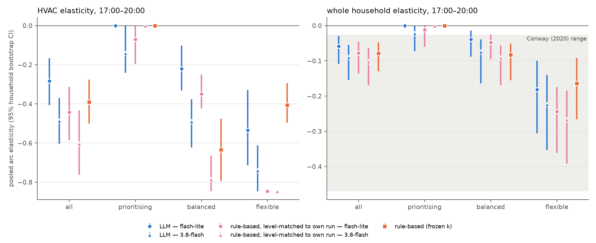
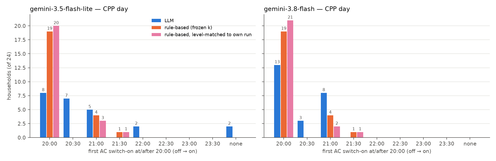
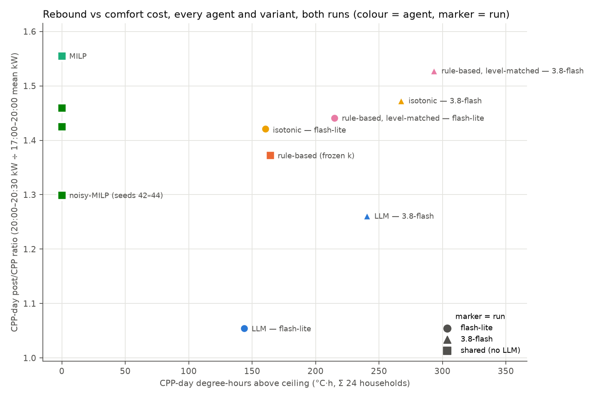

# Cross-model comparison — gemini-3.5-flash-lite (final_v1) vs gemini-3.8-flash (Arm A)

Generated by `experiments/analyze_cross_model.py` from the two runs' saved artifacts and their `analysis/` folders (`experiments/analyze_final_v1.py`). No live LLM calls. Arm A is the pre-registered optional arm A (docs/prereg_final_run_v1.md: model changed, new cache, everything else identical). **Each model's own numbers keep the label they have in that run's analysis (pre-registered or exploratory); the model-vs-model comparison is exploratory (post-hoc)** — the pre-registration makes no cross-model prediction. The level-matched rule-based agent is exploratory throughout.

MILP, noisy-MILP and the frozen-k rule-based agent never call the LLM; their summary rows are identical in the two runs (asserted) and are shown once as *shared*. The frozen k (3.791 / 0.620 / 0.660) was fitted before the run to gemini-3.5-flash-lite's WTP in the comfort sweeps, so it is level-matched to flash-lite by construction but not to 3.8-flash. To compare each model with a rule tuned to its own level, k was refitted to **each run's own** LLM WTP with the same method (`fit_rule_based.fit_hvac`: least squares through the origin, raw WTP on max(0, indoor shown − 26 °C), one row per distinct prompt, fixed ±2.0 band, 3 dp) and that agent (`rule_based_lm`) was simulated offline on all 24 households, both days. The same code path with the frozen k reproduces the saved rule-based curves exactly.

## 1. H1 — WTP by orientation at matched °C above ceiling  *(per model: pre-registered; comparison: exploratory)*

Above-ceiling bins, both days pooled, decision-weighted mean raw WTP with 95% household-bootstrap CI (full tables incl. below-ceiling bins in each run's analysis):

| model | bin (°C over) | n_hh p/b/f | prioritising | balanced | flexible | prio − bal | bal − flex |
|---|---|---|---|---|---|---|---|
| flash-lite | (+0.0, +0.5] | 5/8/11 | 2.05 [1.98, 2.10] | 0.60 [0.50, 0.70] | 0.28 [0.25, 0.31] | 1.44 [1.33, 1.56] | 0.32 [0.21, 0.42] |
| flash-lite | (+0.5, +1.0] | 3/8/11 | 2.25 [2.17, 2.50] | 0.61 [0.51, 0.71] | 0.44 [0.40, 0.50] | 1.64 [1.51, 1.96] | 0.17 [0.05, 0.27] |
| flash-lite | (+1.0, +1.5] | 0/7/11 | – | 1.10 [0.87, 1.48] | 0.53 [0.46, 0.63] | – | 0.57 [0.32, 0.95] |
| flash-lite | (+1.5, +2.0] | 0/6/8 | – | 1.40 [1.16, 1.80] | 0.68 [0.56, 0.82] | – | 0.72 [0.43, 1.14] |
| flash-lite | (+2.0, +2.5] | 0/4/7 | – | 1.92 [1.00, 2.50] | 0.62 [0.52, 0.70] | – | 1.30 [0.42, 1.96] |
| flash-lite | (+2.5, +3.0] | 0/1/2 | – | 2.50 [2.50, 2.50] | 0.48 [0.48, 0.48] | – | 2.02 [2.02, 2.02] |
| flash-lite | (+3.0, +3.5] | 0/0/1 | – | – | 0.46 [0.46, 0.46] | – | – |
| 3.8-flash | (+0.0, +0.5] | 5/8/11 | 1.45 [1.25, 1.55] | 0.39 [0.37, 0.41] | 0.15 [0.13, 0.16] | 1.06 [0.86, 1.16] | 0.25 [0.22, 0.26] |
| 3.8-flash | (+0.5, +1.0] | 4/8/11 | 1.90 [1.75, 2.31] | 0.47 [0.45, 0.49] | 0.32 [0.31, 0.33] | 1.43 [1.27, 1.84] | 0.15 [0.13, 0.17] |
| 3.8-flash | (+1.0, +1.5] | 1/8/11 | 1.75 [1.75, 1.75] | 0.58 [0.52, 0.63] | 0.38 [0.36, 0.40] | 1.17 [1.12, 1.23] | 0.20 [0.14, 0.25] |
| 3.8-flash | (+1.5, +2.0] | 0/8/11 | – | 0.71 [0.65, 0.78] | 0.43 [0.41, 0.45] | – | 0.28 [0.21, 0.35] |
| 3.8-flash | (+2.0, +2.5] | 0/6/11 | – | 1.11 [0.86, 1.42] | 0.48 [0.46, 0.50] | – | 0.63 [0.38, 0.93] |
| 3.8-flash | (+2.5, +3.0] | 0/4/9 | – | 1.19 [1.03, 1.36] | 0.54 [0.50, 0.57] | – | 0.66 [0.49, 0.83] |
| 3.8-flash | (+3.0, +3.5] | 0/2/3 | – | 1.49 [1.44, 1.75] | 0.71 [0.65, 0.85] | – | 0.79 [0.64, 1.09] |
| 3.8-flash | (+3.5, +4.0] | 0/0/2 | – | – | 1.19 [1.15, 1.35] | – | – |

Does prioritising > balanced ≥ flexible hold (bins where all three orientations are observed; robustness variants exploratory)?

| model | variant | bins with all 3 orientations | order holds (point) | prio−bal CI > 0 | bal−flex CI > 0 |
|---|---|---|---|---|---|
| flash-lite | pooled (pre-registered) | (+0.0, +0.5], (+0.5, +1.0] | 2/2 | 2/2 | 2/2 |
| flash-lite | (a) base day only | (+0.0, +0.5], (+0.5, +1.0] | 2/2 | 2/2 | 2/2 |
| flash-lite | (b) distinct prompts | (+0.0, +0.5], (+0.5, +1.0] | 2/2 | 2/2 | 2/2 |
| flash-lite | balanced vs flexible, all above-ceiling bins | (+0.0, +0.5], (+0.5, +1.0], (+1.0, +1.5], (+1.5, +2.0], (+2.0, +2.5], (+2.5, +3.0] | 6/6 | – | 6/6 |
| 3.8-flash | pooled (pre-registered) | (+0.0, +0.5], (+0.5, +1.0], (+1.0, +1.5] | 3/3 | 3/3 | 3/3 |
| 3.8-flash | (a) base day only | (+0.0, +0.5] | 1/1 | 1/1 | 1/1 |
| 3.8-flash | (b) distinct prompts | (+0.0, +0.5], (+0.5, +1.0], (+1.0, +1.5] | 3/3 | 3/3 | 3/3 |
| 3.8-flash | balanced vs flexible, all above-ceiling bins | (+0.0, +0.5], (+0.5, +1.0], (+1.0, +1.5], (+1.5, +2.0], (+2.0, +2.5], (+2.5, +3.0], (+3.0, +3.5] | 7/7 | – | 7/7 |

## 2. WTP resolution and monotonicity  *(descriptive under H4; rate definition post-hoc; comparison exploratory)*

| model | distinct WTP values | distinct above ceiling | top-3 values | top-3 share | non-monotone rate (exact °C) | falls / pairs | non-monotone rate (shown °C) | falls/pairs prioritising | falls/pairs balanced | falls/pairs flexible |
|---|---|---|---|---|---|---|---|---|---|---|
| flash-lite | 11 | 10 | $0.05, $0.45, $0 | 0.867 | 0.104 [0.063, 0.143] | 28/269 | 0.114 [0.069, 0.157] | 0/4 | 2/100 | 26/165 |
| 3.8-flash | 36 | 32 | $0, $0.05, $0.35 | 0.589 | 0.129 [0.103, 0.155] | 56/435 | 0.135 [0.108, 0.163] | 0/7 | 28/154 | 28/274 |

## 3. System metrics per agent  *(metrics pre-registered; isotonic and level-matched agents exploratory)*

CPP-day post/CPP ratio = 20:00–20:30 kW ÷ 17:00–20:00 mean kW. PAR = peak-to-average ratio of the population load. Degree-hours are Σ over the 24 households; max exceedance is the worst household-step. e = pooled arc elasticity (HVAC; whole household).

| model | agent | seed | post/CPP ratio (CPP day) | post 20:00-20:30 kW | PAR base | PAR CPP | PAR base→CPP | degree-h base | degree-h CPP | max exceed. base | max exceed. CPP | e HVAC | e total |
|---|---|---|---|---|---|---|---|---|---|---|---|---|---|
| shared | milp | 42 | 1.555 | 113.072 | 2.024 | 2.253 | 0.229 | 0.000 | 0.000 | 0.000 | 0.000 | -0.685 | -0.160 |
| shared | noisy_milp | 42 | 1.459 | 107.072 | 2.015 | 2.256 | 0.241 | 0.000 | 0.000 | 0.000 | 0.000 | -0.649 | -0.146 |
| shared | noisy_milp | 43 | 1.299 | 97.072 | 1.937 | 2.254 | 0.317 | 0.000 | 0.000 | 0.000 | 0.000 | -0.588 | -0.131 |
| shared | noisy_milp | 44 | 1.425 | 105.072 | 1.981 | 2.234 | 0.253 | 0.000 | 0.000 | 0.000 | 0.000 | -0.657 | -0.161 |
| shared | rule_based | 42 | 1.372 | 107.072 | 1.945 | 2.073 | 0.128 | 113.632 | 164.377 | 1.808 | 2.774 | -0.391 | -0.079 |
| flash-lite | llm | 42 | 1.054 | 85.072 | 1.953 | 1.948 | -0.005 | 107.409 | 143.795 | 2.949 | 3.170 | -0.282 | -0.059 |
| flash-lite | isotonic | 42 | 1.421 | 107.072 | 1.957 | 2.066 | 0.109 | 104.241 | 160.511 | 3.661 | 3.661 | -0.494 | -0.093 |
| flash-lite | rule_based_lm | 42 | 1.441 | 109.072 | 2.063 | 2.130 | 0.067 | 163.777 | 214.930 | 2.958 | 3.174 | -0.442 | -0.078 |
| 3.8-flash | llm | 42 | 1.261 | 95.072 | 1.956 | 2.164 | 0.208 | 177.418 | 240.520 | 3.303 | 3.876 | -0.486 | -0.090 |
| 3.8-flash | isotonic | 42 | 1.473 | 107.072 | 2.196 | 2.253 | 0.057 | 199.144 | 267.446 | 3.567 | 3.876 | -0.610 | -0.105 |
| 3.8-flash | rule_based_lm | 42 | 1.528 | 111.072 | 2.148 | 2.288 | 0.140 | 226.737 | 293.389 | 3.206 | 3.820 | -0.604 | -0.102 |

## 4. Elasticity, pooled and per orientation  *(pooled: pre-registered; per orientation and all comparisons: exploratory)*

| model | agent | group | n | e HVAC [95% CI] | e total [95% CI] |
|---|---|---|---|---|---|
| flash-lite | llm | all | 24 | -0.282 [-0.407, -0.166] | -0.059 [-0.109, -0.030] |
| flash-lite | llm | prioritising | 5 | 0.000 [0.000, 0.000] | 0.000 [0.000, 0.000] |
| flash-lite | llm | balanced | 8 | -0.221 [-0.331, -0.101] | -0.039 [-0.088, -0.014] |
| flash-lite | llm | flexible | 11 | -0.534 [-0.713, -0.329] | -0.181 [-0.305, -0.100] |
| flash-lite | isotonic | all | 24 | -0.494 [-0.639, -0.348] | -0.093 [-0.161, -0.054] |
| flash-lite | isotonic | prioritising | 5 | 0.000 [0.000, 0.000] | 0.000 [0.000, 0.000] |
| flash-lite | isotonic | balanced | 8 | -0.423 [-0.423, -0.423] | -0.055 [-0.098, -0.038] |
| flash-lite | isotonic | flexible | 11 | -0.846 [-0.846, -0.846] | -0.297 [-0.434, -0.211] |
| flash-lite | rule_based_lm | all | 24 | -0.442 [-0.586, -0.313] | -0.078 [-0.136, -0.046] |
| flash-lite | rule_based_lm | prioritising | 5 | -0.071 [-0.195, 0.000] | -0.011 [-0.061, 0.000] |
| flash-lite | rule_based_lm | balanced | 8 | -0.348 [-0.423, -0.249] | -0.048 [-0.095, -0.025] |
| flash-lite | rule_based_lm | flexible | 11 | -0.846 [-0.846, -0.846] | -0.244 [-0.361, -0.175] |
| flash-lite (shared) | rule_based | all | 24 | -0.391 [-0.501, -0.277] | -0.079 [-0.130, -0.047] |
| flash-lite (shared) | rule_based | prioritising | 5 | 0.000 [0.000, 0.000] | 0.000 [0.000, 0.000] |
| flash-lite (shared) | rule_based | balanced | 8 | -0.635 [-0.793, -0.476] | -0.083 [-0.155, -0.052] |
| flash-lite (shared) | rule_based | flexible | 11 | -0.406 [-0.496, -0.294] | -0.164 [-0.266, -0.091] |
| flash-lite (shared) | milp | all | 24 | -0.685 [-0.747, -0.628] | -0.160 [-0.239, -0.116] |
| flash-lite (shared) | milp | prioritising | 5 | -0.716 [-0.846, -0.604] | -0.123 [-0.280, -0.067] |
| flash-lite (shared) | milp | balanced | 8 | -0.654 [-0.762, -0.564] | -0.112 [-0.203, -0.075] |
| flash-lite (shared) | milp | flexible | 11 | -0.695 [-0.786, -0.604] | -0.300 [-0.427, -0.219] |
| 3.8-flash | llm | all | 24 | -0.486 [-0.604, -0.370] | -0.090 [-0.155, -0.055] |
| 3.8-flash | llm | prioritising | 5 | -0.141 [-0.242, 0.000] | -0.023 [-0.072, 0.000] |
| 3.8-flash | llm | balanced | 8 | -0.490 [-0.623, -0.376] | -0.074 [-0.164, -0.039] |
| 3.8-flash | llm | flexible | 11 | -0.740 [-0.846, -0.611] | -0.224 [-0.353, -0.140] |
| 3.8-flash | isotonic | all | 24 | -0.610 [-0.752, -0.465] | -0.105 [-0.165, -0.069] |
| 3.8-flash | isotonic | prioritising | 5 | -0.141 [-0.242, 0.000] | -0.023 [-0.072, 0.000] |
| 3.8-flash | isotonic | balanced | 8 | -0.793 [-0.846, -0.688] | -0.104 [-0.173, -0.075] |
| 3.8-flash | isotonic | flexible | 11 | -0.790 [-0.846, -0.651] | -0.228 [-0.353, -0.145] |
| 3.8-flash | rule_based_lm | all | 24 | -0.604 [-0.762, -0.433] | -0.102 [-0.170, -0.063] |
| 3.8-flash | rule_based_lm | prioritising | 5 | 0.000 [0.000, 0.000] | 0.000 [0.000, 0.000] |
| 3.8-flash | rule_based_lm | balanced | 8 | -0.786 [-0.846, -0.665] | -0.091 [-0.169, -0.056] |
| 3.8-flash | rule_based_lm | flexible | 11 | -0.846 [-0.846, -0.846] | -0.267 [-0.391, -0.184] |
| 3.8-flash (shared) | rule_based | all | 24 | -0.391 [-0.501, -0.277] | -0.079 [-0.130, -0.047] |
| 3.8-flash (shared) | rule_based | prioritising | 5 | 0.000 [0.000, 0.000] | 0.000 [0.000, 0.000] |
| 3.8-flash (shared) | rule_based | balanced | 8 | -0.635 [-0.793, -0.476] | -0.083 [-0.155, -0.052] |
| 3.8-flash (shared) | rule_based | flexible | 11 | -0.406 [-0.496, -0.294] | -0.164 [-0.266, -0.091] |
| 3.8-flash (shared) | milp | all | 24 | -0.685 [-0.747, -0.628] | -0.160 [-0.239, -0.116] |
| 3.8-flash (shared) | milp | prioritising | 5 | -0.716 [-0.846, -0.604] | -0.123 [-0.280, -0.067] |
| 3.8-flash (shared) | milp | balanced | 8 | -0.654 [-0.762, -0.564] | -0.112 [-0.203, -0.075] |
| 3.8-flash (shared) | milp | flexible | 11 | -0.695 [-0.786, -0.604] | -0.300 [-0.427, -0.219] |

## 5. Comfort by orientation, CPP day  *(exploratory)*

Mean degree-hours per household [95% CI]; worst exceedance; household-days above 2.5 °C.

| model | agent | degree-h/hh all | degree-h/hh prioritising | degree-h/hh balanced | degree-h/hh flexible | max exceed. (max) | hh-days > 2.5 °C |
|---|---|---|---|---|---|---|---|
| flash-lite | llm | 5.99 [4.39, 7.79] | 1.31 [0.96, 1.81] | 5.52 [3.79, 7.21] | 8.46 [6.05, 11.05] | 3.17 | 3 |
| flash-lite | isotonic | 6.69 [5.02, 8.55] | 1.31 [0.96, 1.81] | 6.22 [4.59, 7.66] | 9.47 [7.42, 12.15] | 3.66 | 3 |
| flash-lite | rule_based_lm | 8.96 [6.87, 11.07] | 1.75 [1.35, 2.26] | 6.85 [5.83, 7.74] | 13.76 [12.23, 15.47] | 3.17 | 7 |
| flash-lite (shared) | rule_based | 6.85 [5.50, 8.27] | 1.79 [1.41, 2.26] | 9.71 [8.03, 11.13] | 7.07 [5.98, 8.40] | 2.77 | 3 |
| 3.8-flash | llm | 10.02 [7.63, 12.45] | 0.89 [0.49, 1.40] | 10.31 [8.14, 12.51] | 13.96 [11.80, 16.45] | 3.88 | 13 |
| 3.8-flash | isotonic | 11.14 [8.54, 13.67] | 0.74 [0.32, 1.29] | 12.46 [10.10, 14.45] | 14.91 [12.81, 17.27] | 3.88 | 17 |
| 3.8-flash | rule_based_lm | 12.22 [9.75, 14.61] | 1.80 [1.43, 2.27] | 13.09 [11.06, 14.84] | 16.33 [14.98, 18.17] | 3.82 | 17 |
| 3.8-flash (shared) | rule_based | 6.85 [5.50, 8.27] | 1.79 [1.41, 2.26] | 9.71 [8.03, 11.13] | 7.07 [5.98, 8.40] | 2.77 | 3 |

## 6. Switch-on after the event, CPP day  *(exploratory)*

Households by first off→on AC switch at or after 20:00.

| model | agent | 20:00 | 20:30 | 21:00 | 21:30 | 22:00 | 22:30 | 23:00 | 23:30 | none |
|---|---|---|---|---|---|---|---|---|---|---|
| flash-lite | llm | 8 | 7 | 5 | 0 | 2 | 0 | 0 | 0 | 2 |
| flash-lite | isotonic | 18 | 3 | 1 | 0 | 0 | 0 | 0 | 0 | 2 |
| flash-lite | rule_based_lm | 20 | 0 | 3 | 1 | 0 | 0 | 0 | 0 | 0 |
| flash-lite (shared) | rule_based | 19 | 0 | 4 | 1 | 0 | 0 | 0 | 0 | 0 |
| 3.8-flash | llm | 13 | 3 | 8 | 0 | 0 | 0 | 0 | 0 | 0 |
| 3.8-flash | isotonic | 18 | 2 | 4 | 0 | 0 | 0 | 0 | 0 | 0 |
| 3.8-flash | rule_based_lm | 21 | 0 | 2 | 1 | 0 | 0 | 0 | 0 | 0 |
| 3.8-flash (shared) | rule_based | 19 | 0 | 4 | 1 | 0 | 0 | 0 | 0 | 0 |

## 7. Isotonic (monotone) counterfactual vs raw LLM  *(exploratory)*

| model | post/CPP LLM | post/CPP isotonic | e HVAC LLM | e HVAC isotonic | degree-h CPP LLM | degree-h CPP isotonic | max exceed. CPP LLM | max exceed. CPP isotonic |
|---|---|---|---|---|---|---|---|---|
| flash-lite | 1.054 | 1.421 | -0.282 | -0.494 | 143.795 | 160.511 | 3.170 | 3.661 |
| 3.8-flash | 1.261 | 1.473 | -0.486 | -0.610 | 240.520 | 267.446 | 3.876 | 3.876 |

## 8. Each model vs its own level-matched rule-based agent  *(exploratory fairness control)*

Refitted k per orientation (frozen k shown for reference):

| model | orientation | k_level_matched | k_frozen_fixed_band | n_distinct_prompts | rmse | r2_vs_mean |
|---|---|---|---|---|---|---|
| flash-lite | comfort_prioritising | 5.156 | 3.791 | 215 | 0.434 | 0.737 |
| flash-lite | balanced | 0.909 | 0.620 | 348 | 0.337 | 0.603 |
| flash-lite | comfort_flexible | 0.294 | 0.660 | 392 | 0.201 | 0.387 |
| 3.8-flash | comfort_prioritising | 3.294 | 3.791 | 258 | 0.462 | 0.227 |
| 3.8-flash | balanced | 0.461 | 0.620 | 345 | 0.177 | 0.751 |
| 3.8-flash | comfort_flexible | 0.248 | 0.660 | 431 | 0.102 | 0.816 |

| model | agent | post/CPP ratio | PAR base | PAR CPP | degree-h CPP | max exceed. CPP | e HVAC | e total |
|---|---|---|---|---|---|---|---|---|
| flash-lite | llm | 1.054 | 1.953 | 1.948 | 143.795 | 3.170 | -0.282 | -0.059 |
| flash-lite | rule_based_lm | 1.441 | 2.063 | 2.130 | 214.930 | 3.174 | -0.442 | -0.078 |
| flash-lite | rule_based | 1.372 | 1.945 | 2.073 | 164.377 | 2.774 | -0.391 | -0.079 |
| 3.8-flash | llm | 1.261 | 1.956 | 2.164 | 240.520 | 3.876 | -0.486 | -0.090 |
| 3.8-flash | rule_based_lm | 1.528 | 2.148 | 2.288 | 293.389 | 3.820 | -0.604 | -0.102 |
| 3.8-flash | rule_based | 1.372 | 1.945 | 2.073 | 164.377 | 2.774 | -0.391 | -0.079 |

(`rule_based` = frozen k, identical in both runs.)

## 9. Rebound vs comfort, every agent and variant  *(exploratory)*

| model | agent | seed | CPP degree-hours | CPP post/CPP ratio |
|---|---|---|---|---|
| shared | milp | 42 | 0.000 | 1.555 |
| shared | noisy_milp | 42 | 0.000 | 1.459 |
| shared | noisy_milp | 43 | 0.000 | 1.299 |
| shared | noisy_milp | 44 | 0.000 | 1.425 |
| shared | rule_based | 42 | 164.377 | 1.372 |
| flash-lite | llm | 42 | 143.795 | 1.054 |
| flash-lite | isotonic | 42 | 160.511 | 1.421 |
| flash-lite | rule_based_lm | 42 | 214.930 | 1.441 |
| 3.8-flash | llm | 42 | 240.520 | 1.261 |
| 3.8-flash | isotonic | 42 | 267.446 | 1.473 |
| 3.8-flash | rule_based_lm | 42 | 293.389 | 1.528 |

## 10. Summary  *(exploratory)*

- **H1 ordering.** flash-lite: order holds in 2/2 bins with all three orientations ((+0.0, +0.5], (+0.5, +1.0]), prio−bal CI > 0 in 2/2, bal−flex CI > 0 in 2/2. 3.8-flash: order holds in 3/3 bins with all three orientations ((+0.0, +0.5], (+0.5, +1.0], (+1.0, +1.5]), prio−bal CI > 0 in 3/3, bal−flex CI > 0 in 3/3. Robustness variants: see table in item 1.
- **WTP resolution.** flash-lite uses 11 distinct values (top-3 share 87%), 3.8-flash 36 (top-3 share 59%). Non-monotone rate above the ceiling: flash-lite 0.104 [0.063, 0.143], 3.8-flash 0.129 [0.103, 0.155].
- **Rebound (post/CPP ratio, CPP day).** LLM flash-lite 1.054, 3.8-flash 1.261; MILP 1.555; frozen rule-based 1.372; own level-matched rule 1.441 (flash-lite) / 1.528 (3.8-flash); isotonic 1.421 / 1.473.
- **Comfort (CPP-day degree-hours, Σ 24 households).** LLM flash-lite 143.8, 3.8-flash 240.5; frozen rule-based 164.4; own level-matched 214.9 / 293.4. Max exceedance LLM 3.17 / 3.88 °C.
- **Elasticity (pooled HVAC; whole household).** LLM flash-lite -0.282; -0.059, 3.8-flash -0.486; -0.090 (Conway range −0.47 to −0.026).
- **Rebound vs comfort.** flash-lite: the LLM has a lower post/CPP ratio and fewer CPP-day degree-hours than both its isotonic counterfactual and its own level-matched rule. 3.8-flash: the LLM has a lower post/CPP ratio and fewer CPP-day degree-hours than both its isotonic counterfactual and its own level-matched rule. MILP variants: zero degree-hours, ratios 1.299–1.555.
