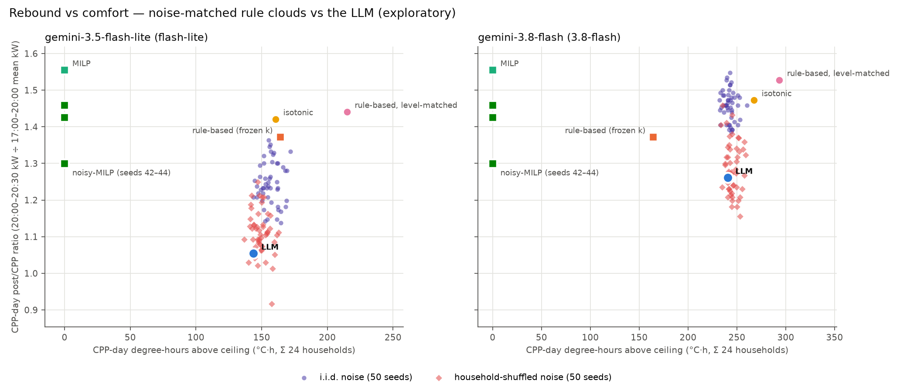

# Context vs dispersion — is the LLM's advantage reproducible by noise?  *(EXPLORATORY)*

**Everything in this file is exploratory (post-hoc); nothing here is pre-registered.** Generated by `experiments/analyze_noise_test.py` from the saved artifacts of `results/phase3/final_v1` (gemini-3.5-flash-lite) and `results/phase3/arm_a` (gemini-3.8-flash) and their `analysis/` folders. No LLM is called (the client is patched to raise on any cache miss or write; the noise agents are pure Python); both caches and both run folders were hashed before and after and are unchanged.

## 1. Context check — what does the LLM's WTP depend on beyond temperature?  *(exploratory, post-hoc)*

**What the prompt contains.** Every HVAC prompt is one of 6 templates (3 personas × within/over/under the band). The only fields that vary between decisions are the persona sentence (= orientation), the clock (`CURRENT STATE AT hh:mm`), the indoor temperature (0.1 °C) and the derived 'X °C OVER the ceiling' fact; the band is fixed (22–26 °C). There is **no price, no history, no minutes-above-ceiling and no previous temperature** in the prompt, and the answer is a deterministic function of the prompt (T = 0 + cache: every repeated prompt has exactly one WTP in both runs). So minutes above ceiling and Δ temperature can only matter through their correlation with the clock and the shown temperature — they are included as requested, as a check on that.

Rows: HVAC decisions above the ceiling (exact pre-decision temperature > 26 °C), both days. Dependent variable: raw WTP ($). Base model: an intercept and a slope on shown °C over the ceiling per orientation. Clock = hour-of-day dummies. Minutes above ceiling so far = 30 × prior steps that day above the ceiling. Δ temp = pre-decision indoor °C minus the previous step's. CV R² = household-grouped 5-fold (orientation-stratified) out-of-fold R². Saturated = one mean per orientation × shown °C cell (the most any temperature-only function can explain; in-sample).

| model | model spec | n | params | R2 | adj_R2 | CV_R2 | ΔR2 | ΔCV_R2 |
|---|---|---|---|---|---|---|---|---|
| flash-lite | °C over ceiling (shown) × orientation | 639 | 6 | 0.677 | 0.674 | 0.633 | – | – |
| flash-lite | + clock (hour of day) | 639 | 17 | 0.694 | 0.686 | 0.639 | 0.017 | 0.006 |
| flash-lite | + minutes above ceiling so far | 639 | 18 | 0.694 | 0.686 | 0.638 | 0.000 | -0.000 |
| flash-lite | + Δ indoor temp since last step | 639 | 19 | 0.694 | 0.685 | 0.637 | 0.000 | -0.002 |
| flash-lite | full − clock (unique contribution) | 639 | 8 | 0.678 | 0.675 | 0.631 | -0.016 | -0.006 |
| flash-lite | full − minutes above so far (unique contribution) | 639 | 18 | 0.694 | 0.686 | 0.637 | -0.000 | 0.001 |
| flash-lite | full − Δ temp (unique contribution) | 639 | 18 | 0.694 | 0.686 | 0.638 | -0.000 | 0.002 |
| flash-lite | saturated: one mean per orientation × shown °C | 639 | 64 | 0.801 | 0.780 | – | – | – |
| flash-lite | saturated + clock | 639 | 75 | 0.815 | 0.791 | – | 0.014 | – |
| 3.8-flash | °C over ceiling (shown) × orientation | 748 | 6 | 0.807 | 0.806 | 0.792 | – | – |
| 3.8-flash | + clock (hour of day) | 748 | 18 | 0.813 | 0.809 | 0.794 | 0.006 | 0.002 |
| 3.8-flash | + minutes above ceiling so far | 748 | 19 | 0.816 | 0.812 | 0.796 | 0.003 | 0.003 |
| 3.8-flash | + Δ indoor temp since last step | 748 | 20 | 0.817 | 0.812 | 0.796 | 0.000 | -0.000 |
| 3.8-flash | full − clock (unique contribution) | 748 | 8 | 0.808 | 0.806 | 0.792 | -0.009 | -0.004 |
| 3.8-flash | full − minutes above so far (unique contribution) | 748 | 19 | 0.813 | 0.809 | 0.793 | -0.003 | -0.003 |
| 3.8-flash | full − Δ temp (unique contribution) | 748 | 19 | 0.816 | 0.812 | 0.796 | -0.000 | 0.000 |
| 3.8-flash | saturated: one mean per orientation × shown °C | 748 | 79 | 0.894 | 0.881 | – | – | – |
| 3.8-flash | saturated + clock | 748 | 91 | 0.897 | 0.882 | – | 0.003 | – |

**Direct test of the clock.** Distinct prompts only; cells of identical orientation × shown °C that were seen at two or more clock times — any WTP difference inside a cell is due to the clock alone (the only other varying field).

| model | distinct above-ceiling prompts | cells (orientation × shown °C) seen at ≥2 clocks | prompts in those cells | cells where WTP differs by clock | share of WTP variance in those cells that is within-cell (clock) |
|---|---|---|---|---|---|
| flash-lite | 318 | 58 | 312 | 47 | 0.221 |
| 3.8-flash | 407 | 66 | 394 | 63 | 0.123 |

Mean residual of the base model (temperature × orientation) by time of day, $ (n decisions):

| model | 00–12 mean resid $ (n) | 12–17 mean resid $ (n) | 17–20 mean resid $ (n) | 20–21 mean resid $ (n) | 21–24 mean resid $ (n) |
|---|---|---|---|---|---|
| flash-lite | +0.000 (20) | -0.018 (286) | +0.076 (227) | -0.148 (62) | -0.072 (44) |
| 3.8-flash | +0.027 (18) | +0.012 (326) | -0.003 (251) | -0.025 (76) | -0.022 (77) |

## 2–3. Noise-matched rule and household-shuffled residuals  *(exploratory, post-hoc)*

Each model's level-matched rule (`rule_based_lm`, k refitted to that run's own LLM WTP; flash-lite: 5.156 / 0.909 / 0.294; 3.8-flash: 3.294 / 0.461 / 0.248 for prioritising / balanced / flexible) emits WTP = max(0, k·(°C over ceiling) + ε) and goes through the same Python halt and archetype factor as the LLM. Residuals are LLM WTP − rule WTP at every HVAC decision of that model's run (the LLM's own states, both days, all 48 steps; the rule WTP uses the exact temperature as the rule agent does). With ε = 0 the code reproduces the saved `rule_based_lm` curves exactly (asserted).

- **i.i.d. noise** (the noise-matched rule): ε drawn with replacement, independently per decision, from the residuals of the same orientation **and the same side of the ceiling** (above vs at/below). Stratifying by side keeps above-ceiling residuals (which can be ±$1–2 for prioritising) out of in-band states, where the LLM itself answers ≈ $0.05.
- **i.i.d. noise (orientation only)** — sensitivity, the literal 'within orientation' pool with both sides mixed.
- **household-shuffled noise**: every household-day takes the complete 48-step residual sequence of a randomly drawn *other* household of the same orientation on the same day label, residual at step t applied at step t (keeps the LLM's temporal structure, breaks household identity). Donors are drawn per seed.

50 seeds each, 24 households, both days. Clouds: median [5th–95th percentile] over seeds. `LLM pct` = percentile of the actual LLM value within the cloud (share of seeds below it, ties half; 0 = better than every seed for ratio and degree-hours, since lower is better on both). `rule_lm` = the zero-noise level-matched rule.

| model | variant | seeds | post/CPP ratio median [5–95%] | post/CPP ratio LLM | post/CPP ratio LLM pct | post/CPP ratio rule_lm |
|---|---|---|---|---|---|---|
| flash-lite | i.i.d. noise | 50 | 1.238 [1.147, 1.340] | 1.054 | 0.000 | 1.441 |
| flash-lite | i.i.d. noise (orientation only) | 50 | 1.367 [1.269, 1.474] | 1.054 | 0.000 | 1.441 |
| flash-lite | household-shuffled noise | 50 | 1.110 [1.025, 1.211] | 1.054 | 14.000 | 1.441 |
| 3.8-flash | i.i.d. noise | 50 | 1.459 [1.392, 1.525] | 1.261 | 0.000 | 1.528 |
| 3.8-flash | i.i.d. noise (orientation only) | 50 | 1.500 [1.422, 1.549] | 1.261 | 0.000 | 1.528 |
| 3.8-flash | household-shuffled noise | 50 | 1.277 [1.189, 1.408] | 1.261 | 38.000 | 1.528 |

| model | variant | CPP degree-hours median [5–95%] | CPP degree-hours LLM | CPP degree-hours LLM pct | CPP degree-hours rule_lm | seeds at least as good as LLM on both |
|---|---|---|---|---|---|---|
| flash-lite | i.i.d. noise | 155.939 [146.398, 168.636] | 143.795 | 2.000 | 214.930 | 0/50 |
| flash-lite | i.i.d. noise (orientation only) | 174.454 [164.503, 181.948] | 143.795 | 0.000 | 214.930 | 0/50 |
| flash-lite | household-shuffled noise | 148.459 [141.097, 159.793] | 143.795 | 18.000 | 214.930 | 1/50 |
| 3.8-flash | i.i.d. noise | 242.308 [233.210, 251.979] | 240.520 | 34.000 | 293.389 | 0/50 |
| 3.8-flash | i.i.d. noise (orientation only) | 260.841 [251.886, 271.688] | 240.520 | 0.000 | 293.389 | 0/50 |
| 3.8-flash | household-shuffled noise | 244.782 [236.580, 256.826] | 240.520 | 14.000 | 293.389 | 1/50 |

| model | variant | e HVAC median [5–95%] | e HVAC LLM | e HVAC LLM pct | e HVAC rule_lm |
|---|---|---|---|---|---|
| flash-lite | i.i.d. noise | -0.372 [-0.442, -0.297] | -0.282 | 99.000 | -0.442 |
| flash-lite | i.i.d. noise (orientation only) | -0.447 [-0.512, -0.372] | -0.282 | 100.000 | -0.442 |
| flash-lite | household-shuffled noise | -0.313 [-0.367, -0.239] | -0.282 | 65.000 | -0.442 |
| 3.8-flash | i.i.d. noise | -0.579 [-0.624, -0.513] | -0.486 | 100.000 | -0.604 |
| 3.8-flash | i.i.d. noise (orientation only) | -0.606 [-0.652, -0.554] | -0.486 | 100.000 | -0.604 |
| 3.8-flash | household-shuffled noise | -0.537 [-0.607, -0.418] | -0.486 | 74.000 | -0.604 |

Level check — the noise agents' realised WTP above the ceiling vs the LLM's (pooled over seeds; the noise agents visit their own states, so this need not match exactly):

| model | variant | orientation | mean WTP above ceiling, LLM | mean WTP above ceiling, noise agent | SD WTP above ceiling, LLM | SD WTP above ceiling, noise agent | share clipped at 0 (noise agent, above ceiling) |
|---|---|---|---|---|---|---|---|
| flash-lite | iid_ori_side | prioritising | 2.085 | 2.232 | 0.656 | 1.384 | 0.072 |
| flash-lite | iid_ori_side | balanced | 0.813 | 0.783 | 0.634 | 0.631 | 0.128 |
| flash-lite | iid_ori_side | flexible | 0.427 | 0.431 | 0.271 | 0.318 | 0.102 |
| flash-lite | iid_ori | prioritising | 2.085 | 1.749 | 0.656 | 1.114 | 0.012 |
| flash-lite | iid_ori | balanced | 0.813 | 0.690 | 0.634 | 0.494 | 0.034 |
| flash-lite | iid_ori | flexible | 0.427 | 0.403 | 0.271 | 0.265 | 0.025 |
| flash-lite | hh_shuffled | prioritising | 2.085 | 1.861 | 0.656 | 1.325 | 0.043 |
| flash-lite | hh_shuffled | balanced | 0.813 | 0.734 | 0.634 | 0.634 | 0.053 |
| flash-lite | hh_shuffled | flexible | 0.427 | 0.403 | 0.271 | 0.297 | 0.025 |
| 3.8-flash | iid_ori_side | prioritising | 1.498 | 1.745 | 0.383 | 0.955 | 0.021 |
| 3.8-flash | iid_ori_side | balanced | 0.588 | 0.563 | 0.308 | 0.377 | 0.069 |
| 3.8-flash | iid_ori_side | flexible | 0.359 | 0.351 | 0.183 | 0.225 | 0.052 |
| 3.8-flash | iid_ori | prioritising | 1.498 | 1.401 | 0.383 | 0.817 | 0.004 |
| 3.8-flash | iid_ori | balanced | 0.588 | 0.559 | 0.308 | 0.360 | 0.024 |
| 3.8-flash | iid_ori | flexible | 0.359 | 0.341 | 0.183 | 0.219 | 0.019 |
| 3.8-flash | hh_shuffled | prioritising | 1.498 | 1.663 | 0.383 | 0.951 | 0.012 |
| 3.8-flash | hh_shuffled | balanced | 0.588 | 0.572 | 0.308 | 0.356 | 0.012 |
| 3.8-flash | hh_shuffled | flexible | 0.359 | 0.347 | 0.183 | 0.193 | 0.000 |

## 4. Rebound vs comfort with the noise clouds  *(exploratory, post-hoc)*

Per-seed values: `noise_test_seeds.csv`. Points are the same as in `fig_rebound_vs_comfort.png` (cross_model.md item 9); the orientation-only sensitivity cloud is in the tables but not drawn.

## 5. Verdict  *(exploratory, post-hoc)*

**flash-lite — the LLM sits outside the i.i.d. noise cloud, but inside the household-shuffled cloud.** Adding the LLM's own residuals to its level-matched rule as independent per-decision noise moves the rule's post/CPP ratio from 1.441 to a median 1.238 (52% of the way to the LLM's 1.054) and its CPP degree-hours from 214.9 to 155.9 (LLM 143.8); no seeds reach the LLM's ratio and 0/50 match it on both axes. When the same residuals keep their time order (borrowed from another household of the same orientation) the cloud moves to a median 1.110 (86% of the gap) and the LLM falls at percentile 14 on the ratio and 18 on degree-hours — inside the cloud. So random dispersion alone does **not** reproduce the LLM's rebound advantage; dispersion that keeps the LLM's time-ordered structure largely does, and that structure is shared across households of an orientation rather than tied to a household's identity. The context check agrees: the clock is the only non-temperature field that varies in the prompt; it adds little overall (R² +0.017; minutes-above-ceiling and Δ temp add ≈ 0, as they must, since neither is in the prompt), but 47 of 58 identical orientation × °C cells get different answers at different times, and at 20:00–21:00 the LLM's WTP is −$0.148 relative to its temperature fit.

**3.8-flash — the LLM sits outside the i.i.d. noise cloud, but inside the household-shuffled cloud.** Adding the LLM's own residuals to its level-matched rule as independent per-decision noise moves the rule's post/CPP ratio from 1.528 to a median 1.459 (26% of the way to the LLM's 1.261) and its CPP degree-hours from 293.4 to 242.3 (LLM 240.5, i.e. the noise cloud matches the LLM's comfort); no seeds reach the LLM's ratio and 0/50 match it on both axes. When the same residuals keep their time order (borrowed from another household of the same orientation) the cloud moves to a median 1.277 (94% of the gap) and the LLM falls at percentile 38 on the ratio and 14 on degree-hours — inside the cloud. So random dispersion alone does **not** reproduce the LLM's rebound advantage; dispersion that keeps the LLM's time-ordered structure largely does, and that structure is shared across households of an orientation rather than tied to a household's identity. The context check gives only weak support for a clock mechanism here: the clock is the only non-temperature field that varies in the prompt; it adds little overall (R² +0.006; minutes-above-ceiling and Δ temp add ≈ 0, as they must, since neither is in the prompt), but 63 of 66 identical orientation × °C cells get different answers at different times, and at 20:00–21:00 the LLM's WTP is −$0.025 relative to its temperature fit — small, so for this model the time-ordered cloud's success may owe as much to the residuals following the temperature path (the linear rule's misfit along a trajectory) as to the clock.

Numbers behind the verdict:

- **flash-lite**: i.i.d. noise: LLM ratio 1.054 sits at percentile 0 of the cloud (1.238 [1.147, 1.340]), degree-hours 143.8 at percentile 2 (155.939 [146.398, 168.636]); seeds at least as good on both: 0/50; household-shuffled noise: LLM ratio 1.054 sits at percentile 14 of the cloud (1.110 [1.025, 1.211]), degree-hours 143.8 at percentile 18 (148.459 [141.097, 159.793]); seeds at least as good on both: 1/50.
- **3.8-flash**: i.i.d. noise: LLM ratio 1.261 sits at percentile 0 of the cloud (1.459 [1.392, 1.525]), degree-hours 240.5 at percentile 34 (242.308 [233.210, 251.979]); seeds at least as good on both: 0/50; household-shuffled noise: LLM ratio 1.261 sits at percentile 38 of the cloud (1.277 [1.189, 1.408]), degree-hours 240.5 at percentile 14 (244.782 [236.580, 256.826]); seeds at least as good on both: 1/50.

Caveats: the residual pools include the linear rule's misfit (LLM WTP is flatter in °C than k·x, notably for prioritising), so i.i.d. resampling also scrambles that systematic part — the noise agents' WTP SD above the ceiling is larger than the LLM's for prioritising (level check above). The household-shuffled variant keeps each donor's residual at its own clock time, so it carries both the clock pattern and the donor's temperature path. One LLM run per model (seed 42, T = 0): the LLM point has no seed spread of its own.
