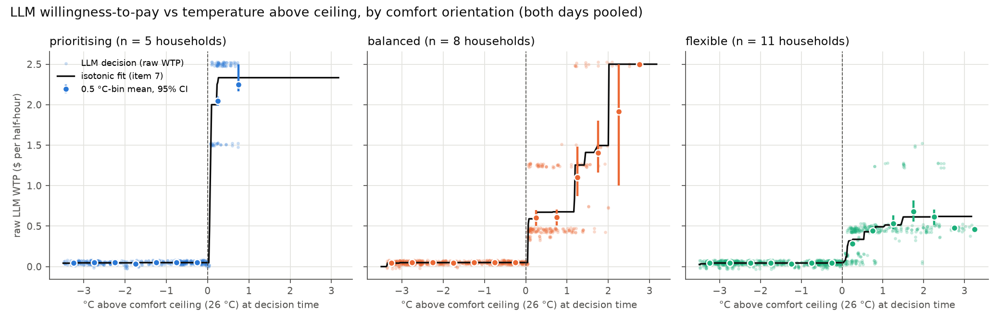
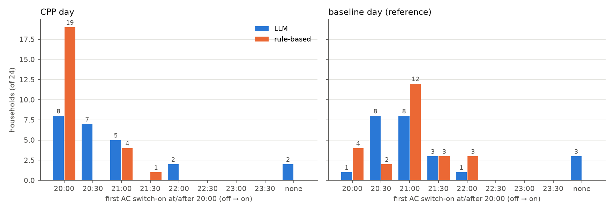
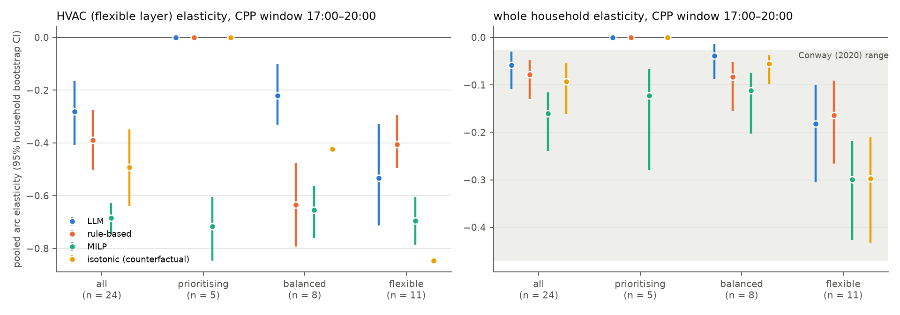
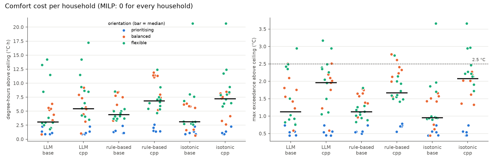

# Final Run v1 — post-run analysis

Generated by `experiments/analyze_final_v1.py` from the saved artifacts in `results/phase3/final_v1/` (commit of the run: `560d7fb`, pre-registration `docs/prereg_final_run_v1.md`). No live LLM calls: every LLM answer is replayed from `results/phase3/llm_cache_final.jsonl`, with the client patched to raise on any cache miss or write. Nothing outside `analysis/` was written.

Every result is labelled **pre-registered** or **exploratory (post-hoc)**. Bootstrap CIs: households resampled with replacement, 10,000 draws, seed 42, percentile 95% intervals; pooled quantities are recomputed on each resample. n per orientation is imbalanced (prioritising 5 / balanced 8 / flexible 11), and cells with 1–3 households give CIs that are narrow by construction, not precise.

## 0. Inventory and offline regeneration

**Saved per step** (`curves.parquet`, 13,824 rows = 24 households × 6 agent-seeds × 2 days × 48 steps): rate, CPP flag, base / HVAC / washer / flexible / total kWh, **end-of-step** indoor temperature, band ceiling, in-band flag. **Saved per decision**: `llm_decision_log.parquet` (t, clock, appliance, full prompt, raw WTP, reason, cost_now, utility, run, cached, forced, scale/factor, model version, misread flags, household, seed, day) and `rule_decision_log.parquet` (same minus prompt/reason, plus the regressor = °C over ceiling, clipped at 0). **Per household**: `elasticity_per_household.csv` (CPP-window kWh per component, both days), `load_metrics.csv`, `personas_used.csv` (orientation, archetype).

**Not saved:** the exact indoor temperature *at decision time* (the logs carry it only as 0.1 °C text inside the prompt; curves hold the post-step value), and the counterfactual agent of item 7. Both were regenerated deterministically: every household × agent × seed × day was re-simulated from the tagged code, with MILP / noisy-MILP / rule-based re-solved and the LLM replayed from the cache, and the pre-decision temperature recorded from the simulator's decision context.

Replay check (all must hold before anything below is computed; they did):

| check | result |
|---|---|
| curves.parquet reproduced exactly (all agents, 13,824 rows) | True |
| llm_decision_log reproduced exactly (prompt, WTP, reason, run, utility, model version, timestamp; 4,608 rows) | True |
| rule_decision_log reproduced exactly | True |
| summary.csv recomputed from replay identical | True |
| live LLM calls during replay | 0 |
| cache hits during replay (= 2,304 prompted decisions) | 2304 |
| cache file unchanged (sha256 before = after) | True |
| max |prompt temperature − replayed pre-decision temperature| (°C) | 0.050 |

Per-decision state (exact °C over ceiling, the value shown to the model, orientation, archetype) is saved as `llm_decisions_with_state.csv`.

## 1. H1 — LLM raw WTP by comfort orientation at matched temperature  *(pre-registered)*

Raw LLM WTP (before archetype factor), both days pooled, binned on the exact pre-decision °C above the 26 °C ceiling in 0.5 °C bins (right-closed; a decision exactly at the ceiling falls in (−0.5, 0]). Mean is decision-weighted within the bin; CI resamples households within orientation. Differences resample each orientation independently. Note: base and CPP days share identical prompts before 17:00, so pre-17:00 decisions appear twice (as pre-specified, 'both days pooled').

| C_above_ceiling | prioritising_n_hh | prioritising_n_dec | prioritising_ci | balanced_n_hh | balanced_n_dec | balanced_ci | flexible_n_hh | flexible_n_dec | flexible_ci | prio_minus_bal | bal_minus_flex |
|---|---|---|---|---|---|---|---|---|---|---|---|
| (-3.5, -3.0] | 3 | 50 | 0.05 [0.04, 0.05] | 6 | 76 | 0.04 [0.04, 0.05] | 8 | 126 | 0.04 [0.04, 0.04] | 0.00 [-0.00, 0.01] | -0.00 [-0.01, 0.01] |
| (-3.0, -2.5] | 5 | 70 | 0.05 [0.05, 0.05] | 8 | 122 | 0.05 [0.05, 0.05] | 11 | 160 | 0.05 [0.04, 0.05] | -0.00 [-0.00, 0.00] | 0.00 [0.00, 0.01] |
| (-2.5, -2.0] | 5 | 34 | 0.05 [0.05, 0.05] | 8 | 68 | 0.05 [0.05, 0.05] | 11 | 80 | 0.05 [0.04, 0.05] | 0.00 [-0.00, 0.00] | 0.00 [0.00, 0.01] |
| (-2.0, -1.5] | 5 | 34 | 0.04 [0.03, 0.04] | 8 | 42 | 0.05 [0.04, 0.05] | 11 | 62 | 0.05 [0.04, 0.05] | -0.01 [-0.02, -0.00] | -0.00 [-0.01, 0.00] |
| (-1.5, -1.0] | 5 | 30 | 0.05 [0.05, 0.05] | 8 | 55 | 0.05 [0.05, 0.05] | 11 | 47 | 0.04 [0.03, 0.04] | 0.00 [-0.00, 0.00] | 0.01 [0.01, 0.02] |
| (-1.0, -0.5] | 5 | 86 | 0.05 [0.05, 0.05] | 8 | 90 | 0.05 [0.05, 0.05] | 11 | 101 | 0.05 [0.04, 0.05] | 0.00 [-0.00, 0.00] | 0.00 [0.00, 0.01] |
| (-0.5, +0.0] | 5 | 94 | 0.05 [0.05, 0.05] | 8 | 91 | 0.05 [0.05, 0.05] | 11 | 147 | 0.05 [0.04, 0.05] | -0.00 [-0.00, 0.00] | 0.00 [0.00, 0.01] |
| (+0.0, +0.5] | 5 | 66 | 2.05 [1.98, 2.10] | 8 | 110 | 0.60 [0.50, 0.70] | 11 | 133 | 0.28 [0.25, 0.31] | 1.44 [1.33, 1.56] | 0.32 [0.21, 0.42] |
| (+0.5, +1.0] | 3 | 16 | 2.25 [2.17, 2.50] | 8 | 45 | 0.61 [0.51, 0.71] | 11 | 86 | 0.44 [0.40, 0.50] | 1.64 [1.51, 1.96] | 0.17 [0.05, 0.27] |
| (+1.0, +1.5] | 0 | 0 | – | 7 | 44 | 1.10 [0.87, 1.48] | 11 | 32 | 0.53 [0.46, 0.63] | – | 0.57 [0.32, 0.95] |
| (+1.5, +2.0] | 0 | 0 | – | 6 | 17 | 1.40 [1.16, 1.80] | 8 | 32 | 0.68 [0.56, 0.82] | – | 0.72 [0.43, 1.14] |
| (+2.0, +2.5] | 0 | 0 | – | 4 | 6 | 1.92 [1.00, 2.50] | 7 | 31 | 0.62 [0.52, 0.70] | – | 1.30 [0.42, 1.96] |
| (+2.5, +3.0] | 0 | 0 | – | 1 | 2 | 2.50 [2.50, 2.50] | 2 | 15 | 0.48 [0.48, 0.48] | – | 2.02 [2.02, 2.02] |
| (+3.0, +3.5] | 0 | 0 | – | 0 | 0 | – | 1 | 4 | 0.46 [0.46, 0.46] | – | – |

### H1 robustness: base day only / one decision per distinct prompt  *(exploratory (post-hoc) robustness check of the pre-registered table; same bins, same bootstrap)*

(a) Baseline day only — each household-step counted once; drops the CPP day's post-17:00 decisions.

| C_above_ceiling | prioritising_n_hh | prioritising_n_dec | prioritising_ci | balanced_n_hh | balanced_n_dec | balanced_ci | flexible_n_hh | flexible_n_dec | flexible_ci | prio_minus_bal | bal_minus_flex |
|---|---|---|---|---|---|---|---|---|---|---|---|
| (-3.5, -3.0] | 3 | 25 | 0.05 [0.04, 0.05] | 6 | 38 | 0.04 [0.04, 0.05] | 8 | 63 | 0.04 [0.04, 0.04] | 0.00 [-0.00, 0.01] | -0.00 [-0.01, 0.01] |
| (-3.0, -2.5] | 5 | 35 | 0.05 [0.05, 0.05] | 8 | 61 | 0.05 [0.05, 0.05] | 11 | 80 | 0.05 [0.04, 0.05] | -0.00 [-0.00, 0.00] | 0.00 [0.00, 0.01] |
| (-2.5, -2.0] | 5 | 17 | 0.05 [0.05, 0.05] | 8 | 34 | 0.05 [0.05, 0.05] | 11 | 40 | 0.05 [0.04, 0.05] | 0.00 [-0.00, 0.00] | 0.00 [0.00, 0.01] |
| (-2.0, -1.5] | 5 | 17 | 0.04 [0.03, 0.04] | 8 | 21 | 0.05 [0.04, 0.05] | 11 | 31 | 0.05 [0.04, 0.05] | -0.01 [-0.02, -0.00] | -0.00 [-0.01, 0.00] |
| (-1.5, -1.0] | 5 | 15 | 0.05 [0.05, 0.05] | 8 | 30 | 0.05 [0.05, 0.05] | 11 | 24 | 0.04 [0.03, 0.04] | 0.00 [-0.00, 0.00] | 0.01 [0.01, 0.02] |
| (-1.0, -0.5] | 5 | 43 | 0.05 [0.05, 0.05] | 8 | 45 | 0.05 [0.05, 0.05] | 11 | 49 | 0.04 [0.04, 0.05] | 0.00 [-0.00, 0.00] | 0.01 [0.00, 0.01] |
| (-0.5, +0.0] | 5 | 47 | 0.05 [0.05, 0.05] | 8 | 46 | 0.05 [0.05, 0.05] | 11 | 85 | 0.04 [0.04, 0.05] | -0.00 [-0.00, 0.00] | 0.01 [0.00, 0.01] |
| (+0.0, +0.5] | 5 | 33 | 2.05 [1.98, 2.10] | 8 | 57 | 0.60 [0.51, 0.70] | 11 | 71 | 0.27 [0.25, 0.30] | 1.45 [1.33, 1.56] | 0.33 [0.23, 0.43] |
| (+0.5, +1.0] | 3 | 8 | 2.25 [2.17, 2.50] | 8 | 22 | 0.59 [0.50, 0.66] | 11 | 43 | 0.43 [0.39, 0.50] | 1.66 [1.55, 1.97] | 0.15 [0.05, 0.24] |
| (+1.0, +1.5] | 0 | 0 | – | 7 | 22 | 1.02 [0.78, 1.42] | 5 | 9 | 0.47 [0.45, 0.48] | – | 0.55 [0.31, 0.96] |
| (+1.5, +2.0] | 0 | 0 | – | 4 | 5 | 1.29 [0.72, 1.99] | 5 | 13 | 0.69 [0.55, 0.91] | – | 0.60 [-0.00, 1.33] |
| (+2.0, +2.5] | 0 | 0 | – | 2 | 2 | 1.62 [0.75, 2.50] | 4 | 14 | 0.63 [0.57, 0.75] | – | 0.99 [0.05, 1.91] |
| (+2.5, +3.0] | 0 | 0 | – | 1 | 1 | 2.50 [2.50, 2.50] | 1 | 6 | 0.48 [0.48, 0.48] | – | 2.02 [2.02, 2.02] |

(b) Deduplicated by distinct prompt — 955 distinct prompts from 2,304 decisions; each kept once, at its first occurrence (household, then baseline before CPP day, then time). Removes the pre-17:00 double count and also collapses identical prompts across households of the same orientation (263 prompts occurred in more than one household); the kept copy's exact temperature sets the bin.

| C_above_ceiling | prioritising_n_hh | prioritising_n_dec | prioritising_ci | balanced_n_hh | balanced_n_dec | balanced_ci | flexible_n_hh | flexible_n_dec | flexible_ci | prio_minus_bal | bal_minus_flex |
|---|---|---|---|---|---|---|---|---|---|---|---|
| (-3.5, -3.0] | 3 | 24 | 0.05 [0.04, 0.05] | 6 | 23 | 0.04 [0.04, 0.05] | 6 | 29 | 0.04 [0.04, 0.05] | 0.00 [-0.01, 0.01] | -0.00 [-0.01, 0.01] |
| (-3.0, -2.5] | 5 | 32 | 0.05 [0.05, 0.05] | 8 | 47 | 0.05 [0.05, 0.05] | 10 | 46 | 0.04 [0.04, 0.05] | -0.00 [-0.00, 0.00] | 0.00 [0.00, 0.01] |
| (-2.5, -2.0] | 5 | 14 | 0.05 [0.05, 0.05] | 7 | 26 | 0.05 [0.05, 0.05] | 9 | 25 | 0.04 [0.04, 0.05] | -0.00 [-0.00, 0.00] | 0.01 [0.00, 0.01] |
| (-2.0, -1.5] | 5 | 12 | 0.04 [0.03, 0.05] | 7 | 13 | 0.05 [0.04, 0.05] | 8 | 18 | 0.05 [0.04, 0.05] | -0.00 [-0.02, 0.01] | -0.00 [-0.01, 0.01] |
| (-1.5, -1.0] | 4 | 13 | 0.05 [0.05, 0.05] | 8 | 30 | 0.05 [0.05, 0.05] | 9 | 14 | 0.04 [0.02, 0.05] | 0.00 [-0.00, 0.00] | 0.01 [0.00, 0.03] |
| (-1.0, -0.5] | 5 | 37 | 0.05 [0.05, 0.05] | 8 | 46 | 0.05 [0.05, 0.05] | 9 | 38 | 0.05 [0.04, 0.05] | 0.00 [-0.00, 0.00] | 0.00 [0.00, 0.01] |
| (-0.5, +0.0] | 5 | 43 | 0.05 [0.05, 0.05] | 8 | 45 | 0.05 [0.05, 0.05] | 10 | 62 | 0.04 [0.04, 0.05] | -0.00 [-0.00, 0.00] | 0.01 [0.00, 0.01] |
| (+0.0, +0.5] | 5 | 32 | 2.06 [1.99, 2.13] | 8 | 51 | 0.61 [0.48, 0.75] | 10 | 53 | 0.27 [0.22, 0.31] | 1.45 [1.30, 1.60] | 0.35 [0.20, 0.49] |
| (+0.5, +1.0] | 3 | 8 | 2.25 [2.17, 2.50] | 7 | 26 | 0.64 [0.51, 0.77] | 11 | 40 | 0.46 [0.42, 0.53] | 1.61 [1.46, 1.96] | 0.18 [0.03, 0.32] |
| (+1.0, +1.5] | 0 | 0 | – | 7 | 25 | 1.08 [0.86, 1.50] | 10 | 21 | 0.53 [0.45, 0.64] | – | 0.55 [0.30, 0.97] |
| (+1.5, +2.0] | 0 | 0 | – | 6 | 12 | 1.45 [1.22, 1.81] | 8 | 18 | 0.64 [0.49, 0.81] | – | 0.81 [0.52, 1.18] |
| (+2.0, +2.5] | 0 | 0 | – | 3 | 3 | 1.92 [0.75, 2.50] | 6 | 15 | 0.57 [0.47, 0.68] | – | 1.34 [0.21, 2.00] |
| (+2.5, +3.0] | 0 | 0 | – | 1 | 1 | 2.50 [2.50, 2.50] | 2 | 9 | 0.48 [0.48, 0.48] | – | 2.02 [2.02, 2.02] |
| (+3.0, +3.5] | 0 | 0 | – | 0 | 0 | – | 1 | 4 | 0.46 [0.46, 0.46] | – | – |

Ordering check in bins where all three orientations are observed:

| variant | bin | n_hh (prio/bal/flex) | prio_mean | bal_mean | flex_mean | order_holds_point | prio-bal_CI_excl_0 | bal-flex_CI_excl_0 |
|---|---|---|---|---|---|---|---|---|
| pooled (pre-registered) | (+0.0, +0.5] | 5/8/11 | 2.05 | 0.60 | 0.28 | True | True | True |
| pooled (pre-registered) | (+0.5, +1.0] | 3/8/11 | 2.25 | 0.61 | 0.44 | True | True | True |
| (a) base day only | (+0.0, +0.5] | 5/8/11 | 2.05 | 0.60 | 0.27 | True | True | True |
| (a) base day only | (+0.5, +1.0] | 3/8/11 | 2.25 | 0.59 | 0.43 | True | True | True |
| (b) distinct prompts | (+0.0, +0.5] | 5/8/10 | 2.06 | 0.61 | 0.27 | True | True | True |
| (b) distinct prompts | (+0.5, +1.0] | 3/7/11 | 2.25 | 0.64 | 0.46 | True | True | True |

All above-ceiling decisions per orientation (not temperature-matched; shown for context only — prioritising households sit much closer to the ceiling):

| orientation | n_households_total | n_hh_above | n_dec_above | mean_wtp_above | ci | mean_C_above_of_those |
|---|---|---|---|---|---|---|
| comfort_prioritising | 5 | 5 | 82 | 2.085 | 2.09 [2.04, 2.13] | 0.321 |
| balanced | 8 | 8 | 224 | 0.813 | 0.81 [0.75, 0.88] | 0.701 |
| comfort_flexible | 11 | 11 | 333 | 0.427 | 0.43 [0.39, 0.47] | 0.958 |

**Summary.** Below the ceiling the LLM gives essentially the same near-zero WTP (~$0.05) to every orientation. Above it, in every bin where all three orientations are observed ((+0.0, +0.5], (+0.5, +1.0]), the pre-registered order prioritising > balanced ≥ flexible holds, and both gaps have 95% CIs above zero. Prioritising households never get more than 0.73 °C over (their high WTP keeps the AC on), so above 1 °C only balanced vs flexible can be compared: balanced > flexible in 6 of 6 bins. H1 is supported where it can be tested; the comparison with prioritising rests on 5 households and ≤1 °C. Robustness: counting the baseline day only, or each distinct prompt once, leaves the ordering and both CI exclusions unchanged in every testable bin.

## 2. Per-orientation elasticity  *(exploratory, post-hoc)*

Pooled arc elasticity (Σ CPP-window kWh, base method, %ΔP = (1.20−0.55)/0.55) over households in the group; primary seed. `isotonic` is the item-7 counterfactual.

| agent | comfort_orientation | n | e_hvac_ci | e_total_ci | q_base_hvac_kwh | q_cpp_hvac_kwh |
|---|---|---|---|---|---|---|
| llm | all | 24 | -0.282 [-0.407, -0.166] | -0.059 [-0.109, -0.030] | 54.000 | 36.000 |
| llm | comfort_prioritising | 5 | 0.000 [0.000, 0.000] | 0.000 [0.000, 0.000] | 12.000 | 12.000 |
| llm | balanced | 8 | -0.221 [-0.331, -0.101] | -0.039 [-0.088, -0.014] | 23.000 | 17.000 |
| llm | comfort_flexible | 11 | -0.534 [-0.713, -0.329] | -0.181 [-0.305, -0.100] | 19.000 | 7.000 |
| rule_based | all | 24 | -0.391 [-0.501, -0.277] | -0.079 [-0.130, -0.047] | 52.000 | 28.000 |
| rule_based | comfort_prioritising | 5 | 0.000 [0.000, 0.000] | 0.000 [0.000, 0.000] | 11.000 | 11.000 |
| rule_based | balanced | 8 | -0.635 [-0.793, -0.476] | -0.083 [-0.155, -0.052] | 16.000 | 4.000 |
| rule_based | comfort_flexible | 11 | -0.406 [-0.496, -0.294] | -0.164 [-0.266, -0.091] | 25.000 | 13.000 |
| milp | all | 24 | -0.685 [-0.747, -0.628] | -0.160 [-0.239, -0.116] | 63.000 | 12.000 |
| milp | comfort_prioritising | 5 | -0.716 [-0.846, -0.604] | -0.123 [-0.280, -0.067] | 13.000 | 2.000 |
| milp | balanced | 8 | -0.654 [-0.762, -0.564] | -0.112 [-0.203, -0.075] | 22.000 | 5.000 |
| milp | comfort_flexible | 11 | -0.695 [-0.786, -0.604] | -0.300 [-0.427, -0.219] | 28.000 | 5.000 |
| isotonic | all | 24 | -0.494 [-0.639, -0.348] | -0.093 [-0.161, -0.054] | 48.000 | 20.000 |
| isotonic | comfort_prioritising | 5 | 0.000 [0.000, 0.000] | 0.000 [0.000, 0.000] | 12.000 | 12.000 |
| isotonic | balanced | 8 | -0.423 [-0.423, -0.423] | -0.055 [-0.098, -0.038] | 16.000 | 8.000 |
| isotonic | comfort_flexible | 11 | -0.846 [-0.846, -0.846] | -0.297 [-0.434, -0.211] | 20.000 | 0.000 |

**Summary.** The LLM's HVAC response grows as comfort orientation loosens: prioritising 0.00, balanced -0.22, flexible -0.53. Prioritising households do not respond at all under either satisficer: their WTP (~$2–2.5 once over the ceiling) clears even the CPP cost. The rule-based agent puts balanced (-0.63) ahead of flexible (-0.41). MILP responds about equally in every group (≈ −0.65 to −0.72). Orientation is confounded with archetype (7 of 11 flexible households are archetype A, and no prioritising household is), so these are not clean orientation effects (see item 4).

## 3. Comfort per household  *(metrics pre-registered; per-orientation / per-archetype breakdown and the > 2.5 °C list exploratory)*

Degree-hours = Σ max(0, indoor − 26 °C) × 0.5 h per household-day (end-of-step temperatures, as in the run's summary); mean over households with bootstrap CI. MILP is 0 for every household and day and is omitted. Per-household values: `comfort_per_household.csv`.

By orientation:

| agent | day | comfort_orientation | n | degree_hours_mean | max_exceedance_mean | max_exceedance_max | n_hh_max_gt_2.5 |
|---|---|---|---|---|---|---|---|
| llm | base | all | 24 | 4.48 [3.09, 6.06] | 1.36 [1.07, 1.67] | 2.95 | 2 |
| llm | base | comfort_prioritising | 5 | 1.31 [0.96, 1.81] | 0.54 [0.47, 0.64] | 0.73 | 0 |
| llm | base | balanced | 8 | 4.30 [3.10, 5.36] | 1.62 [1.24, 1.99] | 2.51 | 1 |
| llm | base | comfort_flexible | 11 | 6.04 [3.46, 8.86] | 1.54 [1.07, 2.02] | 2.95 | 1 |
| llm | cpp | all | 24 | 5.99 [4.39, 7.79] | 1.68 [1.36, 2.01] | 3.17 | 3 |
| llm | cpp | comfort_prioritising | 5 | 1.31 [0.96, 1.81] | 0.54 [0.47, 0.64] | 0.73 | 0 |
| llm | cpp | balanced | 8 | 5.52 [3.79, 7.21] | 1.79 [1.37, 2.15] | 2.51 | 1 |
| llm | cpp | comfort_flexible | 11 | 8.46 [6.05, 11.05] | 2.12 [1.72, 2.49] | 3.17 | 2 |
| rule_based | base | all | 24 | 4.73 [3.81, 5.71] | 1.15 [0.99, 1.31] | 1.81 | 0 |
| rule_based | base | comfort_prioritising | 5 | 1.48 [1.14, 1.95] | 0.58 [0.52, 0.66] | 0.73 | 0 |
| rule_based | base | balanced | 8 | 6.88 [5.61, 7.97] | 1.52 [1.33, 1.67] | 1.79 | 0 |
| rule_based | base | comfort_flexible | 11 | 4.65 [3.95, 5.56] | 1.14 [1.00, 1.30] | 1.81 | 0 |
| rule_based | cpp | all | 24 | 6.85 [5.50, 8.27] | 1.72 [1.46, 1.98] | 2.77 | 3 |
| rule_based | cpp | comfort_prioritising | 5 | 1.79 [1.41, 2.26] | 0.70 [0.62, 0.75] | 0.79 | 0 |
| rule_based | cpp | balanced | 8 | 9.71 [8.03, 11.13] | 2.25 [2.00, 2.49] | 2.77 | 2 |
| rule_based | cpp | comfort_flexible | 11 | 7.07 [5.98, 8.40] | 1.79 [1.59, 2.03] | 2.74 | 1 |
| isotonic | base | all | 24 | 4.34 [2.95, 6.18] | 1.16 [0.91, 1.47] | 3.66 | 1 |
| isotonic | base | comfort_prioritising | 5 | 1.31 [0.96, 1.81] | 0.54 [0.47, 0.64] | 0.73 | 0 |
| isotonic | base | balanced | 8 | 4.24 [2.58, 5.60] | 1.18 [0.86, 1.47] | 1.66 | 0 |
| isotonic | base | comfort_flexible | 11 | 5.79 [3.36, 9.18] | 1.44 [1.03, 1.97] | 3.66 | 1 |
| isotonic | cpp | all | 24 | 6.69 [5.02, 8.55] | 1.85 [1.51, 2.18] | 3.66 | 3 |
| isotonic | cpp | comfort_prioritising | 5 | 1.31 [0.96, 1.81] | 0.54 [0.47, 0.64] | 0.73 | 0 |
| isotonic | cpp | balanced | 8 | 6.22 [4.59, 7.66] | 1.87 [1.62, 2.10] | 2.27 | 0 |
| isotonic | cpp | comfort_flexible | 11 | 9.47 [7.42, 12.15] | 2.42 [2.13, 2.76] | 3.66 | 3 |

By archetype:

| agent | day | archetype | n | degree_hours_mean | max_exceedance_mean | max_exceedance_max | n_hh_max_gt_2.5 |
|---|---|---|---|---|---|---|---|
| llm | base | all | 24 | 4.48 [3.09, 6.06] | 1.36 [1.07, 1.67] | 2.95 | 2 |
| llm | base | A | 8 | 2.49 [1.88, 3.06] | 0.91 [0.76, 1.11] | 1.50 | 0 |
| llm | base | B | 8 | 5.69 [2.55, 9.25] | 1.53 [0.89, 2.19] | 2.95 | 1 |
| llm | base | C | 8 | 5.25 [3.24, 7.84] | 1.63 [1.16, 2.09] | 2.51 | 1 |
| llm | cpp | all | 24 | 5.99 [4.39, 7.79] | 1.68 [1.36, 2.01] | 3.17 | 3 |
| llm | cpp | A | 8 | 5.33 [3.58, 7.19] | 1.61 [1.18, 2.03] | 2.40 | 0 |
| llm | cpp | B | 8 | 5.74 [2.56, 9.32] | 1.55 [0.90, 2.21] | 2.95 | 1 |
| llm | cpp | C | 8 | 6.90 [4.02, 10.34] | 1.88 [1.31, 2.42] | 3.17 | 2 |
| rule_based | base | all | 24 | 4.73 [3.81, 5.71] | 1.15 [0.99, 1.31] | 1.81 | 0 |
| rule_based | base | A | 8 | 3.87 [3.56, 4.26] | 1.01 [0.93, 1.10] | 1.26 | 0 |
| rule_based | base | B | 8 | 3.73 [2.23, 5.07] | 0.99 [0.72, 1.23] | 1.39 | 0 |
| rule_based | base | C | 8 | 6.61 [4.54, 8.25] | 1.44 [1.09, 1.72] | 1.81 | 0 |
| rule_based | cpp | all | 24 | 6.85 [5.50, 8.27] | 1.72 [1.46, 1.98] | 2.77 | 3 |
| rule_based | cpp | A | 8 | 5.84 [5.32, 6.38] | 1.55 [1.50, 1.62] | 1.72 | 0 |
| rule_based | cpp | B | 8 | 5.44 [3.10, 7.51] | 1.53 [1.04, 1.93] | 2.14 | 0 |
| rule_based | cpp | C | 8 | 9.26 [6.02, 11.67] | 2.07 [1.47, 2.56] | 2.77 | 3 |
| isotonic | base | all | 24 | 4.34 [2.95, 6.18] | 1.16 [0.91, 1.47] | 3.66 | 1 |
| isotonic | base | A | 8 | 2.65 [2.04, 3.05] | 0.88 [0.75, 0.96] | 1.00 | 0 |
| isotonic | base | B | 8 | 3.60 [1.80, 5.89] | 1.04 [0.65, 1.51] | 1.97 | 0 |
| isotonic | base | C | 8 | 6.78 [3.82, 11.04] | 1.57 [1.06, 2.24] | 3.66 | 1 |
| isotonic | cpp | all | 24 | 6.69 [5.02, 8.55] | 1.85 [1.51, 2.18] | 3.66 | 3 |
| isotonic | cpp | A | 8 | 6.59 [5.30, 7.62] | 2.02 [1.77, 2.24] | 2.47 | 0 |
| isotonic | cpp | B | 8 | 5.47 [2.44, 8.75] | 1.57 [0.91, 2.27] | 2.96 | 2 |
| isotonic | cpp | C | 8 | 8.00 [4.78, 12.05] | 1.95 [1.36, 2.54] | 3.66 | 1 |

Household-days with max exceedance > 2.5 °C:

| agent | household_id | day | comfort_orientation | archetype | max_exceedance_c | degree_hours | steps_above |
|---|---|---|---|---|---|---|---|
| isotonic | 8208263 | base | comfort_flexible | C | 3.66 | 20.66 | 20 |
| isotonic | 8208263 | cpp | comfort_flexible | C | 3.66 | 20.66 | 20 |
| isotonic | 10444433 | cpp | comfort_flexible | B | 2.96 | 12.39 | 15 |
| isotonic | 10239118 | cpp | comfort_flexible | B | 2.95 | 11.75 | 16 |
| llm | 10239118 | base | comfort_flexible | B | 2.95 | 14.23 | 17 |
| llm | 9012382 | base | balanced | C | 2.51 | 6.33 | 14 |
| llm | 8208263 | cpp | comfort_flexible | C | 3.17 | 17.22 | 21 |
| llm | 10239118 | cpp | comfort_flexible | B | 2.95 | 14.23 | 17 |
| llm | 9012382 | cpp | balanced | C | 2.51 | 9.20 | 16 |
| rule_based | 8596070 | cpp | balanced | C | 2.77 | 11.90 | 20 |
| rule_based | 8208263 | cpp | comfort_flexible | C | 2.74 | 12.39 | 19 |
| rule_based | 9012382 | cpp | balanced | C | 2.61 | 11.38 | 17 |

**Summary.** Under the LLM, comfort cost rises from prioritising (≈1.3 °C·h, never above 0.74 °C) to flexible, which carries the worst cases. Among LLM household-days, 5 exceed 2.5 °C across 3 households (8208263, 9012382, 10239118). Two of them (10239118 flexible/B, 9012382 balanced/C) exceed it on the baseline day too: after the archetype factor their WTP is below the ordinary peak cost, so the cause is not the CPP event. 8208263 (flexible/C) exceeds it only on the CPP day. The rule-based agent's cost is spread more evenly (base-day max 1.81 °C) but is higher on average on the CPP day, where balanced households take the largest hit.

## 4. Why archetype B shows zero LLM elasticity  *(exploratory, post-hoc)*

Orientation × archetype, pooled HVAC elasticity (n = households):

| agent | orientation | archetype | n | q_base_hvac | q_cpp_hvac | e_hvac |
|---|---|---|---|---|---|---|
| llm | prioritising | A | 0 | 0.000 | 0.000 | – |
| llm | prioritising | B | 3 | 7.000 | 7.000 | 0.000 |
| llm | prioritising | C | 2 | 5.000 | 5.000 | 0.000 |
| llm | balanced | A | 1 | 2.000 | 2.000 | 0.000 |
| llm | balanced | B | 2 | 6.000 | 6.000 | 0.000 |
| llm | balanced | C | 5 | 15.000 | 9.000 | -0.338 |
| llm | flexible | A | 7 | 15.000 | 4.000 | -0.621 |
| llm | flexible | B | 3 | 3.000 | 3.000 | 0.000 |
| llm | flexible | C | 1 | 1.000 | 0.000 | -0.846 |
| rule_based | prioritising | A | 0 | 0.000 | 0.000 | – |
| rule_based | prioritising | B | 3 | 6.000 | 6.000 | 0.000 |
| rule_based | prioritising | C | 2 | 5.000 | 5.000 | 0.000 |
| rule_based | balanced | A | 1 | 2.000 | 1.000 | -0.423 |
| rule_based | balanced | B | 2 | 4.000 | 2.000 | -0.423 |
| rule_based | balanced | C | 5 | 10.000 | 1.000 | -0.762 |
| rule_based | flexible | A | 7 | 16.000 | 9.000 | -0.370 |
| rule_based | flexible | B | 3 | 6.000 | 3.000 | -0.423 |
| rule_based | flexible | C | 1 | 3.000 | 1.000 | -0.564 |
| milp | prioritising | A | 0 | 0.000 | 0.000 | – |
| milp | prioritising | B | 3 | 7.000 | 1.000 | -0.725 |
| milp | prioritising | C | 2 | 6.000 | 1.000 | -0.705 |
| milp | balanced | A | 1 | 2.000 | 0.000 | -0.846 |
| milp | balanced | B | 2 | 6.000 | 2.000 | -0.564 |
| milp | balanced | C | 5 | 14.000 | 3.000 | -0.665 |
| milp | flexible | A | 7 | 18.000 | 2.000 | -0.752 |
| milp | flexible | B | 3 | 7.000 | 2.000 | -0.604 |
| milp | flexible | C | 1 | 3.000 | 1.000 | -0.564 |

The mechanism is the halt rule: run iff WTP × factor ≥ 2 kW × 0.5 h × rate. A decision in 17:00–20:00 responds to CPP only if raw WTP lands in [0.55 / factor, 1.20 / factor). LLM WTPs actually given in that window:

| archetype | factor | run_at_peak_if_wtp>= | run_at_cpp_if_wtp>= | llm_wtp_17-20_base_day | llm_wtp_17-20_cpp_day | base_day_decisions_in_responsive_band |
|---|---|---|---|---|---|---|
| A | 1.300 | 0.423 | 0.923 | 0×2, 0.05×26, 0.15×3, 0.45×13, 0.5×3, 1.25×1 | 0.05×6, 0.15×3, 0.35×1, 0.45×28, 0.5×4, 1.25×5, 1.5×1 | 16 |
| B | 1.000 | 0.550 | 1.200 | 0.05×12, 0.35×1, 0.45×12, 0.5×7, 0.75×1, 1.25×5, 1.5×3, 2.5×7 | 0.05×12, 0.35×1, 0.45×11, 0.5×7, 0.75×1, 1.25×5, 1.5×3, 2.5×8 | 1 |
| C | 0.700 | 0.786 | 1.714 | 0.05×8, 0.35×1, 0.45×16, 0.5×2, 1.25×12, 2.5×9 | 0.05×7, 0.35×1, 0.45×11, 0.5×4, 1.25×10, 1.5×1, 2.5×14 | 12 |

Per-household HVAC kWh, 17:00–20:00, baseline vs CPP (LLM and rule-based)

| agent | household_id | comfort_orientation | archetype | q_base_hvac | q_cpp_hvac |
|---|---|---|---|---|---|
| llm | 9911140 | balanced | A | 2.000 | 2.000 |
| llm | 8456189 | comfort_flexible | A | 2.000 | 1.000 |
| llm | 8481835 | comfort_flexible | A | 2.000 | 1.000 |
| llm | 9911204 | comfort_flexible | A | 3.000 | 0.000 |
| llm | 9911250 | comfort_flexible | A | 2.000 | 0.000 |
| llm | 9911254 | comfort_flexible | A | 2.000 | 0.000 |
| llm | 10278838 | comfort_flexible | A | 2.000 | 1.000 |
| llm | 11105177 | comfort_flexible | A | 2.000 | 1.000 |
| llm | 8201999 | balanced | B | 3.000 | 3.000 |
| llm | 8395524 | balanced | B | 3.000 | 3.000 |
| llm | 10239118 | comfort_flexible | B | 0.000 | 0.000 |
| llm | 10444433 | comfort_flexible | B | 2.000 | 2.000 |
| llm | 10556929 | comfort_flexible | B | 1.000 | 1.000 |
| llm | 8211127 | comfort_prioritising | B | 3.000 | 3.000 |
| llm | 8463253 | comfort_prioritising | B | 2.000 | 2.000 |
| llm | 10649333 | comfort_prioritising | B | 2.000 | 2.000 |
| llm | 8596070 | balanced | C | 3.000 | 2.000 |
| llm | 8619039 | balanced | C | 3.000 | 2.000 |
| llm | 8632083 | balanced | C | 3.000 | 2.000 |
| llm | 9012382 | balanced | C | 4.000 | 2.000 |
| llm | 10042536 | balanced | C | 2.000 | 1.000 |
| llm | 8208263 | comfort_flexible | C | 1.000 | 0.000 |
| llm | 8568499 | comfort_prioritising | C | 3.000 | 3.000 |
| llm | 8638181 | comfort_prioritising | C | 2.000 | 2.000 |
| rule_based | 9911140 | balanced | A | 2.000 | 1.000 |
| rule_based | 8456189 | comfort_flexible | A | 2.000 | 1.000 |
| rule_based | 8481835 | comfort_flexible | A | 2.000 | 1.000 |
| rule_based | 9911204 | comfort_flexible | A | 3.000 | 1.000 |
| rule_based | 9911250 | comfort_flexible | A | 3.000 | 2.000 |
| rule_based | 9911254 | comfort_flexible | A | 2.000 | 2.000 |
| rule_based | 10278838 | comfort_flexible | A | 2.000 | 1.000 |
| rule_based | 11105177 | comfort_flexible | A | 2.000 | 1.000 |
| rule_based | 8201999 | balanced | B | 2.000 | 1.000 |
| rule_based | 8395524 | balanced | B | 2.000 | 1.000 |
| rule_based | 10239118 | comfort_flexible | B | 3.000 | 1.000 |
| rule_based | 10444433 | comfort_flexible | B | 1.000 | 1.000 |
| rule_based | 10556929 | comfort_flexible | B | 2.000 | 1.000 |
| rule_based | 8211127 | comfort_prioritising | B | 2.000 | 2.000 |
| rule_based | 8463253 | comfort_prioritising | B | 2.000 | 2.000 |
| rule_based | 10649333 | comfort_prioritising | B | 2.000 | 2.000 |
| rule_based | 8596070 | balanced | C | 2.000 | 1.000 |
| rule_based | 8619039 | balanced | C | 2.000 | 0.000 |
| rule_based | 8632083 | balanced | C | 2.000 | 0.000 |
| rule_based | 9012382 | balanced | C | 2.000 | 0.000 |
| rule_based | 10042536 | balanced | C | 2.000 | 0.000 |
| rule_based | 8208263 | comfort_flexible | C | 3.000 | 1.000 |
| rule_based | 8568499 | comfort_prioritising | C | 3.000 | 3.000 |
| rule_based | 8638181 | comfort_prioritising | C | 2.000 | 2.000 |

**Summary.** The LLM's WTP takes a few fixed values (0.05, 0.45, 0.5, 1.25, 1.5, 2.5, …). For archetype B (factor 1.0) the band that responds to price is $0.55–1.20. The LLM gave a value in it once in 48 baseline-day window decisions (a single $0.75). Every other B decision is either below $0.55 (off at the ordinary peak price already) or at $1.25 or more (on even at CPP), so CPP changes nothing. Factors 1.3 (A) and 0.7 (C) move that band onto values the LLM does give: 0.45/0.5 for A, 1.25/1.5 for C. The zero comes from where the LLM's fixed values sit relative to the price levels, not from B households being price-insensitive. The rule-based agent's continuous WTP crosses the band, so its B elasticity is non-zero.

## 5. Rebound mechanism, CPP day  *(exploratory, post-hoc)*

AC state at steps 38–43 (19:00, 19:30, 20:00, 20:30, 21:00, 21:30; 1 = on), and first off→on switch at or after 20:00. Rate after the event: 0.55 until 21:00, then 0.28 (shoulder), 0.22 from 22:00.

Per household, CPP day (LLM, rule-based, isotonic)

| agent | household_id | orientation | archetype | ac_19:00-21:30 (t38-43) | indoor_at_20:00_c | first_switch_on_after_20 | hvac_kw_20:00 | hvac_kwh_20-22 |
|---|---|---|---|---|---|---|---|---|
| isotonic | 8201999 | balanced | B | 001000 | 26.87 | 20:00 | 2.00 | 1.00 |
| isotonic | 8395524 | balanced | B | 001010 | 27.21 | 20:00 | 2.00 | 2.00 |
| isotonic | 8596070 | balanced | C | 101010 | 27.20 | 20:00 | 2.00 | 2.00 |
| isotonic | 8619039 | balanced | C | 001010 | 27.78 | 20:00 | 2.00 | 2.00 |
| isotonic | 8632083 | balanced | C | 001010 | 27.73 | 20:00 | 2.00 | 2.00 |
| isotonic | 9012382 | balanced | C | 001010 | 27.97 | 20:00 | 2.00 | 2.00 |
| isotonic | 9911140 | balanced | A | 011000 | 26.32 | none | 2.00 | 1.00 |
| isotonic | 10042536 | balanced | C | 001010 | 27.78 | 20:00 | 2.00 | 2.00 |
| isotonic | 8208263 | comfort_flexible | C | 000011 | 29.55 | 21:00 | 0.00 | 2.00 |
| isotonic | 8456189 | comfort_flexible | A | 001100 | 27.72 | 20:00 | 2.00 | 2.00 |
| isotonic | 8481835 | comfort_flexible | A | 001100 | 27.90 | 20:00 | 2.00 | 2.00 |
| isotonic | 9911204 | comfort_flexible | A | 001110 | 28.28 | 20:00 | 2.00 | 3.00 |
| isotonic | 9911250 | comfort_flexible | A | 001100 | 28.47 | 20:00 | 2.00 | 2.00 |
| isotonic | 9911254 | comfort_flexible | A | 001100 | 28.14 | 20:00 | 2.00 | 2.00 |
| isotonic | 10239118 | comfort_flexible | B | 001110 | 28.94 | 20:00 | 2.00 | 3.00 |
| isotonic | 10278838 | comfort_flexible | A | 001100 | 28.13 | 20:00 | 2.00 | 2.00 |
| isotonic | 10444433 | comfort_flexible | B | 001010 | 28.96 | 20:00 | 2.00 | 2.00 |
| isotonic | 10556929 | comfort_flexible | B | 001010 | 28.22 | 20:00 | 2.00 | 2.00 |
| isotonic | 11105177 | comfort_flexible | A | 001101 | 28.22 | 20:00 | 2.00 | 3.00 |
| isotonic | 8211127 | comfort_prioritising | B | 010000 | 25.39 | none | 0.00 | 0.00 |
| isotonic | 8463253 | comfort_prioritising | B | 000100 | 26.03 | 20:30 | 0.00 | 1.00 |
| isotonic | 8568499 | comfort_prioritising | C | 100100 | 25.75 | 20:30 | 0.00 | 1.00 |
| isotonic | 8638181 | comfort_prioritising | C | 100100 | 25.84 | 20:30 | 0.00 | 1.00 |
| isotonic | 10649333 | comfort_prioritising | B | 001000 | 26.32 | 20:00 | 2.00 | 1.00 |
| llm | 8201999 | balanced | B | 010000 | 25.31 | 22:00 | 0.00 | 0.00 |
| llm | 8395524 | balanced | B | 110000 | 25.25 | 22:00 | 0.00 | 0.00 |
| llm | 8596070 | balanced | C | 000110 | 27.37 | 20:30 | 0.00 | 2.00 |
| llm | 8619039 | balanced | C | 010010 | 26.44 | 21:00 | 0.00 | 1.00 |
| llm | 8632083 | balanced | C | 001010 | 26.87 | 20:00 | 2.00 | 2.00 |
| llm | 9012382 | balanced | C | 000110 | 27.92 | 20:30 | 0.00 | 2.00 |
| llm | 9911140 | balanced | A | 010000 | 25.46 | none | 0.00 | 0.00 |
| llm | 10042536 | balanced | C | 001010 | 27.21 | 20:00 | 2.00 | 2.00 |
| llm | 8208263 | comfort_flexible | C | 000010 | 29.14 | 21:00 | 0.00 | 1.00 |
| llm | 8456189 | comfort_flexible | A | 001010 | 27.03 | 20:00 | 2.00 | 2.00 |
| llm | 8481835 | comfort_flexible | A | 001001 | 27.08 | 20:00 | 2.00 | 2.00 |
| llm | 9911204 | comfort_flexible | A | 001101 | 28.26 | 20:00 | 2.00 | 3.00 |
| llm | 9911250 | comfort_flexible | A | 000110 | 28.40 | 20:30 | 0.00 | 2.00 |
| llm | 9911254 | comfort_flexible | A | 001100 | 28.05 | 20:00 | 2.00 | 2.00 |
| llm | 10239118 | comfort_flexible | B | 000011 | 28.94 | 21:00 | 0.00 | 2.00 |
| llm | 10278838 | comfort_flexible | A | 101010 | 27.16 | 20:00 | 2.00 | 2.00 |
| llm | 10444433 | comfort_flexible | B | 010010 | 26.45 | 21:00 | 0.00 | 1.00 |
| llm | 10556929 | comfort_flexible | B | 000011 | 28.07 | 21:00 | 0.00 | 2.00 |
| llm | 11105177 | comfort_flexible | A | 010100 | 26.53 | 20:30 | 0.00 | 1.00 |
| llm | 8211127 | comfort_prioritising | B | 010000 | 25.39 | none | 0.00 | 0.00 |
| llm | 8463253 | comfort_prioritising | B | 000100 | 26.03 | 20:30 | 0.00 | 1.00 |
| llm | 8568499 | comfort_prioritising | C | 100100 | 25.75 | 20:30 | 0.00 | 1.00 |
| llm | 8638181 | comfort_prioritising | C | 100100 | 25.84 | 20:30 | 0.00 | 1.00 |
| llm | 10649333 | comfort_prioritising | B | 001000 | 26.32 | 20:00 | 2.00 | 1.00 |
| rule_based | 8201999 | balanced | B | 001000 | 27.40 | 20:00 | 2.00 | 1.00 |
| rule_based | 8395524 | balanced | B | 001001 | 27.46 | 20:00 | 2.00 | 2.00 |
| rule_based | 8596070 | balanced | C | 101000 | 27.65 | 20:00 | 2.00 | 1.00 |
| rule_based | 8619039 | balanced | C | 001010 | 28.32 | 20:00 | 2.00 | 2.00 |
| rule_based | 8632083 | balanced | C | 001010 | 28.24 | 20:00 | 2.00 | 2.00 |
| rule_based | 9012382 | balanced | C | 001010 | 28.61 | 20:00 | 2.00 | 2.00 |
| rule_based | 9911140 | balanced | A | 001000 | 27.02 | 20:00 | 2.00 | 1.00 |
| rule_based | 10042536 | balanced | C | 001010 | 28.41 | 20:00 | 2.00 | 2.00 |
| rule_based | 8208263 | comfort_flexible | C | 001010 | 27.99 | 20:00 | 2.00 | 2.00 |
| rule_based | 8456189 | comfort_flexible | A | 101000 | 26.77 | 20:00 | 2.00 | 1.00 |
| rule_based | 8481835 | comfort_flexible | A | 101000 | 26.85 | 20:00 | 2.00 | 1.00 |
| rule_based | 9911204 | comfort_flexible | A | 001010 | 27.51 | 20:00 | 2.00 | 2.00 |
| rule_based | 9911250 | comfort_flexible | A | 101000 | 26.90 | 20:00 | 2.00 | 1.00 |
| rule_based | 9911254 | comfort_flexible | A | 010010 | 26.29 | 21:00 | 0.00 | 1.00 |
| rule_based | 10239118 | comfort_flexible | B | 001010 | 27.96 | 20:00 | 2.00 | 2.00 |
| rule_based | 10278838 | comfort_flexible | A | 001000 | 27.12 | 20:00 | 2.00 | 1.00 |
| rule_based | 10444433 | comfort_flexible | B | 010010 | 26.59 | 21:00 | 0.00 | 1.00 |
| rule_based | 10556929 | comfort_flexible | B | 101000 | 27.05 | 20:00 | 2.00 | 1.00 |
| rule_based | 11105177 | comfort_flexible | A | 001010 | 27.29 | 20:00 | 2.00 | 2.00 |
| rule_based | 8211127 | comfort_prioritising | B | 001000 | 26.27 | 20:00 | 2.00 | 1.00 |
| rule_based | 8463253 | comfort_prioritising | B | 100010 | 25.87 | 21:00 | 0.00 | 1.00 |
| rule_based | 8568499 | comfort_prioritising | C | 010010 | 25.56 | 21:00 | 0.00 | 1.00 |
| rule_based | 8638181 | comfort_prioritising | C | 010001 | 25.62 | 21:30 | 0.00 | 1.00 |
| rule_based | 10649333 | comfort_prioritising | B | 001000 | 26.21 | 20:00 | 2.00 | 1.00 |

Switch-on time distribution (households; both days):

| agent | day | 20:00 | 20:30 | 21:00 | 21:30 | 22:00 | none |
|---|---|---|---|---|---|---|---|
| isotonic | base | 4 | 6 | 12 | 1 | 0 | 1 |
| isotonic | cpp | 18 | 3 | 1 | 0 | 0 | 2 |
| llm | base | 1 | 8 | 8 | 3 | 1 | 3 |
| llm | cpp | 8 | 7 | 5 | 0 | 2 | 2 |
| rule_based | base | 4 | 2 | 12 | 3 | 3 | 0 |
| rule_based | cpp | 19 | 0 | 4 | 1 | 0 | 0 |

Post-CPP contribution by orientation (HVAC kW in 20:00–20:30, share of the agent's HVAC and total load in that half-hour, HVAC kWh in the window and after):

| agent | day | orientation | n | hvac_kw_20:00-20:30 | share_of_agent_post_hvac | share_of_agent_post_total | hvac_kwh_17-20 | hvac_kwh_20-22 |
|---|---|---|---|---|---|---|---|---|
| llm | base | prioritising | 5 | 2.000 | 0.500 | 0.027 | 12.000 | 4.000 |
| llm | base | balanced | 8 | 2.000 | 0.500 | 0.027 | 23.000 | 6.000 |
| llm | base | flexible | 11 | 0.000 | 0.000 | 0.000 | 19.000 | 14.000 |
| llm | cpp | prioritising | 5 | 2.000 | 0.125 | 0.024 | 12.000 | 4.000 |
| llm | cpp | balanced | 8 | 4.000 | 0.250 | 0.047 | 17.000 | 9.000 |
| llm | cpp | flexible | 11 | 10.000 | 0.625 | 0.118 | 7.000 | 20.000 |
| rule_based | base | prioritising | 5 | 4.000 | 0.500 | 0.052 | 11.000 | 5.000 |
| rule_based | base | balanced | 8 | 0.000 | 0.000 | 0.000 | 16.000 | 7.000 |
| rule_based | base | flexible | 11 | 4.000 | 0.500 | 0.052 | 25.000 | 9.000 |
| rule_based | cpp | prioritising | 5 | 4.000 | 0.105 | 0.037 | 11.000 | 5.000 |
| rule_based | cpp | balanced | 8 | 16.000 | 0.421 | 0.149 | 4.000 | 13.000 |
| rule_based | cpp | flexible | 11 | 18.000 | 0.474 | 0.168 | 13.000 | 15.000 |
| milp | base | prioritising | 5 | 0.000 | – | 0.000 | 13.000 | 0.000 |
| milp | base | balanced | 8 | 0.000 | – | 0.000 | 22.000 | 0.000 |
| milp | base | flexible | 11 | 0.000 | – | 0.000 | 28.000 | 0.000 |
| milp | cpp | prioritising | 5 | 8.000 | 0.182 | 0.071 | 2.000 | 4.000 |
| milp | cpp | balanced | 8 | 14.000 | 0.318 | 0.124 | 5.000 | 7.000 |
| milp | cpp | flexible | 11 | 22.000 | 0.500 | 0.195 | 5.000 | 11.000 |
| isotonic | base | prioritising | 5 | 2.000 | 0.250 | 0.026 | 12.000 | 4.000 |
| isotonic | base | balanced | 8 | 2.000 | 0.250 | 0.026 | 16.000 | 9.000 |
| isotonic | base | flexible | 11 | 4.000 | 0.500 | 0.052 | 20.000 | 12.000 |
| isotonic | cpp | prioritising | 5 | 2.000 | 0.053 | 0.019 | 12.000 | 4.000 |
| isotonic | cpp | balanced | 8 | 16.000 | 0.421 | 0.149 | 8.000 | 14.000 |
| isotonic | cpp | flexible | 11 | 20.000 | 0.526 | 0.187 | 0.000 | 25.000 |

**Summary.** On the CPP day, 19 of 24 rule-based households switch on in the same half-hour (20:00), versus 8 under the LLM; the LLM spreads switch-on over 20:00, 20:30, 21:00 and later. Most of the difference is flexible households: the LLM gives them roughly $0.45–0.6 whether they are 1 °C or 3 °C over. That is too low for some to pay the 0.55 rate after 20:00, and they wait for the 0.28 shoulder rate at 21:00. The rule-based WTP rises with temperature, so the heat built up during CPP pushes almost all of them over the threshold at 20:00. The LLM's lower post-CPP ratio therefore comes from its coarse, flat WTP interacting with the 21:00 tariff step. It does not look like foresight, and it costs comfort (item 3). Flexible households supply the largest share of every agent's post-CPP HVAC load.

## 6. WTP non-monotonicity  *(pre-registered as descriptive under H4; rate definition post-hoc)*

Consecutive steps of a household-day where °C above ceiling rises and both steps are above the ceiling; rate = share where WTP falls (household-day bootstrap CI). Upper table uses the exact temperature, lower the 0.1 °C value shown to the model.

| group | household_days_with_pairs | pairs | wtp_fell | wtp_same | wtp_rose | fall_rate | household_days_with_any_fall |
|---|---|---|---|---|---|---|---|
| all | 42 | 269 | 28 | 68 | 173 | 0.104 [0.063, 0.143] | 15 |
| comfort_prioritising | 4 | 4 | 0 | 0 | 4 | 0.000 [0.000, 0.000] | 0 |
| balanced | 16 | 100 | 2 | 33 | 65 | 0.020 [0.000, 0.050] | 2 |
| comfort_flexible | 22 | 165 | 26 | 35 | 104 | 0.158 [0.105, 0.203] | 13 |

| group | household_days_with_pairs | pairs | wtp_fell | wtp_same | wtp_rose | fall_rate | household_days_with_any_fall |
|---|---|---|---|---|---|---|---|
| all | 38 | 246 | 28 | 65 | 153 | 0.114 [0.069, 0.157] | 15 |
| comfort_prioritising | 0 | 0 | 0 | 0 | 0 | – | 0 |
| balanced | 16 | 91 | 2 | 32 | 57 | 0.022 [0.000, 0.054] | 2 |
| comfort_flexible | 22 | 155 | 26 | 33 | 96 | 0.168 [0.110, 0.220] | 13 |

Per household-day (rows with ≥ 1 fall)

| household_id | day | orientation | pairs_x_rising_above_ceiling | wtp_fell | wtp_same | wtp_rose | fall_rate |
|---|---|---|---|---|---|---|---|
| 8208263 | base | comfort_flexible | 11 | 1 | 3 | 7 | 0.091 |
| 8208263 | cpp | comfort_flexible | 11 | 2 | 2 | 7 | 0.182 |
| 8481835 | cpp | comfort_flexible | 9 | 1 | 4 | 4 | 0.111 |
| 9012382 | cpp | balanced | 8 | 1 | 3 | 4 | 0.125 |
| 9911204 | base | comfort_flexible | 6 | 1 | 0 | 5 | 0.167 |
| 9911204 | cpp | comfort_flexible | 11 | 2 | 3 | 6 | 0.182 |
| 9911250 | cpp | comfort_flexible | 7 | 1 | 3 | 3 | 0.143 |
| 9911254 | cpp | comfort_flexible | 7 | 2 | 1 | 4 | 0.286 |
| 10042536 | cpp | balanced | 5 | 1 | 1 | 3 | 0.200 |
| 10239118 | base | comfort_flexible | 7 | 2 | 1 | 4 | 0.286 |
| 10239118 | cpp | comfort_flexible | 7 | 2 | 1 | 4 | 0.286 |
| 10444433 | base | comfort_flexible | 10 | 3 | 2 | 5 | 0.300 |
| 10444433 | cpp | comfort_flexible | 10 | 3 | 2 | 5 | 0.300 |
| 10556929 | base | comfort_flexible | 11 | 3 | 2 | 6 | 0.273 |
| 10556929 | cpp | comfort_flexible | 11 | 3 | 2 | 6 | 0.273 |

Across all above-ceiling decisions within an orientation (every pair with different temperature): share where the hotter one got the lower WTP, and share with equal WTP.

| orientation | decisions | pairs_diff_temp | hotter_lower_wtp_share | hotter_equal_wtp_share |
|---|---|---|---|---|
| comfort_prioritising | 82 | 3280 | 0.122 | 0.510 |
| balanced | 224 | 24896 | 0.157 | 0.324 |
| comfort_flexible | 333 | 55160 | 0.178 | 0.295 |

Distinct raw WTP values (all 2,304 HVAC decisions):

| raw_wtp_$ | prioritising | balanced | flexible | all | share_all | all_above_ceiling |
|---|---|---|---|---|---|---|
| 0.000 | 22 | 16 | 81 | 119 | 0.052 | 4 |
| 0.010 | 0 | 0 | 2 | 2 | 0.001 | 0 |
| 0.050 | 380 | 539 | 690 | 1609 | 0.698 | 61 |
| 0.150 | 0 | 0 | 23 | 23 | 0.010 | 23 |
| 0.350 | 0 | 18 | 11 | 29 | 0.013 | 29 |
| 0.450 | 0 | 113 | 156 | 269 | 0.117 | 269 |
| 0.500 | 0 | 0 | 73 | 73 | 0.032 | 73 |
| 0.750 | 0 | 4 | 0 | 4 | 0.002 | 4 |
| 1.250 | 0 | 54 | 17 | 71 | 0.031 | 71 |
| 1.500 | 24 | 6 | 3 | 33 | 0.014 | 33 |
| 2.500 | 54 | 18 | 0 | 72 | 0.031 | 72 |

**Summary.** The LLM uses 11 distinct WTP values; the top three ($0.05, $0.45, $0) make up 87% of decisions. When the house gets hotter from one half-hour to the next above the ceiling, WTP falls 28 times in 269 (0.104 [0.063, 0.143]). Almost all of these are flexible households (26 of 165); balanced has 2, prioritising none. Using the rounded temperature the model saw gives the same picture, so this is not a rounding artefact. Comparing all pairs of decisions within an orientation, 12–18% have the hotter state valued lower, and 29–51% have equal WTP: the temperature-to-WTP mapping is a coarse step function with reversals rather than a rising curve.

## 7. Counterfactual: monotone version of the LLM's own valuation  *(exploratory, post-hoc)*

Per orientation, an isotonic (monotone non-decreasing, least-squares, pool-adjacent-violators) fit of raw LLM WTP on exact °C above ceiling, fitted on all 2,304 LLM HVAC decisions (both days, below-ceiling included), with linear interpolation between fitted points and clipping at the ends. It runs as an agent through the same halt, archetype factor, simulator, tariffs and 24 households on both days. No LLM. Caveat: it is fitted on states the LLM trajectories visited (in-sample), and it runs into hotter states than the LLM did.

| agent | cpp_post_20:00-20:30_kw | cpp_cpp_window_mean_kw | cpp_post_over_cpp_ratio | base_post_over_cpp_ratio | base_degree_hours_above_ceiling | cpp_degree_hours_above_ceiling | base_max_exceedance_c | cpp_max_exceedance_c | elasticity_flexible | elasticity_total |
|---|---|---|---|---|---|---|---|---|---|---|
| milp | 113.072 | 72.709 | 1.555 | 0.770 | 0.000 | 0.000 | 0.000 | 0.000 | -0.685 | -0.160 |
| rule_based | 107.072 | 78.043 | 1.372 | 0.896 | 113.632 | 164.377 | 1.808 | 2.774 | -0.391 | -0.079 |
| llm | 85.072 | 80.709 | 1.054 | 0.843 | 107.409 | 143.795 | 2.949 | 3.170 | -0.282 | -0.059 |
| isotonic | 107.072 | 75.376 | 1.421 | 0.910 | 104.241 | 160.511 | 3.661 | 3.661 | -0.494 | -0.093 |

(`elasticity_flexible` = HVAC here: washer disabled. Per-orientation elasticities with CIs for the isotonic agent are in item 2.)

Fitted step function (isotonic_fit_steps.csv)

| orientation | fitted_wtp | from_C_over | to_C_over | distinct_x |
|---|---|---|---|---|
| comfort_prioritising | 0.0423 | -3.4785 | -3.2179 | 13 |
| comfort_prioritising | 0.0461 | -3.2128 | -1.6781 | 77 |
| comfort_prioritising | 0.0486 | -1.6613 | 0.0331 | 111 |
| comfort_prioritising | 1.5000 | 0.0763 | 0.0842 | 3 |
| comfort_prioritising | 2.0000 | 0.0947 | 0.2215 | 8 |
| comfort_prioritising | 2.2500 | 0.2260 | 0.2417 | 4 |
| comfort_prioritising | 2.3333 | 0.2532 | 0.7340 | 24 |
| balanced | 0.0000 | -3.3655 | -3.3655 | 1 |
| balanced | 0.0433 | -3.3613 | -3.0606 | 30 |
| balanced | 0.0487 | -3.0562 | -1.6546 | 119 |
| balanced | 0.0500 | -1.6058 | 0.0472 | 174 |
| balanced | 0.3500 | 0.0502 | 0.0502 | 1 |
| balanced | 0.4100 | 0.0530 | 0.0558 | 3 |
| balanced | 0.5904 | 0.0646 | 0.2424 | 28 |
| balanced | 0.6715 | 0.2629 | 0.6461 | 40 |
| balanced | 0.6762 | 0.6553 | 1.1748 | 27 |
| balanced | 1.2548 | 1.1977 | 1.4201 | 14 |
| balanced | 1.4100 | 1.4478 | 1.6587 | 10 |
| balanced | 1.4958 | 1.7463 | 2.0023 | 9 |
| balanced | 2.5000 | 2.0149 | 2.5117 | 4 |
| comfort_flexible | 0.0250 | -3.4983 | -3.4786 | 2 |
| comfort_flexible | 0.0344 | -3.4747 | -3.3305 | 16 |
| comfort_flexible | 0.0443 | -3.3116 | -0.3556 | 322 |
| comfort_flexible | 0.0481 | -0.3470 | -0.0023 | 70 |
| comfort_flexible | 0.0500 | 0.0056 | 0.0305 | 3 |
| comfort_flexible | 0.0773 | 0.0715 | 0.0923 | 6 |
| comfort_flexible | 0.1200 | 0.0927 | 0.1257 | 7 |
| comfort_flexible | 0.2500 | 0.1259 | 0.1375 | 4 |
| comfort_flexible | 0.3167 | 0.1545 | 0.1799 | 2 |
| comfort_flexible | 0.3192 | 0.1949 | 0.2488 | 17 |
| comfort_flexible | 0.3364 | 0.2500 | 0.5347 | 47 |
| comfort_flexible | 0.4306 | 0.5362 | 0.7979 | 33 |
| comfort_flexible | 0.4914 | 0.7991 | 1.0273 | 18 |
| comfort_flexible | 0.5000 | 1.0323 | 1.0323 | 1 |
| comfort_flexible | 0.5143 | 1.0532 | 1.4440 | 21 |
| comfort_flexible | 0.6135 | 1.4991 | 2.3136 | 35 |
| comfort_flexible | 0.6194 | 2.3543 | 3.1701 | 21 |

**Summary.** Making the LLM's valuation monotone brings the rebound back: post/CPP ratio 1.421, against 1.054 for the LLM and 1.372 for rule-based. Elasticity rises (HVAC -0.494 vs -0.282; whole-household -0.093, still in the Conway range). Degree-hours are similar to the LLM's on the baseline day and higher on the CPP day, and max exceedance is worse (3.66 °C, flexible household 8208263). So the LLM's low post-CPP ratio depends on its non-monotone and flat WTP, not only on the average level of its valuations. Once the valuation is monotone, the result looks like the rule-based agent.

## 8. `rebound_delta_kw`  *(exploratory, diagnostic)*

**Definition.** `hems.analysis.metrics.rebound_peak_kw` ([src/hems/analysis/metrics.py:82-89](../../../../src/hems/analysis/metrics.py#L82-L89)) = 2 × max half-hour kWh in the `rebound_hours` (= 2, `config/experiment.yaml:163`) after the CPP end, i.e. the peak kW of 20:00–22:00. `load_metrics` ([src/hems/phase3_report.py:297-336](../../../../src/hems/phase3_report.py#L297-L336)) computes it per (scope, series, day), then at lines 330–333 pivots on day and merges `cpp − base` **back onto both day rows**. So `rebound_delta_kw` is one number per (scope, series) = rebound_peak(CPP day) − rebound_peak(baseline day), repeated on each day's row.

| agent | base_rebound_peak_kw | base_peak_step | base_hvac_kwh_20-22 | base_hvac_kw_by_step_20-22 | cpp_rebound_peak_kw | cpp_peak_step | cpp_hvac_kwh_20-22 | cpp_hvac_kw_by_step_20-22 | rebound_delta_kw (saved def.) | hvac_kwh_20-22_cpp_minus_base |
|---|---|---|---|---|---|---|---|---|---|---|
| milp | 77.532 | 21:00 | 0.000 | 0 / 0 / 0 / 0 | 113.072 | 20:00 | 22.000 | 44 / 0 / 0 / 0 | 35.540 | 22.000 |
| noisy_milp | 79.532 | 21:00 | 3.000 | 4 / 0 / 2 / 0 | 107.072 | 20:00 | 19.000 | 38 / 0 / 0 / 0 | 27.540 | 16.000 |
| rule_based | 101.532 | 21:00 | 21.000 | 8 / 4 / 24 / 6 | 107.072 | 20:00 | 33.000 | 38 / 0 / 24 / 4 | 5.540 | 12.000 |
| llm | 93.532 | 21:00 | 24.000 | 4 / 16 / 16 / 12 | 101.532 | 21:00 | 33.000 | 16 / 18 / 24 / 8 | 8.000 | 9.000 |
| isotonic | 101.532 | 21:00 | 25.000 | 8 / 12 / 24 / 6 | 107.072 | 20:00 | 43.000 | 38 / 22 / 22 / 4 | 5.540 | 18.000 |

**Why MILP shows 35.54 on both days.** It is a single cross-day difference printed twice: 113.072 kW (CPP day, peak at 20:00, when 22 of 24 MILP ACs switch on together: 44 kW of HVAC) − 77.532 kW (baseline day, peak at 21:00, zero HVAC — pure SGSC base load) = 35.54. Nothing on the baseline day itself is 35.54.

**Is it valid?** Only in a narrow sense. The arithmetic is correct: it is the increase in the highest 20:00–22:00 kW on the CPP day versus the same window on the baseline day. As a rebound measure it has four problems:

1. The per-day rows are misleading; the value belongs to neither day.
2. It compares two peaks that can fall at different times (20:00 vs 21:00), and a single half-hour decides it. With 2 kW on/off ACs it jumps in 2 kW steps.
3. Each agent's baseline day already has its own post-20:00 peak from the 21:00 peak→shoulder price drop. For the satisficers that peak is large (rule-based 101.5 kW at 21:00), so their delta (5.54) is small even though 19 households switch on at 20:00. MILP's baseline window is flat, so its delta is large. The metric therefore does not put agents on a common scale.
4. It is not a pre-registered metric. H3 is stated on the 20:00–20:30 load and its ratio to the CPP-window mean (`summary.csv`), which avoid 1 and 2.

Use the pre-registered post-CPP metrics for H3. If a rebound quantity is wanted, the HVAC-energy difference (CPP − base) for 20:00–22:00 (last column) is more robust.

## 9. Figures

- `fig_wtp_vs_c_above_ceiling.png`: LLM WTP vs °C above ceiling, one panel per orientation (decisions, bin means with CI, isotonic fit).
- `fig_switch_on_histogram.png`: first AC switch-on at/after 20:00, LLM vs rule-based, CPP day (baseline day for reference).
- `fig_elasticity_by_orientation.png`: pooled HVAC and whole-household elasticity by orientation with 95% CIs; LLM, rule-based, MILP, isotonic counterfactual.
- `fig_comfort_distribution.png`: per-household degree-hours and max exceedance by agent and day, coloured by orientation.

